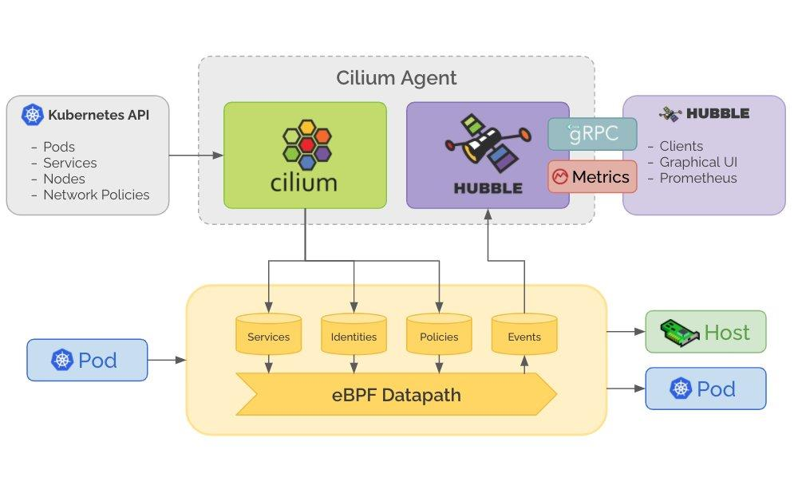

# 1. Cilium là gì?

Cilium là một nền tảng Networking, Security và Observability cho Kubernetes, sử dụng eBPF để xử lý traffic trực tiếp trong Linux Kernel

Điểm khác biệt quan trọng nhất của Cilium so với Kube-OVN là Data Plane

- Cilium: eBPF
- Kube-OVN: OVS + OVN

### eBPF là gì?
eBPF (Extended Berkeley Packet Filter) là công nghệ cho phép chạy các chương trình có thể kiểm soát và quan sát hoạt động của Linux Kernel tại các điểm hook phù hợp

Trong networking, eBPF có thể được sử dụng để:

- Xử lý packet
- Forward packet
- Load balancing
- Network Policy
- Kiểm tra connection
- Thu thập network telemetry

Thay vì phải xử lý mọi packet thông qua nhiều tầng iptables rule, Cilium có thể sử dụng eBPF map và chương trình eBPF để xử lý traffic hiệu quả

# 2. Kiến trúc Cilium



### Cilium Agent

Chạy dưới dạng DaemonSet trên mỗi Kubernetes Node

Nhiệm vụ:

- Quản lý network interface của Pod
- Quản lý eBPF program
- Cập nhật eBPF map
- Triển khai Network Policy
- Quản lý Load Balancing
- Theo dõi Kubernetes API

Đây là thành phần quan trọng nhất trên mỗi Node

### Cilium Operator

Chạy ở cấp độ toàn cluster

Nhiệm vụ:

- Quản lý các công việc cần phối hợp toàn cluster
- IP Address Management trong những mô hình cần Operator
- Một số nhiệm vụ quản lý trạng thái và tài nguyên dùng chung

Operator không nằm trên đường forwarding packet thông thường

### Cilium CNI

Được gọi khi Pod được tạo hoặc xóa

Nhiệm vụ:

- Tạo network interface
- Thiết lập kết nối Pod
- Yêu cầu Cilium Agent cấu hình Data Plane
- Cấu hình IP và routing theo chế độ triển khai

### eBPF Datapath

Đây là phần thực thi thực tế trong Linux Kernel

Có thể xử lý:

- Pod-to-Pod traffic
- Pod-to-Service traffic
- Network Policy
- Load Balancing
- Routing
- Traffic observation

### Hubble

Hubble là hệ thống Network Observability của Cilium

Các thành phần:

| Thành phần | Vai trò |
| :--- | :--- |
| Hubble Server | Thu thập flow trên từng Node |
| Hubble Relay | Tổng hợp flow toàn cluster |
| Hubble CLI | Truy vấn flow |
| Hubble UI | Hiển thị trực quan traffic |

**Ví dụ**

```
Pod-A ---> Pod-B
  |
  v
Cilium eBPF
  |
  v
Hubble
  |
  v
Network Flow Visibility
```

Có thể quan sát:

- Pod nào đang giao tiếp với Pod nào
- Traffic bị drop vì lý do gì
- Network Policy nào được áp dụng
- Service nào đang nhận request

# 3. Các chức năng của Cilium

### Virtual Network

Cilium cung cấp mạng Pod dựa trên hai mô hình chính:

1. Overlay Networking

Các Pod trên nhiều Node giao tiếp thông qua tunnel

**Ví dụ:**

```
Node 1                         Node 2
+-------------+                +-------------+
| Pod-A       |                | Pod-B       |
| 10.0.1.10   |                | 10.0.2.10   |
+------+------+                +------+------+
       |                              |
       v                              v
  Cilium Agent                   Cilium Agent
       |                              |
       +---------- VXLAN -------------+
```

Cilium hỗ trợ VXLAN và Geneve trong chế độ tunnel

2. Native Routing

Cilium sử dụng routing của mạng bên dưới để chuyển tiếp traffic giữa các Pod/Node

```
Pod-A
  |
  v
Node 1
  |
  v
Physical Router
  |
  v
Node 2
  |
  v
Pod-B
```

Native Routing thường phù hợp khi hạ tầng có khả năng định tuyến Pod CIDR hoặc có cơ chế định tuyến phù hợp

### Secure Rule – Network Security

Cilium sử dụng Network Policy để kiểm soát traffic

Có thể áp dụng policy theo:

- Pod Label
- Namespace
- Service
- IP CIDR
- Port
- Protocol
- Identity
- L7 protocol trong các trường hợp được hỗ trợ

**Ví dụ:**

```
apiVersion: cilium.io/v2
kind: CiliumNetworkPolicy
metadata:
  name: allow-api
spec:
  endpointSelector:
    matchLabels:
      app: backend
  ingress:
    - fromEndpoints:
        - matchLabels:
            app: frontend
      toPorts:
        - ports:
            - port: "8080"
              protocol: TCP
```

Ý nghĩa:

- Chỉ Pod có label app=frontend được truy cập
- Đích là Pod app=backend
- Chỉ cho phép TCP port 8080

Điểm mạnh của Cilium là sử dụng identity dựa trên label và metadata thay vì chỉ dựa vào IP address

### BGP

Cilium hỗ trợ BGP Control Plane

BGP cho phép Kubernetes Node quảng bá các route đến router bên ngoài

**Ví dụ:**

```
Kubernetes Cluster
        |
        v
Cilium BGP
        |
        v
BGP Peering
        |
        v
Physical Router
        |
        v
External Network
```

**Các tài nguyên cấu hình chính:**

| Resource | Chức năng |
| :--- | :--- |
| CiliumBGPClusterConfig | Khai báo BGP instance và peer |
| CiliumBGPPeerConfig | Cấu hình BGP peer |
| CiliumBGPAdvertisement | Khai báo prefix cần quảng bá |
| CiliumBGPNodeConfigOverride | Override cấu hình theo Node |

**Lưu ý:** BGP Control Plane chỉ quảng bá route, không trực tiếp lập trình Data Plane để tạo connectivity nội bộ trong cluster. Phần forwarding vẫn do Cilium Data Plane đảm nhiệm

### Load Balancing

Cilium cung cấp Load Balancing thông qua eBPF

Các loại traffic:

- Pod-to-Pod
- Pod-to-Service
- External-to-Service
- NodePort
- ClusterIP
- LoadBalancer IP

### Các chức năng bổ sung

| Chức năng | Ý nghĩa |
| :--- | :--- |
| Ingress | Đưa traffic từ ngoài vào ứng dụng |
| Egress Gateway | Kiểm soát đường ra bên ngoài |
| Hubble | Network Observability |
| Bandwidth Management | Kiểm soát băng thông |
| Cluster Mesh | Kết nối nhiều Kubernetes Cluster |
| L7 Policy | Kiểm soát HTTP/DNS và một số giao thức L7 |
