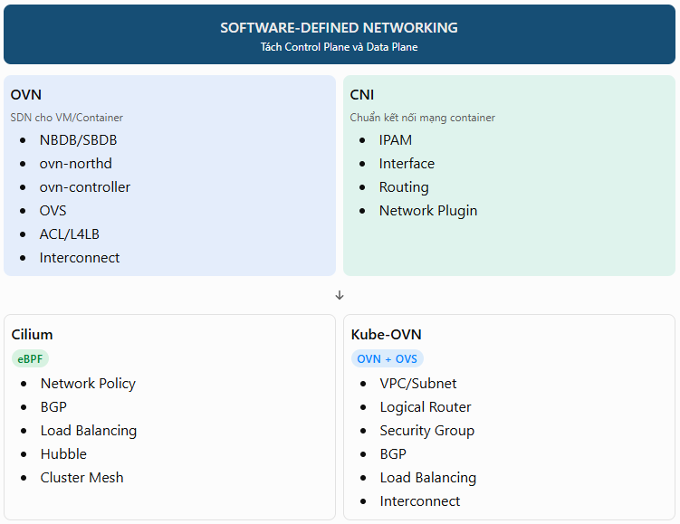

## So sánh chức năng

| Chức năng | OVN | Cilium | Kube-OVN |
| :--- | :--- | :--- | :--- |
| SDN | Có | Không phải kiến trúc OVN truyền thống | Có, dựa trên OVN |
| CNI | Không phải | CNI độc lập mặc định	Có | Có |
| Virtual Network | Mạnh | Pod networking | Rất mạnh |
| Overlay | Geneve | VXLAN/Geneve | Geneve |
| Underlay | Có | Native routing | Có |
| Logical Switch | Có | Không theo mô hình OVN | Có |
| Logical Router | Có | Không theo mô hình OVN | Có |
| VPC | Logical network tương đương về chức năng nền tảng | Không phải mô hình VPC SDN mặc định | Có |
| Firewall | ACL	Network | Policy/eBPF | ACL/Security Group |
| L4 Load Balancer | Có | Có | Có |
| L7 Policy | Không phải chức năng WAF | Có, theo giao thức hỗ trợ | Phụ thuộc tích hợp |
| BGP | Tích hợp daemon ngoài như FRR | BGP Control Plane | BGP Speaker |
| Observability | Công cụ | OVN/OVS	Hubble | Monitoring/tích hợp |
| Interconnect | OVN-IC | Cluster Mesh | Cross-Cluster Interconnect |

## Nên lựa chọn công nghệ nào?

| Nhu cầu | Giải pháp phù hợp |
| :--- | :--- |
| SDN cho OpenStack VM | OVN |
| Mạng Kubernetes dựa trên eBPF | Cilium |
| Network Policy nâng cao | Cilium |
| Hệ thống Kubernetes Multi-Tenant | Kube-OVN |
| VPC/Subnet/Logical Router trong Kubernetes | Kube-OVN |
| eBPF Load Balancing | Cilium |
| OVN Logical Load Balancing | OVN/Kube-OVN |
| Kết nối nhiều OVN deployment | OVN Interconnect |
| Quan sát network flow Kubernetes | Cilium + Hubble |

Cilium và Kube-OVN không phải hai sản phẩm có thể so sánh tuyệt đối theo kiểu một cái thay thế hoàn toàn cái còn lại. Chúng có mục tiêu và Data Plane khác nhau

Kube-OVN đặc biệt phù hợp khi cần mô hình SDN giống Cloud/VM trong Kubernetes. Cilium phù hợp khi ưu tiên eBPF, Network Security và Observability

## Sơ đồ tư duy tổng thể

