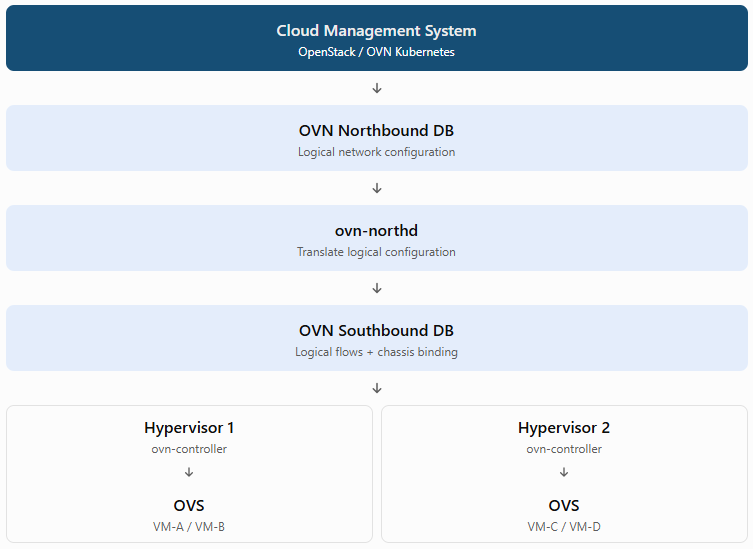

# 1. OVN là gì?

OVN (Open Virtual Network) là giải pháp SDN mã nguồn mở, mở rộng khả năng của Open vSwitch (OVS), cung cấp các chức năng mạng logic cho môi trường VM và container

OVN được xây dựng trên OVS, cho phép quản trị viên làm việc với các khái niệm mạng cấp cao thay vì phải cấu hình trực tiếp từng OpenFlow rule

Các đối tượng chính:

- Logical Switch
- Logical Router
- Logical Port
- ACL
- Load Balancer
- DHCP
- DNS
- Gateway

Ví dụ, thay vì phải tự viết hàng trăm OpenFlow rule để kết nối hai VM, người quản trị chỉ cần tạo Logical Switch và gắn hai VM vào switch đó

# 2. Kiến trúc OVN

OVN có kiến trúc gồm ba lớp chính:

1. Management / Northbound
2. Control Plane / Southbound
3. Data Plane / Hypervisor

### OVN Northbound Database (NBDB)

Đây là nơi lưu trữ cấu hình mạng logic ở mức cao.

Ví dụ:

```
Logical Switch: ls-tenant-a
Logical Router: lr-tenant-a

Subnet: 10.10.0.0/24

Ports:
  vm-a
  vm-b

ACL:
  Allow TCP 80
  Deny TCP 22
```

NBDB nhận cấu hình từ hệ thống quản lý mạng (CMS), ví dụ:

- OpenStack Neutron
- OVN Kubernetes
- Một hệ thống quản lý Cloud tự xây dựng

### Ovn-northd

Đây là thành phần chuyển đổi cấu hình mạng logic thành các cấu hình thực thi ở mức thấp hơn.

Quy trình:

```
CMS
 |
 v
OVN Northbound DB
 |
 v
ovn-northd
 |
 v
OVN Southbound DB
```

Ví dụ:

NBDB có cấu hình:

```
Logical Switch A
  |
  +--- VM-A
  |
  +--- VM-B
```

ovn-northd chuyển cấu hình này thành logical datapath flows và ghi vào Southbound Database

### OVN Southbound Database (SBDB)

SBDB lưu các thông tin cần thiết để các node triển khai mạng logic

Có ba nhóm thông tin quan trọng:

- Physical Network: thông tin về các chassis và kết nối vật lý
- Logical Network: logical datapath flows
- Binding: liên kết logical port với chassis thực tế

### ovn-controller

Được chạy trên mỗi Hypervisor hoặc gateway node

Nhiệm vụ:

- Kết nối tới SBDB
- Nhận logical flow
- Xác định VM/container đang nằm trên node nào
- Cài đặt OpenFlow rule xuống OVS
- Quản lý cấu hình mạng cục bộ

### Open vSwitch (OVS)

Đây là thành phần thực hiện forwarding traffic

OVS xử lý:

- Switching
- Routing thông qua logical flow được triển khai
- ACL
- Encapsulation/decapsulation
- Chuyển tiếp packet giữa các VM

### Luồng hoạt động tổng thể



Luồng điều khiển từ trên xuống; traffic thực tế được xử lý tại OVS trên các Hypervisor

# 3. CÁC CHỨC NĂNG CỦA OVN

OVN cung cấp các chức năng SDN để xây dựng và quản lý mạng ảo. Bốn chức năng quan trọng cần hiểu là Segmentation, L4 Load Balancing, Firewall và OVN Interconnect

## 3.1 Network Segmentation – Phân đoạn mạng

Network Segmentation là kỹ thuật chia một hệ thống mạng thành nhiều mạng logic riêng biệt nhằm:

- Cô lập các nhóm workload
- Ngăn chặn truy cập trái phép
- Quản lý IP và subnet độc lập
- Hạn chế phạm vi ảnh hưởng khi xảy ra sự cố
- Hỗ trợ mô hình Multi-Tenant

Trong OVN, Segmentation được triển khai thông qua:

- Logical Switch
- Logical Router
- Logical Port
- Geneve Overlay
- ACL

### Ví dụ: 

Giả sử có một Cloud Platform với ba Tenant:

| Tenant | Logical Switch | Subnet | VM |
| :--- | :--- | :--- | :--- |
| Tenant A | LS-A | 10.10.0.0/24 | VM-A1, VM-A2 |
| Tenant B | LS-B | 10.10.0.0/24 | VM-B1, VM-B2 |
| Tenant C | LS-C | 10.20.0.0/24 | VM-C1, VM-C2 |

Tenant A và Tenant B sử dụng cùng subnet 10.10.0.0/24, nhưng không giao tiếp trực tiếp với nhau

Lý do:

- Mỗi Tenant có Logical Switch riêng
- Các logical network được định danh độc lập
- Traffic giữa các Hypervisor được đóng gói trong Geneve tunnel
- OVN kiểm soát việc forwarding giữa các mạng

### Cách hoạt động

Ví dụ VM-A1 gửi packet đến VM-A2:

```
VM-A1
  |
  v
OVS Hypervisor 1
  |
  v
OVN Logical Switch A
  |
  v
Geneve Tunnel (nếu khác Hypervisor)
  |
  v
OVS Hypervisor 2
  |
  v
VM-A2
```

Nếu VM-A1 gửi packet đến VM-B1, OVN không tự động chuyển tiếp vì hai VM thuộc hai Logical Switch độc lập

Muốn giao tiếp, cần cấu hình Logical Router hoặc một cơ chế kết nối mạng phù hợp, đồng thời có policy cho phép

Ý nghĩa: Segmentation giúp triển khai mạng riêng cho từng khách hàng mà không cần cấp riêng hạ tầng switch vật lý

## 3.2 L4 Load Balancing – Cân bằng tải Layer 4

### L4LB là gì?

L4 Load Balancing là cơ chế phân phối traffic dựa trên thông tin tầng Transport:

- TCP
- UDP
- IP address
- Port

Ví dụ:

```
Client
  |
  v
VIP: 10.10.0.100:80
  |
  +------------------+
  |                  |
  v                  v
Backend 1          Backend 2
10.10.0.11:80      10.10.0.12:80
```

Client chỉ cần truy cập: `http://10.10.0.100`

OVN sẽ phân phối traffic đến backend tương ứng

### Các thành phần

| Thành phần | Ý nghĩa |
| :--- | :--- |
| VIP | Virtual IP mà client truy cập |
| Backend | Server thực tế |
| Protocol | TCP hoặc UDP |
| Port | Port dịch vụ |
| Load Balancer | Đối tượng quản lý phân phối traffic |

Ví dụ:

```
VIP:
  10.10.0.100:80

Backends:
  10.10.0.11:80
  10.10.0.12:80
  10.10.0.13:80
```

OVN sử dụng logical flow và các cơ chế xử lý kết nối để phân phối traffic

### Ứng dụng

- Cân bằng tải Web Server
- Phân phối traffic giữa nhiều API Server
- Cân bằng tải các dịch vụ TCP/UDP
- Cung cấp VIP cho các ứng dụng chạy trên VM

Lưu ý: OVN L4LB không đồng nghĩa với một Application Load Balancer đầy đủ. Nó không thay thế reverse proxy L7 như Nginx hoặc HAProxy trong các tình huống cần phân tích HTTP path, header hoặc cookie

## 3.3 Firewall – Bảo mật mạng trong OVN

OVN sử dụng ACL (Access Control List) để kiểm soát traffic giữa các logical port, logical switch và các thành phần mạng logic

Các policy có thể kiểm soát:

- Source IP
- Destination IP
- Protocol
- Source Port
- Destination Port
- Connection state
- Hành động Allow/Drop/Reject

### Ví dụ

Giả sử có hai VM: VM-A: 10.10.0.10, VM-B: 10.10.0.20

Yêu cầu:

- Cho phép VM-A truy cập VM-B bằng HTTP
- Cho phép HTTPS
- Chặn SSH
- Chặn các traffic khác

Policy:

| Source | Destination | Protocol | Port | Action |
| :--- | :--- | :--- | :--- | :--- |
| VM-A | VM-B | TCP | 80 | Allow |
| VM-A | VM-B | TCP | 443 | Allow |
| VM-A | VM-B | TCP | 22 | Drop |
| VM-A | VM-B | Any | Any | Drop |

#### Cách Firewall hoạt động

```
VM-A
  |
  v
OVS
  |
  v
OVN Logical Pipeline
  |
  v
ACL Evaluation
  |
  +---- Allow ----> VM-B
  |
  +---- Drop -----> Discard packet
```

OVN biên dịch các ACL thành logical flows để OVS thực thi

### Stateful Firewall

OVN hỗ trợ các rule có xét đến connection state

Ví dụ:

- Cho phép kết nối TCP mới từ A đến B
- Cho phép packet phản hồi thuộc kết nối đã thiết lập
- Không cho phép một kết nối mới không được policy cho phép

Các trạng thái thường gặp:

- new
- est
- rel
- rpl
- inv

Điểm quan trọng: Firewall ACL của OVN chủ yếu là kiểm soát mạng L2-L4, không phải Web Application Firewall (WAF). Nó không thay thế ModSecurity hoặc các hệ thống phát hiện SQL Injection/XSS ở tầng ứng dụng

## 3.4 OVN Interconnect – Kết nối nhiều hệ thống OVN

OVN Interconnect (OVN-IC) cho phép kết nối nhiều OVN deployment với nhau

Ví dụ một doanh nghiệp có:

- Data Center A
- Data Center B
- Data Center C

Mỗi Data Center triển khai một OVN cluster riêng

Nếu không có Interconnect, các logical network thuộc các hệ thống OVN khác nhau không tự động giao tiếp được

OVN-IC cung cấp cơ chế kết nối các hệ thống này

### Các thành vần:

| Thành phần | Vai trò |
| :--- | :--- |
| OVN Deployment | Hệ thống OVN riêng tại mỗi site |
| Global IC NBDB | Lưu cấu hình interconnect |
| Global IC SBDB | Lưu trạng thái interconnect |
| Interconnection Gateway | Chuyển tiếp traffic giữa các OVN |
| Transit Logical Switch | Kết nối các Logical Router |
| Transit Logical Router | Kết nối Layer 3 giữa các site |

### Cách hoạt động

```
             Global OVN Interconnect
                       |
             +---------+---------+
             |                   |
          Site A               Site B
             |                   |
       Logical Router      Logical Router
             |                   |
       Logical Switch      Logical Switch
             |                   |
           VM-A                VM-B
```

Khi VM-A tại Site A muốn giao tiếp với VM-B tại Site B:

1. VM-A gửi packet đến gateway/router của Site A
2. Logical Router định tuyến traffic đến transit network
3. Interconnection Gateway xử lý kết nối giữa hai OVN deployment
4. Traffic được chuyển đến Site B
5. Logical Router của Site B chuyển tiếp packet đến VM-B

### Ứng dụng

- Kết nối nhiều Data Center
- Kết nối nhiều Availability Zone
- Xây dựng mạng Cloud đa vùng
- Kết nối các hệ thống OVN độc lập
- Xây dựng hạ tầng Disaster Recovery

Một điểm cần phân biệt: OVN Interconnect là tính năng kết nối giữa các OVN deployment; nó không đơn thuần là một Geneve tunnel giữa hai VM