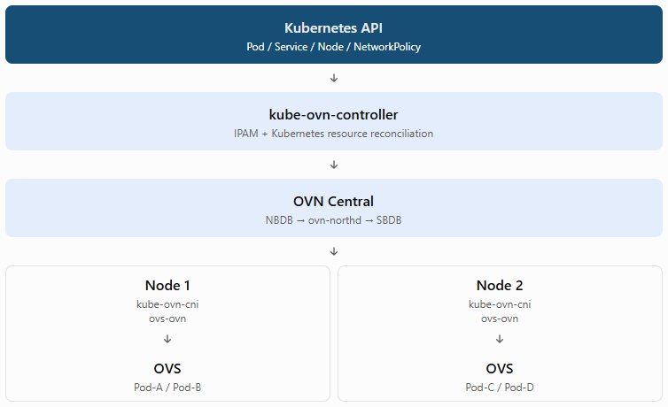

**Kube-OVN** là giải pháp mạng cho Kubernetes được xây dựng dựa trên OVN và Open vSwitch

Mục tiêu của Kube-OVN là đưa các chức năng SDN truyền thống vào môi trường Cloud Native

Ví dụ:

- Logical Switch
- Logical Router
- VPC
- Subnet
- ACL
- QoS
- Gateway
- Load Balancing
- Multi-Tenant Network
- BGP

Nếu Cilium thiên về eBPF và Network Security thì Kube-OVN thiên về Network Virtualization và SDN

# 1. Kiến trúc Kube-OVN

**Kube-OVN có ba nhóm thành phần chính**

1. OVN Central

Chạy dưới dạng Deployment

Bao gồm:

- OVN Northbound Database
- OVN Southbound Database
- ovn-northd

Nhiệm vụ:

- Lưu cấu hình mạng logic
- Chuyển đổi cấu hình
- Phân phối logical flow xuống các Node

Các thành phần OVN Central có thể triển khai nhiều replica và đồng bộ bằng Raft để tăng khả năng sẵn sàng

2. kube-ovn-controller

Đây là thành phần kết nối Kubernetes API với OVN

Chạy dưới dạng Deployment

Nhiệm vụ:
- Theo dõi Pod
- Theo dõi Service
- Theo dõi Endpoint
- Theo dõi Node
- Theo dõi NetworkPolicy
- Quản lý VPC
- Quản lý Subnet
- Quản lý IPAM
- Tạo Logical Switch và Logical Port
- Cập nhật cấu hình OVN

**Ví dụ khi tạo Pod:**

```
kubectl create pod
        |
        v
Kubernetes API
        |
        v
kube-ovn-controller *
        |
        v
Allocate Pod IP
        |
        v
OVN Northbound DB
        |
        v
Create Logical Port
        |
        v
Pod Annotation
```

3. kube-ovn-cni

Chạy dưới dạng DaemonSet trên từng Node

Nhiệm vụ:

- Xử lý yêu cầu CNI ADD/DEL
- Tạo và xóa veth pair
- Kết nối interface vào OVS
- Cấu hình địa chỉ IP
- Cấu hình routing
- Cấu hình QoS
- Cấu hình kết nối mạng cho Pod

4. ovs-ovn

Cũng chạy trên mỗi Node dưới dạng DaemonSet

Bao gồm:

- Open vSwitch
- OVSDB
- ovn-controller

Nhiệm vụ:

- Nhận logical flows từ OVN Central
- Cấu hình OVS
- Forward traffic
- Xử lý encapsulation và decapsulation

### Luồng hoạt động tổng thể



Controller đồng bộ Kubernetes resource sang OVN; CNI và OVS trên từng Node triển khai mạng thực tế

# 2. Các chức năng của KUBE-OVN

### Virtual Network – Mạng ảo

Đây là một trong những chức năng mạnh nhất của Kube-OVN

Kube-OVN cung cấp:

- VPC
- Logical Switch
- Logical Router
- Subnet
- Static IP
- Multi-NIC
- Overlay Network
- Underlay Network

Trong đó: 

1. VPC

VPC (Virtual Private Cloud) là một mạng riêng logic

Mỗi VPC có thể có:

- Không gian địa chỉ riêng
- Router riêng
- Gateway riêng
- Security Group riêng
- Các subnet riêng

Điều này phù hợp với mô hình Multi-Tenant Kubernetes

2. Overlay Network

Kube-OVN hỗ trợ Overlay thông qua OVN/OVS, thường sử dụng Geneve

Overlay giúp tách mạng logic khỏi mạng vật lý

3. Underlay Network

Khác với Overlay, Underlay cho phép Pod hoặc workload kết nối trực tiếp hơn với mạng vật lý thông qua các cơ chế tích hợp NIC/VLAN phù hợp

Ứng dụng:

- Workload cần truy cập trực tiếp mạng vật lý
- Tích hợp thiết bị mạng bên ngoài
- Môi trường yêu cầu hiệu năng hoặc khả năng tương thích đặc biệt

Kube-OVN cũng hỗ trợ mô hình kết hợp Overlay và Underlay

### Secure Rule – Security Group và ACL

Kube-OVN cung cấp các cơ chế bảo mật như:

- NetworkPolicy
- Security Group
- ACL
- Subnet-level isolation

Phân biệt ACL, NetworkPolicy và Security Group

- Kubernetes NetworkPolicy: cơ chế policy chuẩn của Kubernetes, được CNI triển khai
- Kube-OVN Security Group: cơ chế quản lý bảo mật theo mô hình SDN, có thể áp dụng cho workload theo các đối tượng mà Kube-OVN hỗ trợ
- ACL: rule thực thi ở tầng OVN

### BGP trong Kube-OVN

Kube-OVN hỗ trợ quảng bá route bằng BGP thông qua thành phần BGP Speaker

BGP Speaker quảng bá các route phù hợp đến router bên ngoài

Router bên ngoài có thể học được đường đi đến các mạng Pod

Ứng dụng:
- Kết nối Kubernetes với mạng doanh nghiệp
- Tích hợp Spine-Leaf
- Kết nối Data Center
- Quảng bá các route Service hoặc Pod theo cấu hình
- Xây dựng mạng Cloud Hybrid

Điểm khác biệt quan trọng: Kube-OVN sử dụng OVN/OVS để thực thi Data Plane, trong khi Cilium sử dụng eBPF

### Load Balancing trong Kube-OVN

Kube-OVN cung cấp khả năng Load Balancing thông qua OVN và các thành phần tích hợp Kubernetes Service

Các đối tượng:

- ClusterIP
- NodePort
- LoadBalancer Service
- VIP
- Backend endpoints

Ngoài ra, Kube-OVN hỗ trợ các chức năng Gateway như:

- Centralized Gateway
- Distributed Gateway
- EIP
- FIP
- SNAT

Các chức năng này giúp xây dựng mô hình mạng Cloud gần với những gì thường thấy trong OpenStack

### Các chức năng bổ sung của Kube-OVN

| Chức năng | Ý nghĩa |
| :--- | :--- |
| Subnet Management | Quản lý subnet |
| IPAM | Quản lý cấp phát IP |
| Static IP | Cấp IP cố định |
| VPC | Mạng riêng logic |
| Security Group | Kiểm soát truy cập |
| QoS | Kiểm soát chất lượng dịch vụ |
| Traffic Mirroring | Sao chép traffic |
| EIP/FIP | Địa chỉ IP bên ngoài |
| SNAT | Chuyển đổi địa chỉ nguồn |
| Multi-NIC | Nhiều interface cho Pod |
| Interconnect | Kết nối nhiều mạng/cluster |
| BGP | Quảng bá route |

