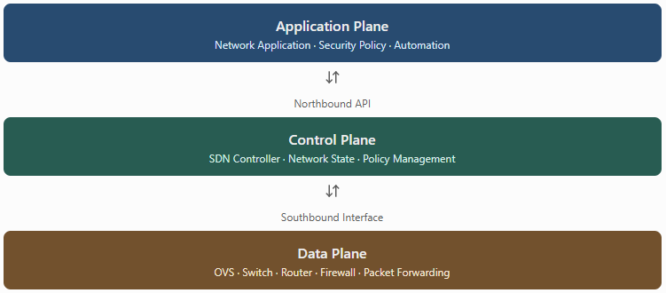
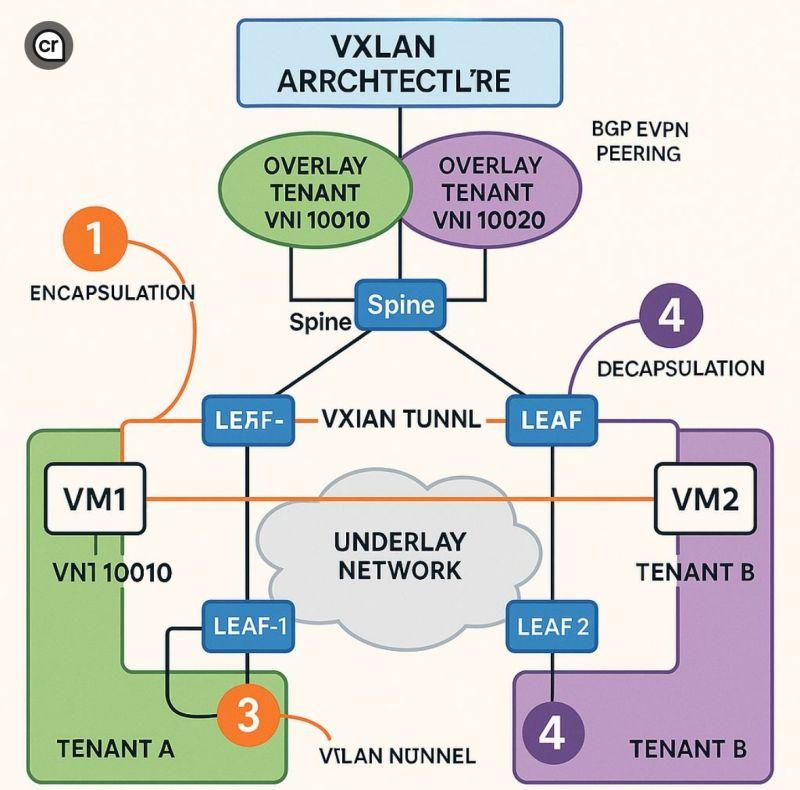

# SDN – SOFTWARE-DEFINED NETWORKING

## 1.1 SDN là gì?

SDN (Software-Defined Networking) là kiến trúc mạng trong đó Control Plane (mặt phẳng điều khiển) được tách khỏi Data Plane (mặt phẳng chuyển tiếp dữ liệu)

Trong mạng truyền thống, mỗi router hoặc switch thường đảm nhiệm cả hai nhiệm vụ:
- Quyết định gói tin sẽ đi theo đường nào
- Thực hiện chuyển tiếp gói tin đến thiết bị tiếp theo
Trong SDN, hai nhiệm vụ này được tách biệt

### SDN tách biệt hai thành phần:



- Control Plane quyết định traffic cần đi đâu
- Data Plane thực hiện forwarding
- Application Plane đưa ra yêu cầu thông qua API


#### Control Plane – Mặt phẳng điều khiển

Đây là nơi đưa ra quyết định về mạng:
- Xác định đường đi của gói tin
- Quản lý topology
- Cấu hình VLAN, subnet, routing
- Xây dựng chính sách bảo mật
- Quản lý các thiết bị mạng

Ví dụ: SDN Controller quyết định VM-A được phép giao tiếp với VM-B qua subnet nào

#### Data Plane – Mặt phẳng dữ liệu

Đây là nơi trực tiếp xử lý gói tin:
- Forward packet
- Drop packet
- Chuyển tiếp traffic
- Áp dụng các rule đã nhận từ Control Plane

Ví dụ: OVS nhận gói tin từ VM-A, kiểm tra flow đã được cài đặt và chuyển tiếp gói tin đến VM-B

## 1.2 So sánh mạng truyền thống và SDN

| Tiêu chí | Mạng truyền thống | SDN |
| :--- | :--- | :--- |
| Điều khiển | Phân tán trên thiết bị | Tập trung logic |
| Forwarding | Router/Switch | Router/Switch/OVS |
| Cấu hình | Thường cấu hình từng thiết bị | Quản lý qua Controller/API |
| Tự động hóa | Hạn chế hơn | Cao |
| Network policy | Cấu hình trên từng thiết bị | Quản lý tập trung |
| Mở rộng | Phụ thuộc thiết bị | Có thể tự động hóa qua phần mềm |

Lưu ý: SDN Controller tập trung về mặt quản lý logic, không có nghĩa toàn bộ traffic phải đi qua Controller. Data Plane vẫn có thể chuyển tiếp traffic trực tiếp

## 1.3 Tại sao cần SDN?

Giả sử một Cloud Platform có:

- 100 Hypervisor
- 1.000 VM
- 100 mạng tenant
- 500 Security Group
- Nhiều subnet và router

Nếu sử dụng mạng truyền thống, việc quản lý VLAN, routing, ACL và kết nối giữa các VM sẽ trở nên phức tạp

### SDN giải quyết vấn đề này thông qua các khả năng:

1. Network Automation: 

Thay vì cấu hình thủ công từng switch, người quản trị có thể gọi API để tạo mạng. 

Ví dụ:

```
POST /networks
{
    "name": "tenant-network",
    "subnet": "10.10.0.0/24"
}
```

Controller nhận yêu cầu và triển khai cấu hình xuống các thiết bị mạng

2. Network Virtualization: 

Tạo nhiều mạng logic độc lập trên cùng một hạ tầng vật lý

Ví dụ:



| Tenant | Virtual Network | Subnet |
| :--- | :--- | :--- |
| A | Network-A | 10.10.0.0/24 |
| B | Network-B | 10.10.0.0/24 |
| C | Network-C | 10.10.0.0/24 |

Các tenant có thể sử dụng cùng dải IP mà không bị xung đột vì được phân tách bằng mạng logic và cơ chế encapsulation

3. Centralized Management

Controller quản lý:
- Logical Switch
- Logical Router
- Firewall Policy
- Load Balancer
- Routing Policy

4. Security

Có thể xây dựng chính sách:

```
VM-A:
  Allow TCP 80 to VM-B
  Allow TCP 443 to VM-B
  Deny all other traffic
```

Chính sách được triển khai xuống Data Plane

5. Scalability

Có thể tạo hàng nghìn mạng logic mà không cần triển khai một switch vật lý riêng cho từng mạng.

### Kết luận: SDN giúp chuyển việc quản lý mạng từ cấu hình thiết bị thủ công sang mô hình điều khiển bằng phần mềm và API

