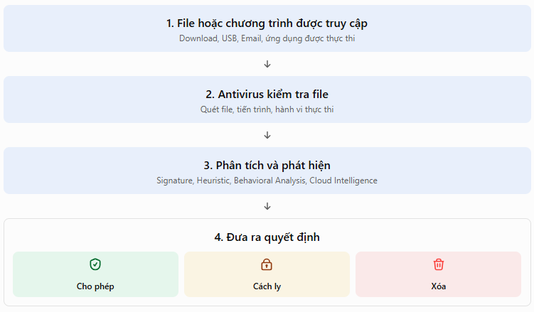

**Antivirus (AV)** là phần mềm bảo mật được thiết kế để phát hiện, ngăn chặn, cách ly và loại bỏ virus cũng như các loại mã độc (Malware) trên thiết bị đầu cuối

Antivirus thường được cài đặt trực tiếp trên:

- Máy tính Windows, Linux, macOS
- Máy chủ vật lý
- Máy chủ ảo (VM)
- Một số môi trường máy chủ doanh nghiệp

# 1. Antivirus hoạt động như thế nào

Antivirus thường thực hiện theo quy trình:



**Ví dụ:**

Một người dùng tải file malware.exe từ Internet

1. Người dùng tải file về máy
2. Antivirus kiểm tra nội dung file
3. Antivirus so sánh chữ ký mã độc và phân tích hành vi
4. Phát hiện file chứa mã độc
5. Chặn thực thi và đưa file vào vùng cách ly (Quarantine)
6. Ghi nhận sự kiện bảo mật

# 2. Các phương pháp phát hiện mã độc

## 2.1 Signature-based Detection

Phát hiện dựa trên chữ ký mã độc đã biết

Mỗi mã độc có thể có những đặc điểm nhận dạng như:

- Hash MD5, SHA-256
- Byte pattern
- Chuỗi lệnh đặc trưng
- Cấu trúc file độc hại

Ưu điểm:

- Phát hiện nhanh
- Độ chính xác tốt với mã độc đã biết
- Ít tiêu tốn tài nguyên phân tích

Nhược điểm:

- Khó phát hiện mã độc mới
- Mã độc có thể thay đổi hash hoặc cấu trúc để né phát hiện

## 2.2. Heuristic-based Detection

Phân tích những đặc điểm đáng ngờ của file để xác định khả năng chứa mã độc

Ví dụ:

- File thực thi có cấu trúc bất thường
- Chương trình tự sửa đổi mã
- Chương trình có hành vi mã hóa nhiều file
- File cố gắng can thiệp vào tiến trình hệ thống

Ưu điểm: Có thể phát hiện những biến thể mã độc chưa có trong cơ sở dữ liệu

Nhược điểm: Có thể tạo ra cảnh báo nhầm (False Positive)

## 2.3. Behavior-based Detection

Theo dõi hành vi của chương trình trong quá trình hoạt động

Ví dụ:

```
Process: suspicious.exe

Behavior:
- Access sensitive files
- Modify registry
- Disable security services
- Encrypt multiple documents

Detection:
Potential Ransomware

Action:
Block Process
```

Phương pháp này đặc biệt hữu ích để phát hiện ransomware và các loại malware có hành vi bất thường

## 2.4. Cloud-based Detection

Antivirus gửi thông tin hoặc metadata của file đến hệ thống phân tích trên Cloud để đánh giá mức độ nguy hiểm

Lợi ích:

- Cập nhật thông tin mã độc nhanh
- Chia sẻ Threat Intelligence
- Giảm phụ thuộc vào cơ sở dữ liệu cục bộ

# 3. Các chức năng chính của Antivirus

|Chức năng	|Ý nghĩa|
| :--- | :--- |
|Real-time Protection	|Quét và bảo vệ theo thời gian thực|
|Full Scan	|Quét toàn bộ hệ thống|
|Quick Scan	|Quét các khu vực quan trọng|
|Malware Detection	|Phát hiện mã độc|
|Quarantine	|Cách ly file nguy hiểm|
|Malware Removal	|Loại bỏ mã độc|
|Web Protection	|Ngăn truy cập website độc hại|
|Email Protection	|Kiểm tra file đính kèm email|
|USB Scanning	|Quét thiết bị lưu trữ ngoài|
|Automatic Update	|Cập nhật cơ sở dữ liệu mã độc|

# 4. Những loại Malware Antivirus có thể phát hiện

- Virus: Mã độc lây nhiễm vào file hoặc chương trình

- Trojan: Giả dạng phần mềm hợp pháp để thực hiện hành vi độc hại

- Ransomware: Mã hóa dữ liệu và đòi tiền chuộc

- Spyware: Thu thập thông tin người dùng trái phép

- Worm: Tự lây lan qua mạng

- Rootkit: Che giấu sự hiện diện của mã độc và duy trì quyền truy cập

