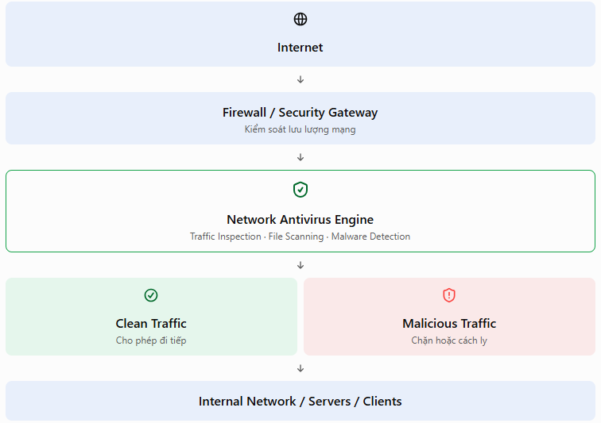

**Network Antivirus** là giải pháp bảo mật tập trung vào việc phát hiện và ngăn chặn mã độc thông qua lưu lượng mạng (Network Traffic)

Khác với Antivirus truyền thống chạy trên từng thiết bị đầu cuối, Network Antivirus kiểm tra dữ liệu khi chúng đi qua các điểm kiểm soát mạng

Ví dụ:

- Người dùng tải file từ Internet
- Máy chủ nhận file từ một máy tính khác
- Email có chứa file đính kèm độc hại
- Máy tính kết nối tới máy chủ điều khiển mã độc (C2 Server)

Network Antivirus có thể phát hiện và chặn các mối đe dọa này trước khi chúng đến thiết bị đích, tùy theo vị trí triển khai và khả năng giải mã lưu lượng

# 1. Kiến trúc hoạt động

Kiến trúc điển hình:



# 2. Network Antivirus hoạt động như thế nào?

Giả sử một máy tính trong mạng nội bộ tải file từ Internet

Quy trình:

1. Máy tính gửi HTTP/HTTPS request đến Internet
2. Firewall nhận và kiểm tra kết nối
3. Network Antivirus kiểm tra nội dung lưu lượng nếu có thể giải mã và trích xuất file
4. File được phân tích bằng signature, heuristic hoặc sandbox
5. Nếu file sạch, hệ thống cho phép tải về
6. Nếu file độc hại, hệ thống chặn tải file và ghi log

Ví dụ:

```
Client: 192.168.1.10
Server: malicious-site.com
File: invoice.exe

Network Antivirus:
- File Inspection: Enabled
- Signature Detection: Match
- Malware: Trojan
- Severity: Critical

Action:
BLOCK DOWNLOAD
Log Event
```

# 3. Các chức năng chính của Network Antivirus

|Chức năng	|Mô tả|
| :--- | :--- |
|Network Traffic Inspection	|Kiểm tra lưu lượng mạng|
|File Scanning	|Quét file truyền qua mạng|
|Malware Detection	|Phát hiện mã độc|
|HTTP/HTTPS Inspection	|Kiểm tra lưu lượng web
Email Attachment Scanning	|Quét file đính kèm email|
|FTP Scanning	|Quét file truyền qua FTP|
|Sandbox Integration	|Phân tích file trong môi trường cách ly|
|C2 Detection	|Phát hiện kết nối đến máy chủ điều khiển mã độc|
|Threat Intelligence	|Sử dụng dữ liệu về mối đe dọa|
Traffic Blocking	|Chặn lưu lượng độc hại|

Lưu ý: Network Antivirus không nhất thiết là một sản phẩm độc lập. Chức năng này thường được tích hợp trong NGFW, Secure Web Gateway, Secure Email Gateway hoặc Network Security Appliance

# 4. Hạn chế của Network Antivirus

## 4.1. Mã hóa HTTPS

Đây là một vấn đề rất quan trọng

Khi client truy cập website bằng HTTPS, nội dung trao đổi được mã hóa bằng TLS

Nếu không giải mã TLS, thiết bị mạng thường chỉ nhìn thấy thông tin kết nối và một số metadata, không thể kiểm tra trực tiếp nội dung file bên trong

Giải pháp:

- SSL/TLS Inspection
- TLS Decryption
- Kiểm tra metadata và hành vi kết nối
- Tích hợp Endpoint Antivirus

## 4.2. Lưu lượng không đi qua thiết bị kiểm tra

Nếu người dùng tải file qua một đường mạng khác hoặc VPN không được kiểm soát, Network Antivirus có thể không nhìn thấy lưu lượng đó

## 4.3. File mã độc mới

Mã độc mới hoặc file được đóng gói, mã hóa có thể vượt qua một số phương pháp phát hiện truyền thống

## 4.4. Ảnh hưởng hiệu năng

Việc giải mã TLS, phân tích file và sandbox có thể gây:

- Tăng độ trễ
- Tăng CPU/RAM
- Giảm throughput
- Tăng thời gian tải file

## 5. So sáng ANTIVIRUS và NETWORK ANTIVIRUS

|Tiêu chí	|Antivirus	|Network Antivirus|
| :--- | :--- | :--- |
|Mục tiêu	|Bảo vệ thiết bị	|Bảo vệ lưu lượng mạng|
|Vị trí	|Endpoint/Server	|Gateway/Network|
|Đối tượng kiểm tra	|File, process, hành vi	|Traffic, file truyền qua mạng|
|Phát hiện Malware	|Có	|Có|
|Quét file cục bộ	|Có	|Thường không|
|Kiểm tra file tải từ Internet	|Có	|Có thể|
|Theo dõi process	|Có	|Không phải chức năng thông thường|
|Chặn kết nối độc hại	|Có thể	|Có|
|Quản lý tập trung	|Có thể	|Thường có|
|Phụ thuộc vào TLS Inspection	|Không	|Có thể cần|
|Phạm vi bảo vệ	|Từng endpoint	|Các kết nối đi qua điểm kiểm tra|