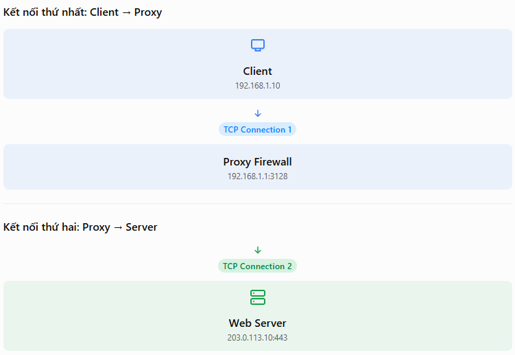
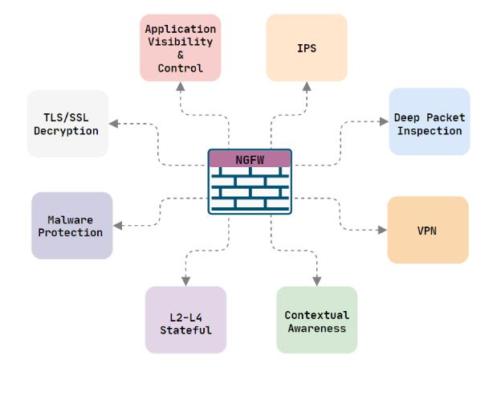
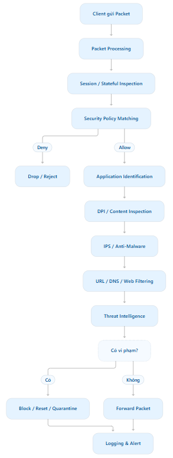

**Firewall** là hệ thống kiểm soát lưu lượng mạng dựa trên các chính sách bảo mật (Security Policies), nhằm quyết định traffic nào được phép đi qua và traffic nào bị chặn

Một **Firewall** có thể hoạt động ở nhiều lớp của mô hình OSI

# Các loại Firewall

## 1. Packet Filtering Firewall 

Đây là dạng Firewall cơ bản nhất hoạt động ở Layer 3 và Layer 4. Chỉ kiểm tra Header của từng gói tin độc lập (IP nguồn/đích, Port nguồn/đích, Giao thức(TCP, UDP, ICMP), Interface và hướng traffic) so với danh sách luật (ACL)

Packet Filtering có thể được triển khai bằng:

- ACL trên Router và Switch Layer 3
- Stateless Firewall
- Stateful Firewall có sử dụng các quy tắc lọc packet
- Linux Netfilter (iptables/nftables)
- Firewall như OPNsense và pfSense

#### Ưu và nhược điểm

| Ưu điểm | Nhược điểm |
| :--- | :--- |
| Hiệu năng cao | Không hiểu đầy đủ nội dung ứng dụng |
| Tiết kiệm tài nguyên | Không phát hiện đầy đủ tấn công tầng ứng dụng |
| Cấu hình tương đối đơn giản | Khó quản lý khi nhiều rule |
| Kiểm soát IP và port | Có thể gặp vấn đề với kết nối hai chiều |
| Dễ triển khai | Phụ thuộc vào thứ tự và chính sách rule |
| Phù hợp mạng lớn | Không thay thế được IDS/IPS và WAF |

## 2. Stateful Firewall

Stateful Firewall (tường lửa có trạng thái) là firewall có khả năng theo dõi trạng thái của các kết nối mạng đang diễn ra

Khác với Stateless Firewall chỉ kiểm tra từng packet độc lập dựa trên các thuộc tính như:

- Source IP
- Destination IP
- Source Port
- Destination Port
- Protocol
- Interface

Stateful Firewall ghi nhớ thông tin về các kết nối đã được thiết lập và sử dụng thông tin này để quyết định xử lý những packet tiếp theo

### Cách Stateful Firewall giải quyết vấn đề chỉ xử lý mỗi packet độc lập của Stateless Firewall

Stateful Firewall thực hiện:

1. Kiểm tra packet đầu tiên
2. Đối chiếu với firewall rule
3. Nếu được phép, tạo trạng thái kết nối
4. Theo dõi các packet tiếp theo
5. Cho phép packet phản hồi hợp lệ
6. Xóa trạng thái khi kết nối kết thúc hoặc hết thời gian timeout

Nhờ vậy, việc quản lý kết nối trở nên đơn giản hơn và giảm số lượng rule cần thiết

### Kiến trúc bên trong Stateful Firewall

Một Stateful Firewall thường có các thành phần chính sau:

**Packet Parser:**	Phân tích header của packet

**Rule Engine:**	Kiểm tra packet với firewall rules

**Connection Tracking:**	Theo dõi các kết nối mạng

**State Table:**	Lưu trạng thái kết nối

**Timeout Manager:**	Quản lý thời gian tồn tại của state

**NAT Engine:**	Thực hiện Network Address Translation nếu có

**Logging:**	Ghi nhận các sự kiện firewall

### Cơ chế hoạt động của Stateful Firewall

Một kết nối thường trải qua 4 giai đoạn:

1. NEW – Kết nối mới
   
   Firewall nhận packet đầu tiên, kiểm tra rule và quyết định có cho phép tạo kết nối hay không

2. ESTABLISHED – Kết nối đã được thiết lập
   
   Firewall nhận diện packet thuộc kết nối đã tồn tại và theo dõi chiều đi, chiều về

3. RELATED – Kết nối liên quan
   
   Packet thuộc một kết nối mới nhưng có quan hệ với một kết nối đã được theo dõi

4. INVALID – Kết nối không hợp lệ
   
   Packet không thể được xác định là thuộc một trạng thái kết nối hợp lệ hoặc vi phạm logic tracking

**Lưu ý:** Đây là các trạng thái Connection Tracking thường gặp trong Linux Netfilter. Không phải mọi firewall đều sử dụng tên hoặc cách phân loại hoàn toàn giống nhau

### TCP State Tracking hoạt động như thế nào?

Stateful Firewall không chỉ lưu thông tin IP và Port mà còn có thể theo dõi quá trình chuyển trạng thái TCP

Ví dụ một kết nối TCP:

| Bước | Packet | Trạng thái kết nối |
| :--- | :--- | :--- |
| 1 | Client → SYN | SYN_SENT |
| 2 | Server → SYN-ACK | SYN_RECV |
| 3 | Client → ACK | ESTABLISHED |
| 4 | Client → FIN | FIN_WAIT |
| 5 | Server → ACK | CLOSE_WAIT / FIN_WAIT |
| 6 | Server → FIN | LAST_ACK |
| 7 | Client → ACK | TIME_WAIT / CLOSED |

Đây là mô hình đơn giản hóa. TCP endpoint state và Connection Tracking state không hoàn toàn giống nhau; cách hiển thị phụ thuộc implementation

#### Tại sao phải theo dõi TCP State?

Giả sử attacker gửi một TCP packet có ACK flag đến một máy chủ mà không có kết nối hợp lệ trước đó

Nếu chỉ kiểm tra ACK flag, firewall không thể kết luận packet thuộc một phiên TCP hợp lệ

Stateful Firewall có thể kiểm tra thông tin kết nối, sequence number, trạng thái và các điều kiện liên quan để đưa ra quyết định

Điều này giúp tăng khả năng phát hiện packet không phù hợp với luồng kết nối

### Stateful Firewall kết hợp NAT như thế nào?

Stateful Firewall thường kết hợp với NAT để bảo vệ mạng nội bộ và cho phép các máy private truy cập Internet

Sau khi Client truy cập Web Server: Firewall thực hiện SNAT -> Firewall lưu thông tin NAT vào trạng thái kết nối

Khi Server trả lời: Firewall tìm được state tương ứng và thực hiện reverse NAT

Nhờ Connection Tracking, firewall biết packet phản hồi thuộc kết nối nào và phải chuyển về Client nào

### Phân biệt Stateful Firewall và Stateless Firewall

| Tiêu chí | Stateless Firewall | Stateful Firewall |
| :--- | :--- | :--- |
| Kiểm tra packet | Độc lập | Dựa trên trạng thái kết nối |
| State Table | Không cần | Có |
| Theo dõi TCP | Không | Có |
| Theo dõi UDP | Không | Có thể |
| Xử lý chiều phản hồi | Cần rule riêng | Có thể tự nhận diện |
| Quản lý kết nối | Đơn giản | Phức tạp hơn |
| Tài nguyên | Thường thấp hơn | Cần RAM và CPU nhiều hơn |
| Khả năng bảo vệ | Cơ bản | Tốt hơn với traffic theo phiên |
| NAT | Không tự có khả năng theo dõi phiên NAT | Tích hợp thuận lợi với connection tracking |

### Ưu điểm và nhược điểm của Stateful Firewall

**Ưu điểm:**

1. Tăng cường bảo mật:

- Firewall không chỉ kiểm tra IP và Port mà còn xác định packet có thuộc một kết nối hợp lệ hay không

- Điều này giúp hạn chế các packet không thuộc phiên giao tiếp được cho phép

2. Giảm số lượng firewall rules: Không cần tạo rule riêng cho từng chiều của mỗi kết nối

3. Hỗ trợ NAT hiệu quả: Connection Tracking giúp firewall ghi nhớ thông tin trước và sau NAT

4. Hỗ trợ nhiều giao thức: Có thể theo dõi trạng thái TCP, UDP, ICMP và một số giao thức khác

5. Hỗ trợ quản lý phiên kết nối: Có thể theo dõi thời gian tồn tại, trạng thái và số lượng kết nối

**Nhược điểm:**

1. Tiêu thụ RAM: Mỗi kết nối được theo dõi cần một state entry

2. Tiêu thụ CPU: Firewall phải tra cứu State Table và cập nhật trạng thái khi xử lý packet

3. Có giới hạn số lượng State: Khi State Table đạt giới hạn, firewall có thể không tạo được state mới

4. Có thể gặp vấn đề với Asymmetric Routing: Đây là nhược điểm đặc biệt quan trọng trong hệ thống có nhiều firewall hoặc nhiều đường truyền

5. Không thay thế được IDS/IPS: Stateful Firewall không mặc nhiên hiểu nội dung ứng dụng hoặc phát hiện mọi cuộc tấn công

## 3. Proxy Firewall 

Proxy Firewall (tường lửa proxy) là một loại Firewall hoạt động như một trung gian giữa hai hệ thống mạng, thường nằm giữa mạng nội bộ (LAN) và mạng bên ngoài (Internet)

Proxy Firewall không đơn thuần chuyển tiếp các gói tin dựa trên địa chỉ IP và Port mà có thể tiếp nhận, phân tích và kiểm tra dữ liệu ở cấp ứng dụng (Application Layer – Layer 7)

Ví dụ:

- Client: 192.168.1.10
- Proxy Firewall: 192.168.1.1
- Web Server: 203.0.113.10
- Dịch vụ: HTTP – Port 80

Khi Client truy cập website, yêu cầu sẽ được gửi đến Proxy Firewall. Proxy kiểm tra yêu cầu, sau đó sử dụng kết nối riêng để truy cập Web Server

**Bản chất của Proxy Firewall**

Điểm quan trọng nhất là Proxy Firewall đóng vai trò Application Gateway

Nó tạo ra hai kết nối riêng biệt:

- Kết nối thứ nhất: Client ↔ Proxy
- Kết nối thứ hai: Proxy ↔ Server đích

Điều này có nghĩa là Client không cần thiết lập kết nối TCP trực tiếp đến Server đích

Proxy đứng giữa hai kết nối và kiểm soát dữ liệu được trao đổi

Proxy có thể kiểm tra:

- Địa chỉ IP nguồn và đích
- Tên miền được truy cập
- HTTP Method: GET, POST, PUT, DELETE
- URL và đường dẫn tài nguyên
- HTTP Header
- Nội dung HTTP Request và Response
- Loại dữ liệu được truyền tải
- Người dùng đang thực hiện truy cập

### Kiến trúc của Proxy Firewall

Một kiến trúc Proxy Firewall phổ biến gồm các thành phần:

| Thành phần | Chức năng |
| :--- | :--- |
| Client | Máy tính gửi yêu cầu truy cập |
| Proxy Server | Tiếp nhận và xử lý yêu cầu |
| Access Control | List	Quy định quyền truy cập |
| Authentication | Xác thực người dùng |
| Content Filter | Lọc nội dung |
| Cache | Lưu nội dung tạm thời |
| Logging | Ghi nhật ký |
| Destination Server | Máy chủ đích |

**Hai kết nối độc lập** -> Đây là điểm cốt lõi trong kiến trúc Proxy Firewall

Hai kết nối này có thể có:

- Source IP khác nhau
- Source Port khác nhau
- TCP Sequence Number khác nhau
- Trạng thái TCP độc lập
- Thời gian thiết lập và kết thúc khác nhau

Proxy tiếp nhận dữ liệu từ kết nối thứ nhất, xử lý rồi gửi dữ liệu qua kết nối thứ hai

Ý nghĩa bảo mật: Client không trực tiếp trao đổi dữ liệu TCP với Server đích. Proxy có thể kiểm soát dữ liệu trước khi chuyển tiếp

**Các loại Proxy Firewall:**

- Application-Level Gateway là Proxy Firewall có khả năng hiểu và phân tích giao thức ứng dụng

- Circuit-Level Gateway tập trung kiểm soát quá trình thiết lập kết nối giữa Client và Server, thường hoạt động ở tầng Session hoặc sử dụng cơ chế kết nối TCP

### So sánh Proxy Firewall với Packet Filtering và Stateful Firewall

| Tiêu chí | Packet Filtering | Stateful Firewall | Proxy Firewall |
| :--- | :--- | :--- | :--- |
| Tầng hoạt động | Chủ yếu L3/L4 | Chủ yếu L3/L4 | L7, tùy loại |
| Kiểm tra IP | Có | Có | Có thể |
| Kiểm tra Port | Có | Có | Có thể |
| Theo dõi trạng thái kết nối | Không | Có | Có hai kết nối riêng |
| Kiểm tra TCP State | Không | Có	Có thể |
| Phân tích HTTP | Không | Thường không | Có |
| Kiểm tra URL | Không | Thường không | Có |
| Authentication | Không phải chức năng cơ bản	| Tùy sản phẩm | Có thể |
| Content Filtering | Không | Không phải chức năng cơ bản | Có thể |
| TLS Inspection | Không | Tùy sản phẩm | Có thể |
| Hiệu suất | Thường cao | Cao | Có thể thấp hơn |

## 4. Next-Generation Firewall (NGFW)

NGFW là thế hệ Firewall tích hợp nhiều tính năng bảo vệ nâng cao thay vì chỉ kiểm tra IP, Port và Protocol

Các chức năng điển hình:

| Chức năng | Mục đích |
| :--- | :--- |
| Stateful Inspection | Theo dõi trạng thái kết nối |
| Application Awareness | Nhận diện ứng dụng |
| IPS | Phát hiện và ngăn chặn khai thác lỗ hổng |
| Antivirus | Phát hiện file độc hại |
| URL Filtering | Chặn website độc hại |
| SSL/TLS Inspection | Kiểm tra traffic mã hóa |
| User Identity | Áp dụng policy theo người dùng |
| Threat Intelligence | Sử dụng dữ liệu về IP/domain độc hại |
| Sandbox Integration | Phân tích file đáng ngờ |

**Ví dụ:**

Một Firewall truyền thống có thể cho phép TCP 443

NGFW có thể phân tích sâu hơn để xác định:

- Đây là traffic HTTPS
- Ứng dụng thực tế là Telegram hay Facebook
- Người dùng nào đang truy cập
- File tải xuống có dấu hiệu malware hay không
- Traffic có chứa hành vi tấn công hay không

### Kiến trúc tổng thể của NGFW

NGFW không đơn thuần là một Firewall có nhiều Rule hơn. Nó là một kiến trúc bảo mật tích hợp nhiều Engine xử lý lưu lượng

### Luồng xử lý của NGFW

Một kết nối đi qua NGFW thường được xử lý theo các bước sau (Thứ tự cụ thể phụ thuộc vào hãng và phiên bản thiết bị)

### Các công nghệ cốt lõi của NGFW

1. DPI – Deep Packet Inspection 

Là công nghệ kiểm tra sâu gói tin, không chỉ kiểm tra Header mà còn phân tích Payload để tìm hiểu nội dung và hành vi của lưu lượng mạng

2. Application Awareness và Application Control

Đây là chức năng giúp NGFW nhận diện ứng dụng đang tạo ra lưu lượng mạng

Firewall truyền thống thường dựa trên Port:

- HTTP: TCP/80
- HTTPS: TCP/443
- SSH: TCP/22
- DNS: UDP/53

Nhưng các ứng dụng hiện đại có thể sử dụng Port 443 cho rất nhiều mục đích

NGFW sử dụng:

- Protocol Analysis
- Application Signature
- DPI
- Traffic Behavior Analysis
- Threat Intelligence

Để xác định ứng dụng thực tế

3. Intrusion Prevention System (IPS)

IPS là hệ thống phát hiện và ngăn chặn hành vi xâm nhập

Trong NGFW, IPS thường được tích hợp trực tiếp vào hệ thống xử lý lưu lượng

IPS có nhiệm vụ:

- Phát hiện dấu hiệu khai thác lỗ hổng
- Phát hiện Buffer Overflow
- Phát hiện SQL Injection ở mức mạng khi có thể nhận diện
- Phát hiện các cuộc tấn công vào dịch vụ
- Phát hiện hoạt động quét cổng
- Ngăn chặn một số hành vi khai thác đã biết

Ba phương pháp phát hiện phổ biến:

- Signature-based: So sánh dữ liệu với mẫu tấn công đã biết
- Anomaly-based: Phát hiện hành vi bất thường so với baseline
- Stateful Protocol Analysis: Kiểm tra giao thức có hoạt động đúng chuẩn hay không

**Phân biệt IDS và IPS:**

| Tiêu chí | IDS | IPS |
| :--- | :--- | :--- |
| Chức năng | Phát hiện | Phát hiện và ngăn chặn |
| Vị trí | Thường giám sát thụ động | Thường nằm inline |
| Chặn packet | Không trực tiếp | Có |
| Cảnh báo | Có | Có |

4. SSL/TLS Inspection

Đây là chức năng đặc biệt quan trọng vì phần lớn lưu lượng Internet hiện nay được mã hóa bằng HTTPS

Nếu không giải mã được lưu lượng HTTPS, Firewall có thể chỉ nhìn thấy một phần thông tin kết nối mà không đọc được nội dung ứng dụng

**Nguyên lý hoạt động:**

Giả sử:

- Client: 192.168.1.10
- NGFW: 192.168.1.1
- Server: 203.0.113.10

Quá trình:

- Client tạo kết nối HTTPS đến Server
- NGFW tiếp nhận kết nối
- NGFW thiết lập kết nối TLS riêng với Client và Server
- NGFW giải mã dữ liệu ở điểm kiểm tra
- Dữ liệu được kiểm tra bằng DPI, IPS và Anti-Malware
- Nếu an toàn, NGFW mã hóa lại và chuyển tiếp dữ liệu

**Các chế độ SSL Inspection:**

- No Inspection: Không giải mã nội dung
- Certificate Inspection: Kiểm tra chứng chỉ TLS, không giải mã toàn bộ nội dung
- Deep Inspection: Giải mã, kiểm tra nội dung và mã hóa lại

**Lưu ý quan trọng:**

- Client cần tin cậy CA Certificate của NGFW trong mô hình giải mã TLS
- Một số ứng dụng sử dụng Certificate Pinning có thể không tương thích
- Cần có chính sách bảo vệ quyền riêng tư
- Một số lưu lượng nhạy cảm nên được loại trừ khỏi giải mã
- Deep Inspection tiêu tốn CPU và ảnh hưởng hiệu năng

5. User Identity Awareness

Firewall truyền thống thường áp dụng chính sách theo IP

NGFW có thể kết hợp danh tính người dùng để áp dụng chính sách bảo mật

6. URL Filtering / Web Filtering

Chức năng này kiểm soát truy cập website dựa trên URL hoặc nhóm nội dung

NGFW có thể sử dụng:

- URL Category Database
- Domain Reputation
- DNS Filtering
- Threat Intelligence

7. Anti-Malware và Sandboxing

NGFW có thể kiểm tra các file được tải xuống hoặc truyền qua mạng

**Anti-Malware:**

- Kiểm tra chữ ký mã độc
- Kiểm tra Hash
- Phân tích file
- Phát hiện một số hành vi độc hại

**Sandboxing:**

Chạy file đáng ngờ trong môi trường cô lập để quan sát hành vi

Ví dụ:

- File tự động tạo tiến trình lạ
- File sửa Registry
- File mã hóa dữ liệu
- File kết nối đến máy chủ Command & Control

Sandbox giúp phát hiện một số loại mã độc chưa có Signature

8. Threat Intelligence

Threat Intelligence là dữ liệu về các mối đe dọa an ninh mạng

NGFW có thể sử dụng dữ liệu về:

- Malicious IP
- Malicious Domain
- Malware Hash
- Phishing URL
- Command & Control Server
- Known Attack Signatures

### So sánh NGFW với các loại Firewall 

| Tiêu chí | Packet Filtering | Stateful Firewall | Proxy Firewall | NGFW |
| :--- | :--- | :--- | :--- | :--- |
| Lọc IP | Có | Có | Có thể | Có |
| Lọc Port | Có | Có | Có thể | Có |
| Theo dõi Session | Không | Có | Có | Có |
| Application Awareness | Không | Hạn chế | Có | Có |
| DPI | Không | Hạn chế | Có thể | Có |
| IPS tích hợp | Không | Không mặc định | Không mặc định | Có |
| Anti-Malware | Không | Không mặc định | Có thể | Có |
| User Awareness | Không | Hạn chế | Có thể | Có |
| SSL Inspection | Không | Không mặc định | Có thể | Có thể |
| Threat Intelligence | Không | Không mặc định | Không mặc định | Có thể |

Điểm khác biệt cốt lõi:

- Packet Filtering: Kiểm tra packet
- Stateful Firewall: Kiểm tra packet và trạng thái kết nối
- Proxy Firewall: Đứng trung gian xử lý kết nối ứng dụng
- NGFW: Kết hợp kiểm soát kết nối, nhận diện ứng dụng, kiểm tra nội dung và ngăn chặn tấn công

### Các chế độ triển khai NGFW

1. Routed Mode

NGFW hoạt động như một Router Layer 3

Đặc điểm:

- Có địa chỉ IP trên các interface
- Thực hiện Routing
- Kiểm soát lưu lượng giữa các Subnet
- Có thể thực hiện NAT

2. Transparent Mode

NGFW hoạt động như một thiết bị Bridge Layer 2

Đặc điểm:

- Không nhất thiết phải thay đổi địa chỉ IP Gateway của hệ thống
- Có thể kiểm tra lưu lượng đi qua thiết bị
- Phù hợp khi muốn bổ sung Firewall vào mạng đang hoạt động mà ít thay đổi cấu trúc IP

3. Virtual NGFW

NGFW chạy dưới dạng máy ảo trên nền tảng ảo hóa

Ví dụ:

- VMware
- KVM
- OpenStack
- Hyper-V

Ưu điểm:

- Triển khai linh hoạt
- Dễ mở rộng
- Phù hợp với môi trường Cloud
- Có thể triển khai Firewall theo từng Tenant hoặc Network

4. Firewall as a Service (FWaaS)

FWaaS là mô hình Firewall được cung cấp dưới dạng dịch vụ trên Cloud

Thay vì quản lý toàn bộ thiết bị Firewall vật lý, doanh nghiệp sử dụng dịch vụ Firewall từ nhà cung cấp

Phù hợp với:

- Doanh nghiệp có nhiều chi nhánh
- Người dùng làm việc từ xa
- Hạ tầng Hybrid Cloud
- Mô hình bảo mật tập trung

### Ưu điểm và nhược điểm của NGFW

**Ưu điểm:**

- Bảo mật nhiều lớp: Tích hợp nhiều chức năng bảo vệ trong một nền tảng
- Nhận diện ứng dụng: Kiểm soát ứng dụng thay vì chỉ kiểm soát Port
- Ngăn chặn tấn công: IPS giúp phát hiện và ngăn chặn nhiều kiểu tấn công mạng
- Kiểm soát người dùng: Cho phép áp dụng chính sách theo User, Group và Department
- Kiểm tra lưu lượng mã hóa: Có thể kiểm tra HTTPS thông qua SSL/TLS Inspection
- Quản lý tập trung: Có thể quản lý chính sách, log và cảnh báo trên một hệ thống

**Nhược điểm:**

- Chi phí cao: Phần cứng, License và Subscription
- Tốn tài nguyên: DPI, IPS và SSL Inspection tiêu thụ CPU/RAM
- Giảm Throughput: Khi bật nhiều chức năng kiểm tra
- Cấu hình phức tạp: Nhiều Engine và Policy
- False Positive: Có thể chặn nhầm lưu lượng hợp lệ
- SSL Inspection: Có thể gây lỗi tương thích ứng dụng
- Phụ thuộc cập nhật: Signature và Threat Intelligence phải được cập nhật

