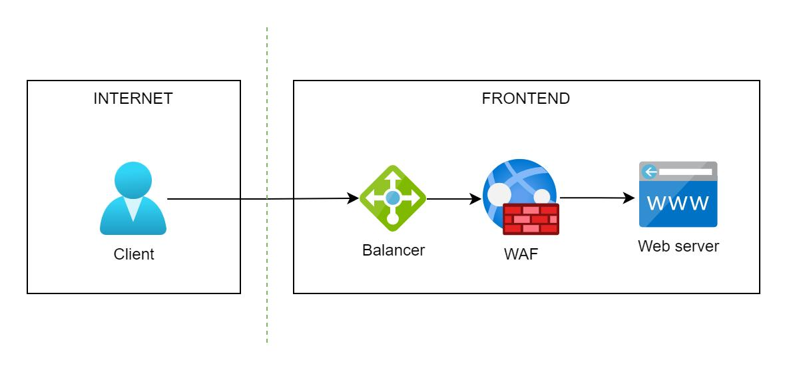

**WAF** (Web Application Firewall) là tường lửa ứng dụng Web, có nhiệm vụ giám sát, phân tích và kiểm soát lưu lượng HTTP/HTTPS giữa Client và Web Server

Khác với Firewall truyền thống chủ yếu kiểm tra IP, Port và Protocol, WAF phân tích nội dung của HTTP Request và HTTP Response để phát hiện những hành vi tấn công vào ứng dụng Web

**WAF** chủ yếu hoạt động ở:

- OSI Layer 7 – Application Layer
- HTTP/HTTPS
- Các giao thức Web như WebSocket, tùy sản phẩm

**Ví dụ:**

Một Web Server có địa chỉ: `https://example.com`

Người dùng gửi request:

```
GET /login HTTP/1.1
Host: example.com
User-Agent: Mozilla/5.0
```

WAF sẽ kiểm tra:

- IP nguồn
- HTTP Method
- URL và URI
- HTTP Headers
- Query Parameters
- Cookies
- Request Body
- Nội dung JSON, XML hoặc Form Data
- Các dấu hiệu tấn công như SQL Injection, XSS

Nếu request hợp lệ, WAF cho phép đi tiếp đến Web Server

Nếu request chứa dấu hiệu tấn công, WAF có thể chặn hoặc ghi log

# 1. Kiến trúc WAF



Có ba mô hình triển khai WAF phổ biến:

1. Reverse Proxy 

- WAF đứng trước Web Server
- Toàn bộ HTTP/HTTPS Request đi qua WAF
- WAF kiểm tra rồi chuyển tiếp request hợp lệ
- Có thể kết hợp SSL/TLS Termination

2. Transparent WAF

- WAF nằm trên đường truyền giữa Client và Server
- Không nhất thiết phải thay đổi URL hoặc cấu hình truy cập của Client
- Kiểm tra lưu lượng trước khi chuyển tiếp

3. Host-based WAF

- WAF được cài đặt trực tiếp trên Web Server
- Kiểm tra request ngay tại máy chủ
- Phụ thuộc vào tài nguyên và môi trường của từng Server

# 2. Các chức năng chính của WAF

1. SQL Injection Protection

SQL Injection là hình thức tấn công chèn câu lệnh SQL độc hại vào input của ứng dụng

Request có thể khiến truy vấn SQL bị thay đổi nếu ứng dụng xây dựng câu lệnh không an toàn

WAF có thể nhận diện các dấu hiệu:

- SQL keywords bất thường
- Ký tự và toán tử đáng ngờ
- Payload có cấu trúc SQL
- Các mẫu khai thác SQL Injection phổ biến

2. Cross-Site Scripting (XSS) Protection

XSS là hình thức chèn JavaScript độc hại vào nội dung Web để thực thi trong trình duyệt của nạn nhân.

WAF có thể kiểm tra:

- Request Parameters
- URL
- HTTP Headers
- Form Data
- Request Body

Sau đó nhận diện những đoạn mã đáng ngờ

Có ba dạng XSS chính:

- Reflected XSS: Payload được phản hồi ngay trong response
- Stored XSS: Payload được lưu trong database
- DOM-based XSS: Lỗ hổng xảy ra trong xử lý DOM phía Client

WAF có thể giảm thiểu một số cuộc tấn công XSS nhưng không thể thay thế việc encode output và xử lý dữ liệu an toàn trong ứng dụng

3. OWASP Top 10 Protection

WAF thường cung cấp các bộ quy tắc phát hiện những nhóm lỗ hổng phổ biến theo OWASP

Ví dụ:

- SQL Injection
- Cross-Site Scripting
- Path Traversal
- Local File Inclusion
- Remote Code Execution
- Command Injection
- Server-Side Request Forgery (SSRF)
- Các hành vi khai thác lỗ hổng đã biết

Một số nhóm tấn công cần logic ứng dụng hoặc cơ chế bảo vệ chuyên biệt, vì vậy không phải WAF nào cũng phát hiện đầy đủ mọi trường hợp

4. HTTP Protocol Validation

Kiểm tra tính hợp lệ của giao thức HTTP

Ví dụ:

- HTTP Method không được phép
- Header không hợp lệ
- Request bất thường
- URL có cấu trúc đáng ngờ
- Request quá lớn
- Content-Type không phù hợp
- HTTP Protocol Violation

5. IP Reputation và GeoIP Filtering

WAF có thể kết hợp dữ liệu IP Reputation để đánh giá nguồn truy cập

Ví dụ:

- IP nằm trong danh sách độc hại
- IP thuộc nguồn phát tán Bot
- IP từng tham gia tấn công
- IP thuộc quốc gia hoặc khu vực không được phép

6. Rate Limiting

Rate Limiting giới hạn số lượng request trong một khoảng thời gian

Ví dụ:

```
Maximum: 100 requests
Time Window: 60 seconds
Scope: Per Client IP
```

Nếu một IP gửi 500 request trong 60 giây, hệ thống có thể:

- Block
- Rate Limit
- Trả về HTTP 429 Too Many Requests
- Ghi log cảnh báo

Rate Limiting giúp giảm thiểu request flooding và lạm dụng ứng dụng, nhưng không thay thế Anti-DDoS ở quy mô mạng lớn

7. Virtual Patching

Virtual Patching là cơ chế tạo rule để ngăn chặn việc khai thác một lỗ hổng đã biết mà chưa cần sửa ngay mã nguồn ứng dụng

Ví dụ:

```
Application:
Vulnerable API

Known Vulnerability:
Path Traversal

WAF Rule:
Block suspicious ../ patterns
```

WAF sẽ chặn các request có dấu hiệu khai thác lỗ hổng

Đây là giải pháp giảm thiểu rủi ro tạm thời, không thay thế việc vá lỗi phần mềm

5. SSL/TLS Inspection

WAF có thể giải mã HTTPS để kiểm tra nội dung HTTP bên trong

Quy trình:

```
Client
  |
  | HTTPS
  v
 WAF
  |
  | TLS Decryption
  v
 HTTP Inspection
  |
  | Re-encryption
  v
Web Server
```

Nếu không giải mã TLS, WAF thường chỉ nhìn thấy metadata của kết nối chứ không kiểm tra được nội dung HTTP được mã hóa

# 3. Các chế độ hoạt động của WAF

| Chế độ | Ý nghĩa |
| :--- | :--- |
| Monitor | Chỉ giám sát và ghi log |
| Detection | Phát hiện và cảnh báo |
| Blocking | Phát hiện và chặn |
| Learning | Học hành vi ứng dụng để đề xuất rule |

Trong thực tế nên triển khai theo trình tự:

1. Monitor
2. Thu thập log
3. Phân tích False Positive
4. Điều chỉnh rule
5. Chuyển sang Blocking

**False Positive** là trường hợp WAF nhận diện nhầm request hợp lệ thành request tấn công

Ví dụ: Người dùng gửi nội dung có chuỗi SELECT trong một bài viết bình thường nhưng WAF lại chặn vì nghi ngờ SQL Injection.

# 4. Ưu và nhược điểm của WAF

| Ưu điểm | Nhược điểm |
| :--- | :--- |
| Bảo vệ ứng dụng Web | Có thể phát sinh False Positive |
| Phát hiện SQLi, XSS | Không thay thế Secure Coding |
| Hỗ trợ Virtual Patching | Cần cập nhật rule |
| Kiểm soát HTTP/HTTPS | Có thể tăng độ trễ |
| Hỗ trợ ghi log và điều tra | Cần tài nguyên xử lý |

