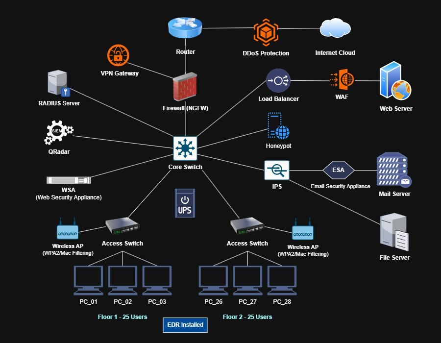

### So sánh MALWARE và CYBER ATTACK

|Tiêu chí	|Malware	|Cyber Attack|
| :--- | :--- | :--- |
|Bản chất	|Phần mềm độc hại	|Hành động tấn công|
|Mục tiêu	|Thực hiện hành vi độc hại	|Khai thác hệ thống|
|Cách thức	|Chạy mã độc	|Sử dụng nhiều kỹ thuật|
|Ví dụ	|Virus, Worm, Trojan	|DoS, Phishing, MITM|
|Có cần mã độc không?	|Có	|Không nhất thiết|
|Phát hiện	|Antivirus, EDR	|IDS/IPS, SIEM, WAF và các công cụ khác|

### Kết hợp Malware và Attack

Một cuộc tấn công có thể kết hợp nhiều phương pháp:

1. Phishing: Lừa nhân viên mở file
2. Trojan: Đưa Malware vào máy tính
3. Backdoor: Tạo đường truy cập từ xa
4. Privilege Escalation: Nâng quyền
5. Lateral Movement: Di chuyển sang máy chủ khác
6. Data Exfiltration: Đánh cắp dữ liệu
7. Ransomware: Mã hóa dữ liệu để tống tiền

Đây là lý do tại sao doanh nghiệp không thể chỉ triển khai một phần mềm Antivirus rồi cho rằng hệ thống đã an toàn

Thông thường cần kết hợp nhiều lớp bảo vệ theo mô hình Defense in Depth (Phòng thủ nhiều lớp) như:

1. Antivirus

 Phát hiện, cách ly và loại bỏ Malware dựa trên chữ ký, phân tích hành vi và các kỹ thuật phát hiện khác

Phòng chống: Virus, Trojan, Spyware, Worm

2. EDR (Endpoint Detection and Response)

Theo dõi hành vi trên máy tính và máy chủ, phát hiện hoạt động đáng ngờ và hỗ trợ điều tra, cô lập thiết bị

Phòng chống: Ransomware, Backdoor, Rootkit, Privilege Escalation

3. Firewall / NGFW

Kiểm soát lưu lượng mạng dựa trên IP, Port, Protocol, Application và các chính sách bảo mật

Phòng chống: Kết nối trái phép, một số hoạt động C2, truy cập bất thường

4. IDS/IPS

Phát hiện hoặc chủ động ngăn chặn các hành vi tấn công trên mạng

Phòng chống: Port Scanning, Exploit, một số dạng DoS, Brute Force

5. WAF

Bảo vệ Web Application thông qua việc kiểm tra HTTP/HTTPS Request

Phòng chống: SQL Injection, XSS và một số HTTP-based attacks

6. SIEM

Thu thập, phân tích và tương quan log từ nhiều hệ thống để phát hiện các dấu hiệu tấn công.

Phát hiện: Brute Force, Phishing indicators, Malware activity, Insider Threat, Lateral Movement

7. Anti-DDoS

Phân tích lưu lượng, nhận diện và giảm thiểu các cuộc tấn công từ chối dịch vụ phân tán.

Phòng chống: SYN Flood, UDP Flood, ICMP Flood, HTTP Flood.

### Đối chiếu attack và phương pháp bảo vệ

|Hình thức tấn công	|Giải pháp phù hợp|
| :--- | :--- |
|Virus	|Antivirus, EDR|
|Worm	|EDR, IDS/IPS, Firewall|
|Trojan	|Antivirus, EDR, Sandbox|
|Spyware	|EDR, Antivirus, DLP|
|Ransomware	|EDR, Backup, SIEM|
|Rootkit	|EDR, Secure Boot, Integrity Monitoring|
|Botnet	|NGFW, IDS/IPS, DNS Security|
|DoS	|Firewall, Rate Limiting|
|DDoS	|Anti-DDoS, CDN|
|Phishing	|Email Security, MFA, Sandbox|
|Backdoor	|EDR, NGFW, SIEM|
|Brute Force	|MFA, IPS, Rate Limiting|
|MITM	|TLS, VPN, IDS/IPS|
|SQL Injection	|WAF, Secure Coding|
|XSS	|WAF, CSP, Output Encoding|
|RCE	|Patch Management, WAF, EDR|
|Privilege Escalation	|EDR, IAM, Least Privilege|
|Insider Threat	|SIEM, DLP, IAM|

### Liên hệ kiến trúc CLOUD SECURITY

Nếu triển khai một nền tảng Cloud như OpenStack , có thể tổ chức các lớp bảo vệ như sau:

|Lớp bảo vệ	|Thành phần	|Nhiệm vụ|
| :--- | :--- | :--- |
|Internet Edge	|Anti-DDoS	|Giảm thiểu DDoS|
|Network Edge	|NGFW	|Kiểm soát lưu lượng|
|Application	|WAF, API Protection	|Bảo vệ Web/API|
|Network Monitoring	|IDS/IPS, NDR	|Phát hiện tấn công mạng|
|Compute	|Antivirus, EDR	|Bảo vệ VM và Server|
|Identity	|IAM, MFA	|Bảo vệ tài khoản|
|Central Monitoring	|SIEM	|Phân tích và cảnh báo|
|Data	|DLP, Backup	|Bảo vệ và phục hồi dữ liệu|

Ví dụ:

Giả sử một doanh nghiệp triển khai Web Application trên OpenStack

1. Attacker gửi lượng lớn HTTP Request
2. Anti-DDoS nhận diện lưu lượng bất thường và giảm thiểu
3. Nếu một request độc hại lọt qua, WAF tiếp tục kiểm tra
4. Nếu máy chủ bị khai thác và cài Trojan, EDR phát hiện hành vi
5. SIEM thu thập log từ WAF, Firewall, IDS/IPS và EDR
6. Đội ngũ Security Operations Center (SOC) phân tích và xử lý sự cố

