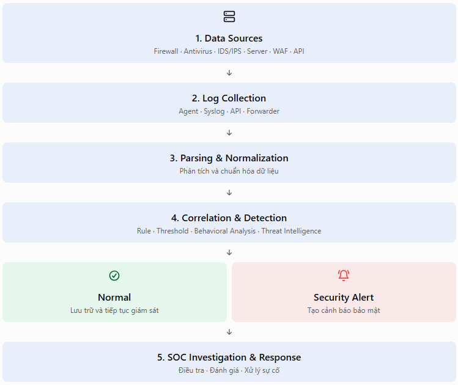
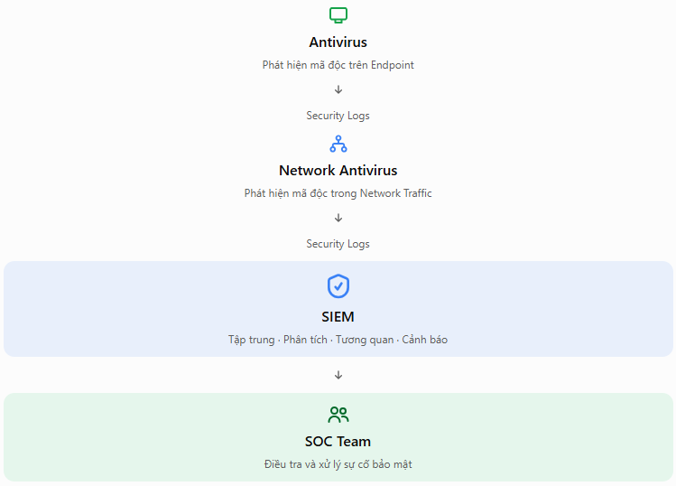

**SIEM** (Security Information and Event Management) là hệ thống quản lý thông tin và sự kiện bảo mật, có nhiệm vụ thu thập, tập trung, chuẩn hóa, phân tích và tương quan dữ liệu bảo mật từ nhiều thiết bị, ứng dụng và hệ thống trong hạ tầng CNTT

Mục tiêu chính của SIEM là giúp quản trị viên và đội ngũ SOC (Security Operations Center):

- Theo dõi tình trạng an toàn thông tin của toàn bộ hệ thống
- Phát hiện các cuộc tấn công mạng
- Phát hiện hành vi bất thường
- Phân tích và tương quan các sự kiện bảo mật
- Cảnh báo khi phát hiện nguy cơ
- Hỗ trợ điều tra sự cố bảo mật
- Lưu trữ log phục vụ kiểm toán và tuân thủ

Điểm quan trọng: SIEM không đơn thuần là một hệ thống lưu trữ log. Giá trị lớn nhất của SIEM nằm ở khả năng phân tích và tương quan nhiều sự kiện riêng lẻ để phát hiện một cuộc tấn công

Ví dụ:

Một hacker thực hiện các hành động:

1. Quét cổng Firewall
2. Thử đăng nhập SSH nhiều lần
3. Đăng nhập thành công vào máy chủ
4. Thực hiện leo thang đặc quyền
5. Truy cập cơ sở dữ liệu

Mỗi thiết bị có thể chỉ ghi nhận một phần hoạt động. SIEM tập hợp các log này và xác định chúng có liên quan đến cùng một chuỗi tấn công

# 1. Kiến trúc của SIEM

Một hệ thống SIEM thường gồm 5 thành phần chính

## 1.1. Log Sources – Nguồn dữ liệu

Đây là nơi phát sinh dữ liệu mà SIEM cần thu thập

Các nguồn dữ liệu phổ biến:

|Nhóm	|Thiết bị / Hệ thống	|Dữ liệu thu thập|
| :--- | :--- | :--- |
|Network	|Router, Switch	|Network events|
|Firewall	|NGFW, OPNsense	|Allow, Deny, IPS logs|
|Endpoint	|Antivirus, EDR	|Malware, process events|
|Server	|Windows, Linux	|System logs|
|Application	|Web Server, API	|Access logs, error logs|
|Database	|PostgreSQL, MySQL	|Login, query, audit logs|
|Identity	|Active Directory	|Authentication events|
|Cloud	|OpenStack, AWS	|Cloud audit logs|
|Security	|IDS, IPS, WAF	|Attack detection events|

## 1.2. Log Collector – Thu thập log

Log Collector có nhiệm vụ nhận dữ liệu từ các nguồn khác nhau và chuyển chúng về SIEM

Các phương pháp thu thập phổ biến:

|Phương pháp	|Mô tả|
| :--- | :--- |
|Syslog	|Thu thập log từ Firewall, Router, Linux|
|Agent	|Cài phần mềm trên Endpoint/Server|
|API	|Lấy dữ liệu thông qua API|
|SNMP	|Thu thập thông tin và cảnh báo từ thiết bị mạng|
|Windows Event Forwarding	|Chuyển Windows Event Logs|
|File Monitoring	|Theo dõi file log|
|Network Protocol	|Nhận dữ liệu qua các giao thức hỗ trợ|

## 1.3. Log Normalization – Chuẩn hóa log

Đây là bước rất quan trọng

Vì mỗi thiết bị sử dụng định dạng log khác nhau nên SIEM phải chuyển chúng về một cấu trúc dữ liệu thống nhất

Những trường thường được chuẩn hóa:

- Timestamp
- Source IP
- Destination IP
- Source Port
- Destination Port
- Username
- Hostname.
- Event Type
- Severity
- Action
- Protocol

Lợi ích:

- Dễ tìm kiếm log
- Dễ so sánh dữ liệu từ nhiều thiết bị
- Dễ xây dựng Detection Rules
- Dễ phân tích và tương quan sự kiện

## 1.4. Correlation Engine – Bộ tương quan sự kiện

Đây là một trong những thành phần quan trọng nhất của SIEM

Correlation Engine phân tích nhiều sự kiện để xác định chúng có tạo thành một dấu hiệu tấn công hay không

Ngoài số lượng sự kiện, Correlation Engine còn có thể phân tích:

- Sự kiện xảy ra liên tiếp
- Sự kiện từ cùng một địa chỉ IP
- Nhiều tài khoản bị tấn công
- Một tài khoản đăng nhập từ vị trí bất thường
- Hành vi bất thường sau khi đăng nhập thành công
- Chuỗi hoạt động trên nhiều thiết bị

## 1.5. Dashboard & Alerting – Hiển thị và cảnh báo

SIEM cung cấp giao diện giám sát tập trung

Thông tin có thể hiển thị:

- Tổng số sự kiện bảo mật
- Số lượng cảnh báo Critical, High, Medium, Low
- Top IP tấn công
- Top tài khoản đăng nhập thất bại
- Các máy chủ đang bị tấn công
- Các loại Malware phát hiện
- Tình trạng Firewall, IDS/IPS
- Dòng thời gian của các sự kiện

Hệ thống cũng có thể gửi cảnh báo qua:

- Email
- Slack
- Microsoft Teams
- Telegram (thông qua tích hợp phù hợp)
- Hệ thống quản lý sự cố

# 2. Quy trình hoạt động của SIEM

# 3. Các chức năng chính của SIEM

## 3.1. Log Management

Quản lý log tập trung từ nhiều nguồn

Bao gồm:

- Thu thập log
- Lưu trữ log
- Tìm kiếm log
- Phân loại log
- Lọc log
- Lưu trữ theo thời gian
- Phục vụ kiểm toán

## 3.2. Security Event Monitoring

Theo dõi các sự kiện bảo mật theo thời gian thực hoặc gần thời gian thực

Ví dụ:

- Firewall phát hiện IP đáng ngờ
- Antivirus phát hiện Trojan
- Server có nhiều lần đăng nhập thất bại
- Database xuất hiện truy vấn bất thường

## 3.3. Correlation Analysis

Tương quan sự kiện từ nhiều hệ thống

SIEM kết hợp các sự kiện để xác định một chuỗi tấn công có khả năng đang diễn ra

## 3.4. Threat Intelligence

Threat Intelligence là thông tin về các mối đe dọa an ninh mạng

Ví dụ:

- IP độc hại
- Domain độc hại
- URL phishing
- Hash của malware
- C2 Server
- IOC (Indicators of Compromise)

SIEM có thể đối chiếu log với nguồn Threat Intelligence

## 3.5. Alert Management

Quản lý cảnh báo bảo mật:

- Tạo cảnh báo
- Phân loại mức độ nghiêm trọng
- Gán cảnh báo cho nhân viên SOC
- Theo dõi trạng thái xử lý
- Ghi nhận kết quả điều tra
- Đóng cảnh báo

## 3.6. Incident Investigation

Hỗ trợ điều tra sự cố bảo mật

Ví dụ: Một tài khoản Administrator bị chiếm quyền.

SIEM có thể giúp xác định:

1. IP nào thực hiện đăng nhập?
2. Đăng nhập vào thời gian nào?
3. Tài khoản nào bị ảnh hưởng?
4. Máy chủ nào bị truy cập?
5. Có hành vi leo thang đặc quyền không?
6. Có dữ liệu nào bị truy cập hoặc thay đổi?
7. Có kết nối đến máy chủ C2 không?

## 3.7. Compliance & Audit

SIEM hỗ trợ đáp ứng yêu cầu giám sát và kiểm toán của các tiêu chuẩn như:

- ISO 27001
- PCI DSS
- SOC 2
- NIST Cybersecurity Framework

Tuy nhiên, cài SIEM không đồng nghĩa hệ thống tự động đạt chứng nhận tuân thủ. Doanh nghiệp vẫn phải đáp ứng các yêu cầu kiểm soát tương ứng

# 4. Các cuộc tấn công SIEM có thể phát hiện

|Loại tấn công	|Dấu hiệu SIEM có thể phát hiện|
| :--- | :--- |
|Brute Force	|Nhiều lần đăng nhập thất bại|
|Port Scanning	|Quét nhiều cổng liên tục|
|DDoS	|Lưu lượng tăng bất thường|
|Malware	|Antivirus/EDR phát hiện mã độc|
|Ransomware	|Hành vi mã hóa hàng loạt file|
|Privilege Escalation	|Tài khoản tăng quyền bất thường|
|Lateral Movement	|Truy cập bất thường giữa các máy|
|Data Exfiltration	|Lưu lượng gửi dữ liệu ra ngoài bất thường|
|Account Compromise	|Đăng nhập bất thường, thay đổi quyền|
|Web Attack	|WAF/IDS ghi nhận SQL Injection, XSS|

# 5. Các sản phẩm SIEM phổ biến

- Splunk Enterprise Security: Nền tảng SIEM doanh nghiệp, mạnh về tìm kiếm, phân tích log, correlation và dashboard

- IBM QRadar: Giải pháp SIEM tập trung vào thu thập, tương quan sự kiện, phát hiện mối đe dọa và quản lý cảnh báo

- Microsoft Sentinel: SIEM trên nền tảng Cloud, tích hợp với hệ sinh thái Microsoft và hỗ trợ tự động hóa phản ứng

- Wazuh: Nền tảng bảo mật mã nguồn mở, có khả năng thu thập log, phân tích sự kiện, phát hiện xâm nhập và giám sát Endpoint

- Elastic Security: Giải pháp phân tích bảo mật dựa trên hệ sinh thái Elastic, hỗ trợ tìm kiếm, phân tích dữ liệu và phát hiện mối đe dọa

# 6. Phân biệt SIEM, SOC, SOAR và XDR

Đây là bốn khái niệm thường xuất hiện cùng nhau trong hệ thống bảo mật doanh nghiệp

|Thành phần	|Vai trò|
| :--- | :--- |
|SIEM	|Thu thập, phân tích và tương quan sự kiện|
|SOC	|Đội ngũ hoặc trung tâm vận hành an ninh mạng
|SOAR	|Tự động hóa quy trình xử lý sự cố|
|XDR	|Phát hiện và phối hợp phản ứng trên nhiều lớp bảo mật|

Ví dụ quy trình:

1. Antivirus phát hiện malware
2. SIEM nhận log và tạo cảnh báo
3. SOC phân tích và xác nhận sự cố
4. SOAR tự động gọi API để cô lập máy tính
5. XDR hỗ trợ điều tra và phối hợp phản ứng trên Endpoint, Network và Cloud

**Phân biệt quan trọng:** SIEM chủ yếu phát hiện và cung cấp thông tin; SOAR tập trung tự động hóa hành động phản ứng. SIEM hiện đại có thể tích hợp một số chức năng SOAR

# 7. So sánh ANTIVIRUS, NETWORK ANTIVIRUS và SIEM

|Tiêu chí	|Antivirus	|Network Antivirus	|SIEM|
| :--- | :--- | :--- | :--- |
|Mục tiêu	|Bảo vệ Endpoint	|Bảo vệ lưu lượng mạng	|Giám sát bảo mật tập trung|
|Vị trí	|Máy tính, Server	|Firewall, Gateway	|SIEM Server/Cloud|
|Phát hiện Malware	|Có	|Có	|Phân tích cảnh báo từ nguồn khác|
|Quét file	|File trên thiết bị	|File truyền qua mạng	|Không phải chức năng chính|
|Phát hiện tấn công mạng	|Hạn chế	|Có	|Có, thông qua tương quan log|
|Thu thập log	|Có	|Có	|Là chức năng cốt lõi|
|Correlation	|Hạn chế	|Hạn chế	|Có|
|Dashboard	|Có thể có	|Có thể có	|Có|
|Alert	|Có	|Có	|Có|
|Incident Investigation	|Hạn chế|	Hạn chế	|Có|
|Tự động phản ứng	|Có thể có	|Có thể có	|Có thể tích hợp SOAR|

### Mối quan hệ giữa ba thành phần

Có thể hiểu đơn giản:

- Antivirus bảo vệ từng máy chủ
- Network Antivirus bảo vệ dữ liệu khi di chuyển qua mạng
- SIEM quan sát và phân tích toàn bộ hệ thống bảo mật
