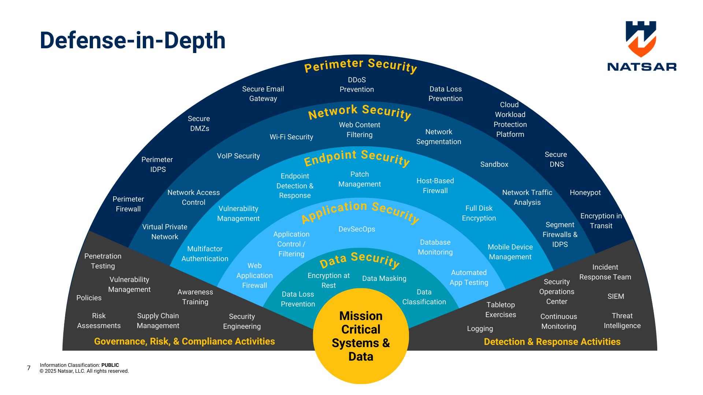
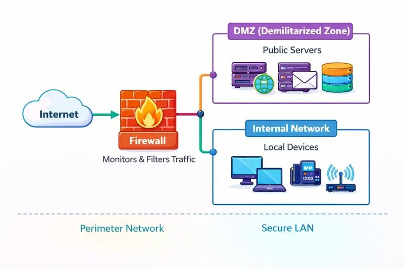
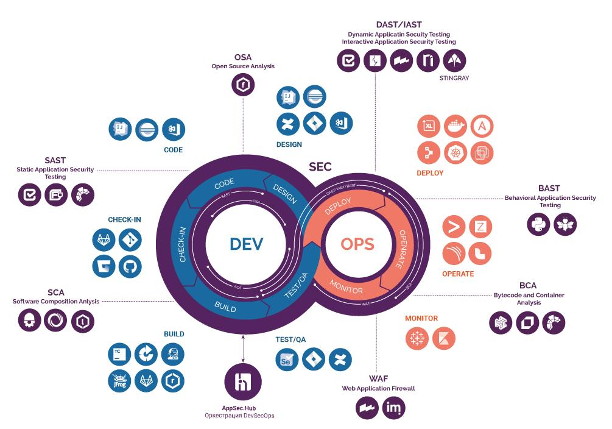
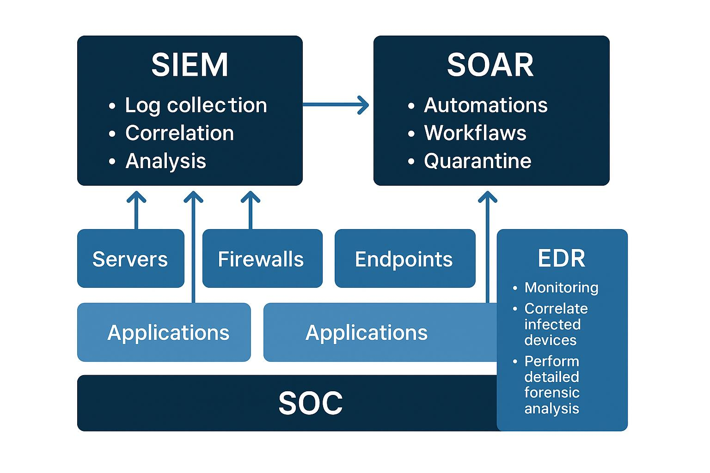
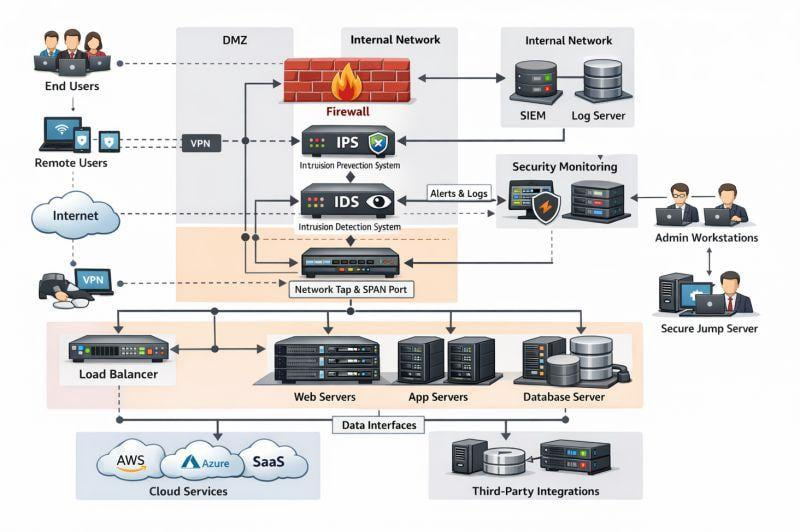

# 1. Tổng quan về Security Architecture & Integration

**Security Architecture & Integration** (Kiến trúc và tích hợp bảo mật) là một lĩnh vực thiết kế, xây dựng và kết nối các thành phần bảo mật thành một hệ thống thống nhất nhằm bảo vệ toàn bộ hạ tầng CNTT, bao gồm:

- Hạ tầng mạng (Network Infrastructure)
- Máy chủ vật lý và máy chủ ảo (Physical/Virtual Servers)
- Hệ điều hành (Operating Systems)
- Ứng dụng và API (Application & API)
- Cơ sở dữ liệu (Database)
- Cloud và Container
- Người dùng, danh tính và quyền truy cập (Identity & Access)

Mục tiêu không chỉ là triển khai nhiều sản phẩm bảo mật riêng lẻ, mà là làm cho chúng phối hợp với nhau, chia sẻ dữ liệu, phát hiện nguy cơ và phản ứng tự động trước các cuộc tấn công

### 1.1. Phân biệt Security Architecture và Security Integration

|Tiêu chí	|Security Architecture	|Security Integration|
| :--- | :--- | :--- |
|Bản chất	|Thiết kế kiến trúc bảo mật	|Tích hợp các giải pháp bảo mật|
|Mục tiêu	|Xác định cần bảo vệ gì và bảo vệ như thế nào	|Đảm bảo các thành phần phối hợp|
|Phạm vi	|Toàn bộ hệ thống	|Các sản phẩm, dịch vụ bảo mật|
|Công việc	|Thiết kế Network Security, IAM, Zero Trust	|Kết nối Firewall, SIEM, EDR, IAM|
|Kết quả	|Bản thiết kế bảo mật tổng thể	|Hệ thống bảo mật hoạt động đồng bộ|

**Ví dụ:** Một doanh nghiệp có:

- Firewall bảo vệ mạng
- WAF bảo vệ Web Application
- EDR bảo vệ Endpoint
- IAM quản lý tài khoản
- SIEM thu thập và phân tích log
- SOAR tự động hóa xử lý sự cố

**Security Architecture** xác định vị trí, vai trò và cách bố trí các thành phần này

**Security Integration** đảm bảo Firewall, WAF, EDR, IAM gửi dữ liệu về SIEM; khi phát hiện tấn công, SIEM có thể kích hoạt SOAR để khóa tài khoản hoặc cô lập máy tính bị nhiễm mã độc

# 2. Mục tiêu của Security Architecture

Một kiến trúc bảo mật tốt cần đáp ứng các mục tiêu sau

### 2.1. Confidentiality – Tính bảo mật

Đảm bảo dữ liệu chỉ được truy cập bởi người hoặc hệ thống có quyền

Ví dụ:

- Nhân viên không được xem dữ liệu lương của toàn công ty
- API không được trả về thông tin của khách hàng khác
- Database phải giới hạn quyền truy cậ
- Dữ liệu nhạy cảm được mã hóa

Các giải pháp:

- IAM (Identity and Access Management)
- RBAC (Role-Based Access Control)
- ABAC (Attribute-Based Access Control)
- Encryption
- DLP (Data Loss Prevention)

### 2.2. Integrity – Tính toàn vẹn

Đảm bảo dữ liệu không bị sửa đổi trái phép

Ví dụ: Một attacker xâm nhập API và sửa thông tin giao dịch ngân hàng

Các biện pháp:

- Digital Signature
- Hashing
- Database Audit
- File Integrity Monitoring
- Access Control

### 2.3. Availability – Tính sẵn sàng

Đảm bảo hệ thống luôn có thể phục vụ người dùng hợp lệ

Ví dụ: Một ứng dụng Cloud bị tấn công DDoS khiến người dùng không thể truy cập

Các giải pháp:

- Anti-DDoS
- Load Balancer
- High Availability (HA)
- Backup & Disaster Recovery
- Rate Limiting

# 3. Các mô hình kiến trúc bảo mật phổ biến

### 3.1. Defense in Depth – Phòng thủ nhiều lớp

Đây là nguyên tắc triển khai nhiều lớp bảo vệ độc lập và bổ trợ nhau



Các lớp bảo vệ:

|Lớp	|Thành phần	|Chức năng|
| :--- | :--- | :--- |
|1. Perimeter	|Anti-DDoS, Firewall	|Bảo vệ biên mạng|
|2. Network	|IDS/IPS, Network Firewall	|Kiểm soát lưu lượng|
|3. Application	|WAF, API Gateway	|Bảo vệ Web và API|
|4. Endpoint	|EDR, Antivirus	|Phát hiện mã độc|
|5. Identity	|IAM, MFA	|Xác thực và phân quyền|
|6. Data	|Encryption, |DLP	Bảo vệ dữ liệu|
|7. Monitoring	|SIEM, SOAR	|Giám sát và phản ứng|

**Ví dụ:** Một attacker gửi SQL Injection đến Web Application:

1. Anti-DDoS kiểm tra lưu lượng bất thường
2. Firewall kiểm soát kết nối đến máy chủ
3. WAF phát hiện payload SQL Injection
4. API Gateway kiểm tra token và giới hạn request
5. Application sử dụng parameterized query để chống SQL Injection
6. SIEM ghi nhận và tương quan các sự kiện
7. SOAR có thể tạo cảnh báo hoặc thực hiện hành động ứng phó

### 3.2. Zero Trust Architecture

Zero Trust (Không tin tưởng mặc định) là mô hình bảo mật không mặc định tin tưởng bất kỳ người dùng, thiết bị hoặc kết nối nào, kể cả khi chúng nằm trong mạng nội bộ

**Nguyên tắc:**

- Never Trust, Always Verify
- Least Privilege
- Assume Breach
- Continuous Verification

Các thành phần chính:

|Thành phần	|Vai trò|
| :--- | :--- | 
|Identity Provider (IdP)	|Xác thực danh tính|
|MFA	|Xác thực nhiều yếu tố|
|Policy Engine	|Đánh giá quyền truy cập|
|Policy Administrator	|Quyết định và điều phối cấp quyền|
|Policy Enforcement Point	|Thực thi quyết định|
|Device Security	|Kiểm tra trạng thái thiết bị|
|Monitoring	|Theo dõi hoạt động|

**Ví dụ:** Một nhân viên đăng nhập vào hệ thống quản trị Cloud:

1. IAM xác minh tài khoản
2. MFA xác minh người dùng
3. Hệ thống kiểm tra thiết bị có đạt yêu cầu bảo mật không
4. Policy Engine đánh giá vai trò và ngữ cảnh truy cập
5. Nếu hợp lệ, Policy Enforcement Point cho phép truy cập
6. SIEM tiếp tục giám sát hoạt động

### 3.3. Perimeter-based Security

Đây là mô hình bảo mật truyền thống, tập trung bảo vệ ranh giới giữa mạng nội bộ và Internet



Các thành phần:

- External Firewall
- DMZ
- Internal Firewall
- IDS/IPS
- VPN Gateway

Nhược điểm:

- Tin tưởng tương đối nhiều vào mạng nội bộ
- Khó kiểm soát truy cập giữa các hệ thống nội bộ
- Không đủ hiệu quả khi sử dụng Cloud, Microservices và làm việc từ xa

Hiện nay, mô hình này vẫn hữu ích nhưng thường được kết hợp với Zero Trust và phân đoạn mạng

### 3.4. Security Architecture theo mô hình Cloud và Microservices

Khi hệ thống chuyển từ ứng dụng nguyên khối (Monolithic) sang Microservices, cách bảo vệ cũng thay đổi

Ví dụ một nền tảng Cloud có các dịch vụ:

- Identity API
- User API
- Configuration API
- Subscription API
- Provision Management API
- Cloud Firewall API
- API Gateway

Mỗi dịch vụ có thể chạy trong container hoặc Kubernetes

Các lớp bảo mật cần triển khai:

- API Gateway: Authentication, Authorization, Rate Limiting
- Service Mesh: Mã hóa giao tiếp giữa các service bằng mTLS
- Kubernetes RBAC: Phân quyền quản trị cluster
- Network Policy: Giới hạn giao tiếp giữa các Pod
- Secrets Management: Bảo vệ mật khẩu, token, certificate
- Image Scanning: Phát hiện lỗ hổng trong container image
- Runtime Security: Phát hiện hành vi bất thường khi container chạy
- SIEM: Thu thập và phân tích log

Một điểm cần nhớ: bảo vệ Kubernetes không chỉ là bảo vệ API Server hoặc Worker Node. Cần bảo vệ cả Control Plane, Workload, Container Image, Network, Storage và danh tính

# 4. Các thành phần quan trọng trong Security Architecture

### 4.1. Identity and Access Management (IAM)

IAM là hệ thống quản lý danh tính và quyền truy cập của người dùng, ứng dụng và dịch vụ

**IAM có các chức năng chính:**

1. Authentication – Xác thực

Xác định người dùng có đúng là người mà họ khai báo hay không

Các phương pháp:

- Username/Password
- OTP
- MFA
- Certificate-based Authentication
- Biometric Authentication
- SSO

2. Authorization – Phân quyền

Xác định người dùng được phép thực hiện những hành động nào

Các mô hình phân quyền:

- RBAC: phân quyền theo vai trò
- ABAC: phân quyền theo thuộc tính
- PBAC: phân quyền theo chính sách
- ACL: danh sách quyền truy cập

### 4.2. Network Security Architecture

Network Security là kiến trúc bảo vệ lưu lượng và các vùng mạng

Các thành phần:

|Thành phần	|Vai trò|
| :--- | :--- |
|Firewall	|Kiểm soát traffic|
|NGFW	|Kiểm soát ứng dụng, người dùng và mối đe dọa|
|IDS	|Phát hiện xâm nhập|
|IPS	|Phát hiện và ngăn chặn xâm nhập|
|WAF	|Bảo vệ Web Application|
|Anti-DDoS	|Giảm thiểu tấn công từ chối dịch vụ|
|VPN	|Tạo kết nối mạng riêng|
|NAC	|Kiểm soát thiết bị tham gia mạng|
|Network Segmentation	|Phân chia mạng thành các vùng độc lập|

**Network Segmentation và Micro-Segmentation**

- Network Segmentation: chia mạng thành các vùng như LAN, WAN, DMZ, Database
- Micro-Segmentation: kiểm soát chi tiết giao tiếp giữa từng workload, VM, container hoặc ứng dụng

**Ví dụ:** Application API A được phép kết nối PostgreSQL trên port 5432, nhưng API B không được phép

Điều này hạn chế khả năng attacker di chuyển ngang (Lateral Movement) nếu đã xâm nhập được một máy chủ

### 4.3. Application Security Architecture

Application Security tập trung bảo vệ phần mềm trong suốt vòng đời phát triển



Các thành phần:

|Thành phần	|Chức năng|
| :--- | :--- |
|SAST	|Phân tích mã nguồn tĩnh|
|DAST	|Kiểm thử ứng dụng khi đang chạy|
|SCA	|Phân tích thư viện phụ thuộc|
|IAST	|Phân tích bảo mật trong lúc ứng dụng chạy|
|WAF	|Bảo vệ ứng dụng Web|
|API Security	|Bảo vệ API|
|Secrets Scanning	|Phát hiện secret bị lộ|
|Code Review	|Kiểm tra chất lượng và bảo mật code|

### 4.4. Data Security Architecture

Data Security bảo vệ dữ liệu trong suốt vòng đời sử dụng

**Các nguyên tắc:**

1. Data Classification – Phân loại dữ liệu

- Public: dữ liệu công khai
- Internal: dữ liệu nội bộ
- Confidential: dữ liệu mật
- Restricted: dữ liệu đặc biệt nhạy cảm

2. Encryption – Mã hóa

Có hai loại chính:
|Loại	|Ý nghĩa	|Ví dụ|
| :--- | :--- | :--- |
|Encryption at Rest	|Mã hóa dữ liệu lưu trữ	|AES-256|
|Encryption in Transit	|Mã hóa dữ liệu truyền tải	|TLS 1.2/1.3|

3. Key Management – Quản lý khóa

Không nên lưu khóa mã hóa cùng nơi với dữ liệu được mã hóa.

Các giải pháp:
- KMS (Key Management Service)
- HSM (Hardware Security Module)
- Certificate Management
- Secret Vault

4. DLP – Data Loss Prevention

Ngăn chặn dữ liệu nhạy cảm bị thất thoát thông qua:
- Email
- USB
- Upload lên Cloud
- Web Browser
- File Sharing

### 4.5. Endpoint Security Architecture

Endpoint Security bảo vệ các thiết bị đầu cuối như:

- Windows Server
- Linux Server
- Laptop
- Desktop
- Virtual Machine
- Container Host

Các giải pháp:

|Công nghệ	|Vai trò|
| :--- | :--- |
|Antivirus	|Phát hiện mã độc|
|EDR	|Phát hiện và phản ứng trên Endpoint|
|XDR	|Tương quan sự kiện từ nhiều nguồn|
|HIDS	|Phát hiện xâm nhập trên Host|
|Host Firewall	|Kiểm soát traffic trên máy|
|Patch Management	|Quản lý bản vá|
|Application Control	|Kiểm soát phần mềm được chạy|

### 4.6. Security Monitoring và Incident Response

Đây là lớp giám sát và phản ứng sự cố



Các thành phần quan trọng:

|Công nghệ	|Vai trò|
| :--- | :--- |
|SIEM	|Thu thập, tương quan và phân tích log|
|SOAR	|Tự động hóa xử lý sự cố|
|SOC	|Trung tâm giám sát an ninh|
|Threat Intelligence	|Cung cấp dữ liệu về mối đe dọa|
|UEBA	|Phân tích hành vi người dùng và thực thể|
|NDR	|Phát hiện mối đe dọa trên mạng|

# 5. Security Integration – Tích hợp các hệ thống bảo mật

### 5.1. Mô hình tổng quan



Mô hình tích hợp có thể chia thành bốn lớp:

|Lớp	|Thành phần	|Nhiệm vụ|
| :--- | :--- | :--- |
|Security Control	|Firewall, WAF, EDR, IAM	|Ngăn chặn và kiểm soát|
|Data Collection	|Syslog, Agent, API	|Thu thập dữ liệu|
|Security Analytics	|SIEM, UEBA, Threat Intelligence	|Phân tích và phát hiện|
|Response & Automation	|SOAR, Firewall API, EDR API	|Phản ứng và tự động hóa|

### 5.2. Các phương thức tích hợp

1. API Integration

API cho phép các hệ thống trao đổi dữ liệu và thực hiện hành động với nhau

Các giao thức và tiêu chuẩn thường gặp:

- REST API
- SOAP API
- GraphQL
- OpenAPI
- OAuth 2.0
- API Key
- Mutual TLS

Cần bảo vệ API tích hợp bằng authentication, authorization, rate limiting, audit log và kiểm tra dữ liệu đầu vào

2. Syslog Integration

Syslog là giao thức phổ biến để gửi log từ các thiết bị mạng và hệ thống về máy chủ tập trung

**Ví dụ:**

```
Firewall --------\
Router -----------\
Linux Server ------> Syslog Server ---> SIEM
IDS/IPS -----------/
WAF --------------/
```

Các cổng phổ biến:

|Protocol	|Port|
| :--- | :--- |
|Syslog UDP	|514|
|Syslog TCP	|514|
|Syslog TLS	|6514|

3. Agent-based Integration

Cài Agent trên máy chủ để thu thập dữ liệu

Agent có thể thu thập:

- System Logs
- Authentication Logs
- File Integrity
- Process Events
- Security Events

4. Event Streaming Integration

Sử dụng hệ thống truyền tải sự kiện để kết nối các dịch vụ bảo mật

Mô hình:

```
Firewall Logs ----\
WAF Events --------\
EDR Events ---------> Kafka / RabbitMQ
IAM Events --------/        |
                           v
                     SIEM / Analytics
                           |
                           v
                         SOAR
```

Lợi ích:

- Giảm phụ thuộc trực tiếp giữa các dịch vụ
- Hỗ trợ xử lý bất đồng bộ
- Tăng khả năng mở rộng
- Hỗ trợ lưu trữ và phát lại sự kiện

5. Identity Integration

Tích hợp các hệ thống thông qua nền tảng định danh

Các tiêu chuẩn thường gặp:

|Tiêu chuẩn	|Chức năng|
| :--- | :--- |
|LDAP	|Truy vấn và quản lý danh bạ|
|Active Directory	|Quản lý danh tính trong hệ sinh thái Microsoft|
|SAML 2.0	|Trao đổi thông tin xác thực SSO|
|OAuth 2.0	|Ủy quyền truy cập|
|OpenID Connect	|Xác thực dựa trên OAuth 2.0|
|SCIM	|Đồng bộ vòng đời tài khoản|

# 6. Tích hợp các sản phẩm bảo mật với nhau

Một kiến trúc thực tế cần xác định rõ sản phẩm nào cung cấp dữ liệu, sản phẩm nào phân tích và sản phẩm nào thực thi hành động

|Hệ thống nguồn	|Tích hợp với	|Mục đích|
| :--- | :--- | :--- |
|Firewall	|SIEM	|Phân tích traffic và sự kiện|
|WAF	|SIEM	|Phát hiện Web Attack|
|EDR	|SIEM	|Giám sát Endpoint|
|IAM	|SIEM	|Phát hiện đăng nhập bất thường|
|IDS/IPS	|SIEM	|Phát hiện xâm nhập|
|SIEM	|SOAR	|Kích hoạt quy trình xử lý|
|SOAR	|Firewall	|Chặn IP|
|SOAR	|EDR	|Cô lập máy|
|SOAR	|IAM	|Khóa tài khoản|
|Threat Intelligence	|SIEM	|Đối chiếu IOC|

# 7. Các tiêu chuẩn và framework trong Security Architecture

### 7.1. NIST Cybersecurity Framework (CSF)

NIST CSF là framework hỗ trợ tổ chức quản lý rủi ro an ninh mạng

NIST CSF 2.0 có sáu chức năng chính:

|Chức năng	|Ý nghĩa	|Ví dụ triển khai|
| :--- | :--- | :--- |
|Govern	|Quản trị bảo mật	|Security Policy, Risk Management|
|Identify	|Nhận diện tài sản và rủi ro	|Asset Inventory, Risk Assessment|
|Protect	|Bảo vệ hệ thống	|Firewall, IAM, Encryption|
|Detect	|Phát hiện tấn công	|SIEM, IDS, EDR
|Respond	|Phản ứng sự cố	|SOAR, Incident Response|
|Recover	|Khôi phục hệ thống	|Backup, Disaster Recovery|

### 7.2. NIST SP 800-207 – Zero Trust Architecture

Đây là tài liệu hướng dẫn kiến trúc Zero Trust

Các nội dung quan trọng:

- Không tin tưởng mặc định dựa trên vị trí mạng
- Xác thực và cấp quyền trước khi truy cập tài nguyên
- Chính sách truy cập dựa trên nhiều yếu tố
- Giám sát liên tục
- Kiểm soát truy cập theo từng tài nguyên

### 7.3. ISO/IEC 27001

ISO 27001 là tiêu chuẩn về hệ thống quản lý an toàn thông tin (ISMS)

Các nội dung:

- Đánh giá rủi ro
- Xây dựng chính sách bảo mật
- Quản lý tài sản
- Kiểm soát truy cập
- Quản lý sự cố
- Quản lý nhà cung cấp
- Kiểm toán và cải tiến liên tục

ISO 27001 không phải một sản phẩm Firewall hay phần mềm bảo mật. Đây là tiêu chuẩn quản lý và tổ chức các hoạt động bảo mật

### 7.4. CIS Controls và CIS Benchmarks

Hai khái niệm này có liên quan nhưng khác nhau:

- CIS Controls: Xác định các biện pháp kiểm soát an ninh mạng ưu tiên
- CIS Benchmarks: Hướng dẫn cấu hình bảo mật cụ thể cho hệ điều hành, phần mềm và thiết bị

Ví dụ:

- CIS Benchmark Ubuntu
- CIS Benchmark Windows Server
- CIS Benchmark Kubernetes
- CIS Benchmark Docker
- CIS Benchmark PostgreSQL

### 7.5. MITRE ATT&CK

MITRE ATT&CK mô tả hành vi và kỹ thuật của attacker trong các giai đoạn tấn công

Ví dụ:

|Tactic	|Kỹ thuật hoặc hành vi|
| :--- | :--- |
|Initial Access	|Phishing, Exploit Public-Facing Application|
|Execution	|PowerShell, Command and Scripting Interpreter|
|Persistence	|Scheduled Task, Account Manipulation|
|Privilege Escalation	|Exploitation for Privilege Escalation|
|Credential Access	|Credential Dumping|
|Lateral Movement	|Remote Services|
|Exfiltration	|Exfiltration Over C2 Channel|
|Impact	|Data Destruction, Service Stop|

MITRE ATT&CK giúp thiết kế hệ thống phát hiện và xác định những khoảng trống trong khả năng phòng thủ

### 7.6. OWASP

OWASP tập trung vào bảo mật ứng dụng và API

Các tài liệu quan trọng:

- OWASP Top 10: Các rủi ro bảo mật Web Application
- OWASP API Security Top 10: Các rủi ro bảo mật API
- OWASP ASVS: Tiêu chuẩn xác minh bảo mật ứng dụng
- OWASP SAMM: Mô hình trưởng thành bảo mật phần mềm

Đặc biệt, đối với hệ thống Microservices và API Gateway, cần quan tâm đến Broken Access Control, Authentication Failures, Security Misconfiguration và Server-Side Request Forgery

