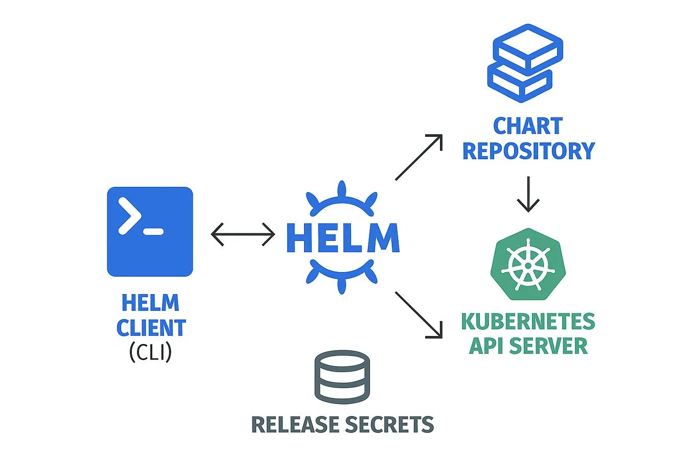
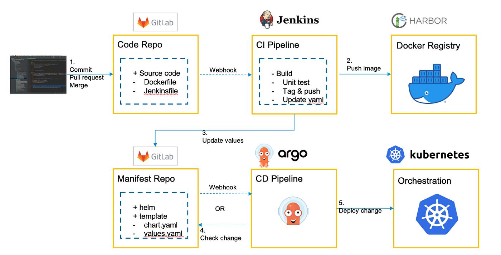

# 1. Kubernetes

Kubernetes (K8s) là nền tảng mã nguồn mở dùng để tự động hóa việc triển khai, quản lý và mở rộng ứng dụng được container hóa

Kubernetes giải quyết những vấn đề phát sinh khi hệ thống chạy hàng trăm hoặc hàng nghìn container

Ví dụ: Một hệ thống thương mại điện tử có các dịch vụ:

- Identity API
- User API
- Product API
- Order API
- Payment API
- Notification API
- API Gateway
- Redis
- RabbitMQ
- PostgreSQL

Nếu chạy bằng Docker thủ công, quản trị viên phải tự xử lý:

- Container nào chạy trên Server nào?
- Nếu Server bị lỗi thì sao?
- Nếu container bị crash thì ai khởi động lại?
- Khi có nhiều request thì tăng số lượng container như thế nào?
- Các container giao tiếp với nhau ra sao?
- Cập nhật phiên bản mới thế nào mà không gián đoạn dịch vụ?

Kubernetes tự động hóa những công việc này

# 2. Kiến trúc Kubernetes Cluster

Một Kubernetes Cluster bao gồm hai thành phần chính:

1. Control Plane
2. Worker Nodes

### 2.1 Control Plane

Control Plane là bộ não điều khiển Kubernetes Cluster

Các thành phần quan trọng

1. kube-apiserver

Đây là trung tâm giao tiếp của Kubernetes

Mọi yêu cầu quản lý Cluster đều đi qua API Server

2. etcd

etcd là cơ sở dữ liệu key-value phân tán dùng để lưu trữ trạng thái của Kubernetes

Nó lưu thông tin như:

- Pod
- Deployment
- Service
- ConfigMap
- Secret
- Node
- Namespace
- Cluster configuration

Trong môi trường Production, etcd cần:

- Backup thường xuyên
- Bảo vệ dữ liệu
- Mã hóa khi cần
- Triển khai HA với số lượng member phù hợp, thường là 3 hoặc 5
- Giám sát quorum, latency và dung lượng

3. kube-scheduler

Scheduler chịu trách nhiệm lựa chọn Worker Node để chạy Pod chưa được phân bổ

Scheduler xem xét:

- CPU
- Memory
- Node Affinity
- Pod Affinity
- Taints và Tolerations
- Topology Spread
- Volume Constraints
- Các chính sách scheduling khác

4. kube-controller-manager

Đây là thành phần chạy các Controller để duy trì trạng thái mong muốn

Một số Controller:

|Controller	|Chức năng|
| :--- | :--- |
|Node Controller	|Theo dõi trạng thái |
|ReplicaSet Controller	|Duy trì số lượng Pod|
|Deployment Controller	|Quản lý Deployment|
|Job Controller	|Quản lý Job|
|EndpointSlice Controller	|Quản lý EndpointSlice|
|Namespace Controller	|Quản lý vòng đời Namespace|

5. Cloud Controller Manager

Thành phần tích hợp Kubernetes với Cloud Provider

Ví dụ:

- Tạo Cloud Load Balancer
- Quản lý Node liên quan đến hạ tầng Cloud
- Quản lý một số loại Route

Trong môi trường tự triển khai, có thể sử dụng Cloud Controller Manager của nền tảng tương ứng hoặc không triển khai thành phần này nếu không cần

### 2.2 Worker Node

Worker Node là máy chủ thực thi ứng dụng

Một Worker Node có những thành phần chính

1. kubelet

Kubelet là Agent chạy trên mỗi Worker Node

Nhiệm vụ:

- Nhận thông tin Pod được giao
- Kiểm tra trạng thái container
- Gọi Container Runtime
- Đảm bảo container chạy theo cấu hình Pod
- Báo cáo trạng thái về API Server

2. Container Runtime

Container Runtime chịu trách nhiệm chạy container

Ví dụ:

- containerd
- CRI-O

Kubernetes giao tiếp với Container Runtime thông qua CRI (Container Runtime Interface)

Một điểm rất quan trọng: Docker Engine không còn là Container Runtime trực tiếp được Kubernetes hỗ trợ mặc định thông qua dockershim từ Kubernetes 1.24 trở đi. Docker-built images vẫn có thể chạy trên các runtime tương thích OCI như containerd

3. kube-proxy

kube-proxy thực hiện các chức năng mạng cho Service trong nhiều cấu hình Kubernetes

Thông thường nó sử dụng:

- iptables
- IPVS

Nó thiết lập các quy tắc để chuyển traffic đến các Pod phù hợp

Lưu ý: Một số CNI như Cilium có thể thay thế kube-proxy bằng cơ chế eBPF

4. CNI Plugin

CNI (Container Network Interface) là giao diện và hệ sinh thái plugin cấu hình mạng cho container

Ví dụ:

- Calico
- Flannel
- Cilium
- OVN-Kubernetes
- Kube-OVN

CNI có nhiệm vụ:

- Cấp IP cho Pod
- Kết nối Pod với Network
- Hỗ trợ routing
- Hỗ trợ Network Policy tùy plugin
- Hỗ trợ các mô hình Overlay hoặc Routing

# 3. Các đối tượng cốt lõi trong Kubernetes

### 3.1 Pod

Pod là đơn vị triển khai nhỏ nhất trong Kubernetes

Pod có thể chứa một hoặc nhiều container

Các container trong cùng Pod:

- Chia sẻ Network Namespace
- Có thể giao tiếp qua localhost
- Có thể chia sẻ Volume
- Được triển khai và quản lý như một đơn vị

Mỗi Pod thông thường có một địa chỉ IP riêng trong Cluster

Pod có thể giao tiếp với Pod khác thông qua mạng Cluster

Địa chỉ IP của Pod có thể thay đổi khi Pod bị tạo lại => Ứng dụng không nên dựa vào IP Pod cố định để giao tiếp lâu dài

### 3.2 ReplicaSet

ReplicaSet đảm bảo số lượng Pod đang hoạt động theo yêu cầu

Ví dụ:

```
spec:
  replicas: 5
```

Nếu hiện tại chỉ có 4 Pod, ReplicaSet tạo thêm 1 Pod, nếu có 6 Pod, ReplicaSet điều chỉnh về 5 Pod

Trong thực tế, thường quản lý ReplicaSet gián tiếp thông qua Deployment

### 3.3 Deployment

Deployment là tài nguyên quản lý việc triển khai và cập nhật ứng dụng theo kiểu stateless thông thường

Deployment quản lý ReplicaSet, ReplicaSet quản lý số lượng Pod

Kiến trúc

```
Deployment
    |
 ReplicaSet
    |
 +----+----+----+
 |    |    |    |
 Pod1 Pod2 Pod3
```

Ví dụ: Muốn chạy 3 bản sao của Nginx:

111
apiVersion: apps/v1
kind: Deployment
metadata:
  name: nginx-deployment
spec:
  replicas: 3
  selector:
    matchLabels:
      app: nginx
  template:
    metadata:
      labels:
        app: nginx
    spec:
      containers:
        - name: nginx
          image: nginx:1.27
          ports:
            - containerPort: 80
111

Triển khai: `kubectl apply -f nginx.yaml`

Kiểm tra:

```
kubectl get deployments
kubectl get replicasets
kubectl get pods -o wide
```

Nếu một Pod bị xóa, ReplicaSet sẽ tạo Pod thay thế để duy trì 3 replica

### 3.4 StatefulSet

StatefulSet được sử dụng cho ứng dụng cần danh tính và lưu trữ ổn định

Ví dụ:

- PostgreSQL
- MongoDB
- Kafka
- ZooKeeper

Đặc điểm:

- Pod có tên ổn định
- Thứ tự khởi tạo và xóa có thể được kiểm soát
- Có thể gắn PersistentVolumeClaim riêng cho từng Pod
- Hỗ trợ các mô hình ứng dụng stateful

Khác với Deployment, StatefulSet phù hợp với những ứng dụng cần danh tính ổn định

Tuy nhiên, StatefulSet không tự động biến một database đơn lẻ thành database HA. Việc đồng bộ dữ liệu, replication và failover vẫn cần cơ chế riêng của database hoặc Operator

### 3.5 DaemonSet

DaemonSet đảm bảo một Pod được chạy trên mỗi Node phù hợp với điều kiện lựa chọn

Ví dụ:

- Log Collector
- Monitoring Agent
- Network Agent
- Security Agent

Khi thêm Worker Node mới, DaemonSet có thể tự động tạo Pod tương ứng

### 3.6 Job và CronJob

**Job**: Chạy một hoặc nhiều Pod để hoàn thành một công việc

Ví dụ:

- Database Migration
- Backup
- Batch Processing

**CronJob**: Chạy Job theo lịch

Ví dụ:

- Backup database mỗi ngày
- Xóa log cũ mỗi tuần
- Đồng bộ dữ liệu mỗi giờ

### 3.7 Service

Service cung cấp một điểm truy cập ổn định đến một nhóm Pod

Vì Pod có thể bị xóa và tạo lại, IP của Pod có thể thay đổi. Service giải quyết vấn đề này bằng một địa chỉ và cơ chế truy cập ổn định

Có 4 loại Service quan trọng:

1. ClusterIP

Đây là Service mặc định trong Kubernetes

Cung cấp một địa chỉ IP ảo nội bộ cố định để các thành phần bên trong cụm giao tiếp với nhau. Service này không thể truy cập trực tiếp từ bên ngoài cụm

**Đặc điểm chính:**

- Phạm vi nội bộ: Chỉ hoạt động trong mạng nội bộ của cluster; các Pod bên ngoài không thể gọi thẳng tới ClusterIP nếu không qua Ingress, NodePort hoặc LoadBalancer

- Địa chỉ IP ổn định và cân bằng tải: Pod có thể thay đổi IP khi khởi động lại, nhưng ClusterIP giữ nguyên và tự động phân phối lưu lượng tới các Pod khỏe mạnh khớp với `selector`

- Cấp phát IP: Control plane tự động gán một IP duy nhất trong dải IP của Service (hoặc bạn có thể chỉ định tĩnh nếu nằm trong dải cho phép)

- Headless Service (clusterIP: None): Khi đặt clusterIP là "None", Kubernetes không cấp IP ảo mà trả về trực tiếp IP của các Pod qua DNS, thường dùng cho StatefulSet hoặc cơ sở dữ liệu

**Khi nào nên dùng:**

- Giao tiếp giữa Frontend và Backend trong cùng một cụm
- Kết nối Backend tới Database hoặc cache nội bộ
- Làm nền tảng phía sau Ingress để định tuyến lưu lượng HTTP/HTTPS từ bên ngoài vào cụm

2. NodePort 

Là một loại Service trong Kubernetes giúp mở một cổng (port) tĩnh trên địa chỉ IP của tất cả các Node trong cụm, cho phép truy cập ứng dụng trực tiếp từ bên ngoài thông qua

**Đặc điểm chính:**

- Dải cổng mặc định: Kubernetes tự động cấp một cổng trong khoảng 30000 – 32767 (hoặc bạn có thể chỉ định thủ công một cổng nằm trong dải này)

- Tự động tạo ClusterIP: Khi tạo NodePort, Kubernetes cũng tự động tạo một ClusterIP bên dưới để định tuyến lưu lượng nội bộ tới các Pod

- Truy cập trên mọi Node: Dù Pod chỉ chạy trên 1 Node, bạn vẫn có thể gọi tới cổng NodePort của bất kỳ Node nào trong cụm; Kubernetes sẽ tự động chuyển tiếp (route) yêu cầu đến đúng Pod

**Nên dùng:** Môi trường dev/test, chạy cụm cục bộ (Minikube, Kind), hoặc tự cấu hình Load Balancer bên ngoài trỏ thẳng vào các Node

**Hạn chế:** Không phù hợp cho môi trường production lớn vì phải mở cổng trên tất cả các Node (rủi ro bảo mật), số cổng lẻ khó nhớ, và nếu IP của Node thay đổi thì client phải cập nhật lại

3. LoadBalancer

Là loại Service trong Kubernetes giúp công khai ứng dụng trực tiếp ra internet thông qua một bộ cân bằng tải bên ngoài do nhà cung cấp đám mây (Cloud Provider) cấp phát tự động

**Đặc điểm chính:**

- Tự động cấp phát IP công cộng: Khi bạn tạo Service loại này trên AWS, Google Cloud, Azure..., nền tảng sẽ tự động tạo một Cloud Load Balancer và gắn một địa chỉ IP công cộng (External IP) hoặc tên miền riêng cho Service

- Xây dựng trên NodePort và ClusterIP: Bên dưới LoadBalancer, Kubernetes tự động tạo sẵn một NodePort và một ClusterIP để điều phối lưu lượng từ ngoài vào trong các Pod

- Cân bằng tải tầng mạng (Layer 4): Phân phối lưu lượng TCP/UDP trực tiếp đến các Node, giúp chịu tải cao và đảm bảo tính sẵn sàng khi một Node gặp sự cố

4. ExternalName

Là một loại Service đặc biệt trong Kubernetes giúp ánh xạ (map) một tên Service nội bộ trong cụm sang một tên miền bên ngoài (DNS name) thông qua bản ghi `CNAME`, thay vì định tuyến lưu lượng tới các Pod bằng `selector`

**Đặc điểm chính:**

- Hoạt động ở tầng DNS: Không tạo ra ClusterIP hay proxying lưu lượng. Khi một Pod gọi tới tên của ExternalName Service, CoreDNS của Kubernetes sẽ trả về trực tiếp bản ghi `CNAME` trỏ đến tên miền bên ngoài (externalName)

- Không dùng `selector` và `ports`: Vì không trỏ tới Pod nào trong cụm nên cấu hình không cần khai báo `selector` hay ánh xạ cổng

- Tách biệt cấu hình ứng dụng: Giúp code bên trong Pod chỉ cần gọi một tên nội bộ cố định (ví dụ: `my-database`); khi đổi địa chỉ dịch vụ bên ngoài (từ môi trường staging sang production), bạn chỉ cần sửa YAML của Service mà không phải sửa code hay biến môi trường của ứng dụng

**Nên dùng:** Kết nối từ Pod trong cụm tới các dịch vụ quản lý bên ngoài như AWS RDS, Cloud SQL, API đối tác, hoặc dịch vụ nằm ở một cụm/máy chủ khác

**Lưu ý giao thức HTTPS/TLS:** Vì ExternalName chỉ chuyển hướng ở mức DNS (CNAME), trình duyệt hoặc HTTP client bên trong Pod vẫn gửi header `Host` là tên nội bộ (VD: `external-db`), điều này có thể gây lỗi xác thực chứng chỉ SSL/TLS nếu server bên ngoài chỉ chấp nhận tên miền gốc

### 3.8 Ingress và Gateway API

Ingress và Gateway API đều là các cơ chế quản lý lưu lượng từ bên ngoài vào cụm Kubernetes (chủ yếu ở tầng ứng dụng HTTP/HTTPS), giúp định tuyến nhiều dịch vụ qua một điểm truy cập duy nhất thay vì tạo nhiều LoadBalancer tốn kém. Trong đó, Gateway API là thế hệ kế nhiệm chính thức của Ingress, được thiết kế mạnh mẽ, chuẩn hóa và linh hoạt hơn

**Ingress** là tài nguyên truyền thống trong Kubernetes dùng để định tuyến lưu lượng HTTP/HTTPS từ bên ngoài vào các ClusterIP Service bên trong cụm dựa trên tên miền (Host) hoặc đường dẫn (Path)

**Cách hoạt động:** Bạn khai báo luật định tuyến trong tài nguyên Ingress, nhưng cụm bắt buộc phải cài thêm một Ingress Controller (như NGINX, Traefik, HAProxy) để thực thi các luật đó

**Hạn chế:** Chỉ hỗ trợ tốt HTTP/HTTPS; các tính năng nâng cao (chia tỷ lệ traffic, rewrite URL, timeout, gRPC/TCP) không có chuẩn chung mà phụ thuộc vào các chuỗi cấu hình riêng lẻ (annotations) của từng nhà cung cấp controller

**Gateway API** là bộ tiêu chuẩn định tuyến mới của Kubernetes (đã đạt trạng thái ổn định - GA), được tạo ra để khắc phục toàn bộ điểm yếu của Ingress và tách biệt rõ vai trò giữa đội vận hành hạ tầng và đội phát triển ứng dụng

Kiến trúc phân tách vai trò (Role-oriented):
	
- GatewayClass: Định nghĩa loại controller sử dụng (do nhà cung cấp hạ tầng quản lý)
- Gateway: Khai báo điểm vào mạng, cổng lắng nghe và chứng chỉ TLS (do đội Infra/Platform quản lý)
- HTTPRoute / TCPRoute / GRPCRoute: Khai báo luật định tuyến chi tiết tới các Service (do đội Dev tự quản lý độc lập cho từng ứng dụng) 
    
**Tính năng gốc (Native):** Hỗ trợ sẵn định tuyến đa giao thức (HTTP, HTTPS, gRPC, TCP, UDP), chia lưu lượng theo trọng số (Canary deployment), phản chiếu lưu lượng (Traffic mirroring), và chỉnh sửa header mà không cần dùng annotations phức tạp

### 3.9 ConfigMap và Secret

ConfigMap và Secret là hai tài nguyên trong Kubernetes dùng để tách biệt dữ liệu cấu hình ra khỏi mã nguồn và container image. Trong đó, ConfigMap lưu trữ dữ liệu cấu hình thông thường (không nhạy cảm), còn Secret dùng để lưu trữ thông tin bảo mật như mật khẩu, token hoặc khóa SSH

**ConfigMap** lưu trữ dữ liệu dạng cặp khóa - giá trị (key-value) hoặc toàn bộ nội dung file cấu hình ở dạng văn bản thuần (plain text)

- Mục đích: Giúp thay đổi cấu hình ứng dụng (như URL API, chế độ log, file nginx.conf) mà không cần build lại Docker image
- Giới hạn kích thước: Tối đa 1 MiB cho mỗi ConfigMap

**Secret** có cơ chế hoạt động tương tự ConfigMap nhưng được thiết kế riêng cho dữ liệu nhạy cảm

- Mã hóa Base64: Dữ liệu trong data của Secret được mã hóa dưới dạng Base64 (lưu ý: Base64 chỉ là mã hóa hiển thị, không phải mã hóa bảo mật; muốn mã hóa thực sự trong etcd cần bật Encryption at Rest)

- Hỗ trợ stringData: Cho phép viết thẳng chuỗi văn bản thường trong YAML, Kubernetes sẽ tự động chuyển sang Base64 khi lưu

- Các loại Secret phổ biến: Opaque (dữ liệu tùy ý mặc định), kubernetes.io/tls (chứng chỉ SSL/TLS), kubernetes.io/dockerconfigjson (thông tin đăng nhập Docker Registry)

**Cách đưa ConfigMap & Secret vào Pod**

Có 2 cách chính để ứng dụng bên trong Pod đọc được dữ liệu từ ConfigMap và Secret:

1. Nạp dưới dạng Biến môi trường (Environment Variables):

	- Dùng envFrom để nạp toàn bộ các key thành biến môi trường, hoặc valueFrom để lấy từng key lẻ
	- Lưu ý: Nếu cập nhật ConfigMap/Secret, biến môi trường trong Pod không tự cập nhật cho tới khi Pod khởi động lại

2. Gắn dưới dạng File vào thư mục (Volume Mount):

	- Dữ liệu được mount thành các file bên trong container (tên key là tên file, giá trị là nội dung file).
	- Ưu điểm: Khi cập nhật ConfigMap/Secret, nội dung file bên trong Pod sẽ tự động cập nhật sau vài chục giây mà không cần restart Pod

# 4. Kuberneter networking

Kubernetes Networking là hệ thống kết nối mạng giữa:

- Pod với Pod
- Pod với Service
- Pod với Node
- Pod với Internet
- Người dùng bên ngoài với ứng dụng bên trong Cluster

Đây là phần có liên hệ trực tiếp với SDN, OVS, VXLAN, OVN và Cilium

### 4.1 Các nguyên tắc mạng Kubernetes

Mạng Kubernetes thông thường tuân theo các nguyên tắc:

1. Mỗi Pod có một IP riêng
2. Pod có thể giao tiếp với Pod khác mà không cần NAT giữa các Pod trong mô hình mạng chuẩn
3. Node có thể giao tiếp với các Pod trên Node đó
4. Container trong cùng Pod chia sẻ Network Namespace
5. Service cung cấp cơ chế truy cập ổn định đến các Pod

### 4.2 Pod-to-Pod Communication

Ví dụ:

```
Pod A
10.244.1.10
    |
Worker 1
192.168.1.10
    |
    +------ Network ------+
                           |
                       Worker 2
                       192.168.1.11
                           |
                         Pod B
                       10.244.2.10
```

Khi Pod A gửi request đến Pod B:

1. Pod A gửi gói tin đến IP Pod B
2. Kernel xử lý routing
3. CNI thực hiện forwarding
4. Gói tin được chuyển qua mạng vật lý hoặc overlay
5. Node đích chuyển gói tin đến Pod B

Cách thực hiện cụ thể phụ thuộc vào CNI

### 4.3 Kubernetes Network Policy

Network Policy là cơ chế kiểm soát lưu lượng mạng giữa các Pod

Mặc định, nếu CNI không áp dụng Network Policy, nhiều Cluster cho phép Pod giao tiếp tự do với nhau

Ví dụ:

```
Frontend
   |
   v
Backend API
   |
   v
Database
```

Ta muốn:

- Frontend được gọi Backend
- Backend được truy cập Database
- Frontend không được truy cập trực tiếp Database

Network Policy giúp thực hiện phân đoạn bảo mật này

Ví dụ YAML:

```
apiVersion: networking.k8s.io/v1
kind: NetworkPolicy
metadata:
  name: allow-backend-to-database
  namespace: production
spec:
  podSelector:
    matchLabels:
      app: database
  policyTypes:
    - Ingress
  ingress:
    - from:
        - podSelector:
            matchLabels:
              app: backend
      ports:
        - protocol: TCP
          port: 5432
```

Ý nghĩa: Chỉ Pod có label `app=backend` trong cùng Namespace được phép truy cập Database qua TCP port 5432, theo chính sách Ingress này

Điều kiện: CNI phải hỗ trợ thực thi Network Policy

# 5. Kubernetes storage

Container có vòng đời độc lập với dữ liệu ứng dụng. Nếu container bị xóa, dữ liệu trong writable layer của container thường không còn được giữ lại

Kubernetes cung cấp hệ thống Persistent Storage có các thành phần:

1. PersistentVolume (PV)

PV là tài nguyên đại diện cho vùng lưu trữ được cung cấp cho Cluster

2. PersistentVolumeClaim (PVC)

PVC là yêu cầu sử dụng Storage của ứng dụng

3. StorageClass

StorageClass định nghĩa loại lưu trữ và cơ chế cấp phát động

4. Container Storage Interface (CSI)

CIS là giao diện chuẩn để Kubernetes tích hợp với hệ thống lưu trữ

### Tích hợp Kubernetes với OpenStack Cinder

Trong môi trường OpenStack, có thể dùng Cinder CSI để cấp Volume cho Pod

Ví dụ:

```
Kubernetes Pod
      |
     PVC
      |
  Cinder CSI
      |
  Cinder API
      |
  Cinder Volume
      |
  Storage Backend
```

Khi Pod cần ổ đĩa:

1. Kubernetes nhận PVC
2. CSI Provisioner yêu cầu tạo Volume
3. Cinder tạo Volume
4. Volume được attach vào Node
5. CSI Node Plugin mount Volume
6. Pod sử dụng Volume

Điều này cho phép Kubernetes chạy ứng dụng trên nền tảng lưu trữ OpenStack

# 6. Autoscaling, High Availability VÀ Self-healing

### 6.1 Autoscaling

Kubernetes autoscaling tự động điều chỉnh tài nguyên tính toán dựa trên nhu cầu thực tế của ứng dụng, giúp đảm bảo hiệu năng khi tải cao và tối ưu chi phí hạ tầng khi nhàn rỗi

Kubernetes có nhiều cơ chế tự động mở rộng gồm:

1. Horizontal Pod Autoscaler (HPA)

HPA là tính năng trong Kubernetes tự động tăng hoặc giảm số lượng Pod (replicas) của một workload (như Deployment, ReplicaSet, StatefulSet) dựa trên mức sử dụng tài nguyên hoặc các chỉ số tùy chỉnh

Cơ chế hoạt động dựa trên vòng lặp điều khiển: Controller của HPA định kỳ truy vấn Metrics API (mặc định mỗi 15 giây) để lấy chỉ số hiện tại của Pod

Cơ sở tính toán: Mức sử dụng (utilization) tính theo tỷ lệ giữa tài nguyên thực tế và resources.requests của container (không tính theo limits)

**Các loại metric hỗ trợ**

- Resource metrics: CPU, RAM (cần cài đặt Metrics Server)
- ContainerResource metrics: Theo dõi riêng từng container trong Pod
- Custom & External metrics: Số lượng request, độ trễ, độ dài hàng đợi (thông qua Prometheus, KEDA...)

**Điều kiện và lưu ý quan trọng**

- Khai báo `resources.requests`: Bắt buộc phải có để HPA tính phần trăm sử dụng tài nguyên
- Chống dao động (thrashing/flapping): Cấu hình `minReplicas`, `maxReplicas`, và `behavior` (cửa sổ ổn định/stabilization window, tốc độ scale-up/scale-down) để tránh tăng giảm Pod liên tục
- Khởi động Pod: Dùng `startupProbe`/`readinessProbe` và các tham số như `--horizontal-pod-autoscaler-cpu-initialization-period` để tránh scale sai do spike CPU lúc khởi động.
- Tài nguyên Node: HPA chỉ tăng số Pod; nếu cluster thiếu tài nguyên, Pod mới sẽ ở trạng thái `Pending` trừ khi kết hợp với Cluster Autoscaler

2. Vertical Pod Autoscaler (VPA)

VPA là công cụ mở rộng trong Kubernetes giúp tự động điều chỉnh lượng tài nguyên CPU và RAM (requests và limits) cấp phát cho các container bên trong Pod dựa trên mức sử dụng thực tế, thay vì tăng giảm số lượng Pod như HPA

Khác với HPA có sẵn mặc định, VPA cần được cài đặt thêm dưới dạng add-on (hoặc bật sẵn trên các cloud như GKE, AKS) và yêu cầu cluster đã có Metrics Server

**Kiến trúc gồm 3 thành phần chính:**

- Recommender: Theo dõi lịch sử tiêu thụ tài nguyên và các sự kiện OOM (Out-of-Memory) để tính toán mức đề xuất (Target, Lower Bound, Upper Bound)
- Updater: Quyết định khi nào cần áp dụng cấu hình mới nếu tài nguyên hiện tại của Pod lệch quá xa so với đề xuất của Recommender
- Admission Controller: Can thiệp vào quá trình tạo Pod mới (qua mutating webhook) để ghi đè requests/limits bằng thông số VPA đã tính toán

**Các chế độ cập nhật (updateMode):**

- Off: Chỉ thu thập dữ liệu và ghi mức đề xuất vào phần `.status` của object VPA, không tự động thay đổi Pod. Rất hữu ích để chạy thử (dry-run) và tối ưu chi phí
- Initial: Chỉ áp dụng cấu hình tài nguyên mới khi Pod được tạo lần đầu, không can thiệp vào Pod đang chạy
- Recreate: Tự động thu hồi (evict) và khởi tạo lại Pod với cấu hình CPU/RAM mới khi có thay đổi lớn. (Lưu ý: chế độ Auto cũ đã bị deprecated từ VPA v1.4.0 và hiện hoạt động giống hệt Recreate)
- InPlaceOrRecreate / InPlace: Điều chỉnh trực tiếp CPU/RAM cho Pod đang chạy mà không cần restart (tận dụng tính năng In-place Pod Vertical Scaling ổn định từ Kubernetes v1.35). `InPlaceOrRecreate` sẽ fallback sang restart Pod nếu Node không đủ chỗ hoặc runtime chưa hỗ trợ resize trực tiếp (ví dụ khi giảm RAM)

**Lưu ý khi dùng chung HPA và VPA:**

- Không dùng chung trên cùng một metric: Nếu cả HPA và VPA cùng theo dõi CPU/RAM trên một Deployment, chúng sẽ xung đột (VPA tăng RAM/CPU làm giảm % sử dụng, khiến HPA giảm số Pod, gây vòng lặp dao động)
- Cách kết hợp an toàn: Dùng VPA ở chế độ `Off` để lấy thông số chuẩn cho Pod, hoặc cấu hình HPA scale theo Custom Metric (như số lượng request/giây) trong khi VPA lo phần tối ưu CPU/RAM cho từng Pod

3. Cluster Autoscaler (CA)

CA là thành phần tự động điều chỉnh số lượng Node (máy ảo) trong Kubernetes cluster dựa trên nhu cầu tài nguyên của các Pod và mức độ sử dụng thực tế của hạ tầng

Nếu HPA/VPA điều chỉnh ở tầng ứng dụng (Pod), thì Cluster Autoscaler hoạt động ở tầng hạ tầng (Node) để đảm bảo cluster luôn có đủ máy chủ chạy Pod và không lãng phí chi phí khi hệ thống rảnh rỗi

**Cơ chế hoạt động:**

- Scale-up (Mở rộng Node): Quét định kỳ (mặc định 10 giây) để tìm các Pod đang ở trạng thái Pending do thiếu CPU, RAM hoặc không thỏa mãn ràng buộc lập lịch (`nodeSelector`, `affinity`, `taints`). Khi đó, CA gọi API của nhà cung cấp Cloud (AWS Auto Scaling Group, GCP Managed Instance Group, Azure VMSS...) để thêm Node mới vào Node Group phù hợp
- Scale-down (Thu hẹp Node): Kiểm tra các Node có mức sử dụng tài nguyên thấp (mặc định tổng CPU và RAM được request dưới 50% trong khoảng thời gian 10 phút). Nếu toàn bộ Pod trên Node đó có thể di chuyển sang các Node khác an toàn, CA sẽ cordons/drain các Pod đó và xóa Node để tiết kiệm chi phí

**Các điều kiện ngăn Scale-down**

Cluster Autoscaler sẽ không xóa một Node dù Node đó đang rảnh nếu tồn tại một trong các yếu tố sau:

- Có Pod chịu ràng buộc bởi `PodDisruptionBudget` (PDB) mà việc xóa Node sẽ vi phạm số lượng Pod tối thiểu đang chạy
- Có Pod sử dụng local storage (`emptyDir`, `hostPath`) mà không có annotation cho phép xóa (cluster-autoscaler.kubernetes.io/safe-to-evict: "true")
- Có Pod không thuộc controller quản lý (Pod tạo lẻ trực tiếp, không nằm trong Deployment, ReplicaSet, StatefulSet, Job...)
- Có các Pod hệ thống quan trọng (như CoreDNS, kube-proxy) chạy trên Node đó mà không có PDB cho phép di chuyển

4. Phối hợp bộ 3: HPA, VPA và Cluster Autoscaler

|Thành phần	|Đối tượng tác động	|Kích hoạt khi nào?	|Vai trò chính|
| :--- | :--- | :--- | :--- |
|HPA	|Số lượng Pod	|CPU/RAM hoặc Custom Metric của Pod tăng/giảm	|Đáp ứng lưu lượng truy cập (traffic) biến động|
|VPA	|CPU/RAM của từng Pod	|Pod dùng thừa hoặc thiếu tài nguyên so với requests	|Tối ưu cấu hình tài nguyên chuẩn cho từng Pod|
|Cluster Autoscaler	|Số lượng Node	|Có Pod bị Pending hoặc có Node dư thừa tài nguyên	|Đảm bảo đủ hạ tầng chạy Pod và tiết kiệm chi phí cloud|

Luồng phối hợp điển hình: Traffic tăng → HPA tạo thêm Pod → Hết tài nguyên Node nên Pod mới bị Pending → Cluster Autoscaler thêm Node mới vào cluster → Scheduler đưa Pod vào chạy trên Node mới

**Lưu ý khi vận hành thực tế**

- Tốc độ phản hồi: Quá trình thêm Node phụ thuộc vào tốc độ khởi tạo máy ảo của Cloud Provider (thường mất từ 1 đến 4 phút), chậm hơn nhiều so với HPA. Nếu cần tốc độ scale cực nhanh và linh hoạt hơn về loại máy, nhiều hệ thống hiện nay chuyển sang dùng Karpenter (đặc biệt trên AWS EKS)
- Over-provisioning (Dự phòng sẵn): Để tránh Pod phải chờ máy ảo khởi động khi traffic tăng đột ngột, kỹ sư thường tạo các "Pause Pod" có độ ưu tiên thấp (PriorityClass thấp) để giữ sẵn một phần tài nguyên trống; khi Pod thật xuất hiện, nó sẽ đẩy Pause Pod ra và kích hoạt CA âm thầm thêm Node bù vào

### 6.2 Self-Healing

Self-healing (tự phục hồi) là khả năng cốt lõi của Kubernetes giúp hệ thống tự động phát hiện và khắc phục sự cố mà không cần sự can thiệp thủ công của con người, đảm bảo trạng thái thực tế (actual state) luôn khớp với trạng thái mong muốn (desired state)

**Cơ chế cốt lõi:** Reconciliation Loop

Mọi cơ chế self-healing trong Kubernetes đều vận hành dựa trên vòng lặp đối soát (Control Loop) của các Controller trong Control Plane:

1. Quan sát (Observe): Theo dõi trạng thái hiện tại của cluster qua API Server
2. So sánh (Diff): Đối chiếu với cấu hình mong muốn mà bạn đã khai báo (trong file YAML)
3. Hành động (Act): Thực hiện các thao tác (tạo mới, khởi động lại, chuyển hướng traffic) để đưa hệ thống về đúng trạng thái chuẩn

**Các cấp độ Self-healing trong Kubernetes**

1. Cấp độ Container (Restart Policy):
	- kubelet trên từng Node giám sát tiến trình chính (PID 1) của container
	- Nếu container bị crash hoặc thoát với mã lỗi (exit code khác 0), kubelet tự động khởi động lại nó theo chính sách restartPolicy (mặc định là Always, tăng dần thời gian chờ theo cơ chế Exponential Backoff nếu lỗi lặp lại)

2. Cấp độ Ứng dụng (Health Probes):
	- Liveness Probe: Kiểm tra xem ứng dụng bên trong container có bị treo (deadlock) không. Nếu kiểm tra thất bại liên tiếp, kubelet sẽ kill và khởi động lại container
	- Readiness Probe: Kiểm tra xem ứng dụng đã sẵn sàng nhận traffic chưa (ví dụ: đang load cache hoặc mất kết nối DB tạm thời). Nếu thất bại, Kubernetes sẽ gỡ IP của Pod ra khỏi Service Endpoints để ngừng gửi request tới Pod đó cho đến khi nó khỏe lại (không restart container)
	- Startup Probe: Bảo vệ các ứng dụng khởi động chậm, tạm vô hiệu hóa Liveness/Readiness probe cho đến khi ứng dụng khởi động xong hoàn toàn

3. Cấp độ Pod (Workload Controllers):
	- Các controller như Deployment, ReplicaSet, StatefulSet, DaemonSet luôn đảm bảo số lượng bản sao (replicas) hoạt động đúng như khai báo
	- Nếu một Pod bị xóa nhầm hoặc bị hệ thống thu hồi (evict) do thiếu RAM (OOMKilled), controller sẽ lập tức tạo một Pod mới thay thế

4. Cấp độ Hạ tầng / Node:
	- Node Controller theo dõi tín hiệu (heartbeat) từ kubelet trên các Node
	- Nếu một Node mất kết nối hoặc hỏng phần cứng quá thời gian quy định (mặc định khoảng 40 giây mất tín hiệu + 5 phút chờ phục hồi), Kubernetes đánh dấu Node là NotReady, tự động đẩy (evict) các Pod khỏi Node lỗi đó và lập lịch chạy lại chúng trên các Node khỏe mạnh khác

### 6.3 Health Check trong Kubernetes

Health Check trong Kubernetes là cơ chế sử dụng các Probes (bộ dò) do kubelet thực hiện định kỳ trên từng container để kiểm tra tình trạng sống còn và khả năng sẵn sàng phục vụ của ứng dụng, giúp hệ thống tự động phục hồi (self-healing) và điều hướng traffic chính xác

**Có 3 loại Probe chính**

|Loại Probe	|Mục đích kiểm tra	|Hành động khi thất bại (vượt failureThreshold)|
| :--- | :--- | :--- |
|Liveness Probe	|Ứng dụng còn sống hay đã bị treo (deadlock, infinite loop)?	|Kill và khởi động lại container (theo restartPolicy)
|Readiness Probe	|Ứng dụng đã sẵn sàng nhận request từ người dùng chưa?	|Ngắt traffic tới Pod (gỡ IP khỏi Service Endpoints), không restart container|
|Startup Probe	|Ứng dụng khởi động chậm đã hoàn tất quá trình boot chưa?	|Kill và khởi động lại container. Tạm khóa 2 probe trên cho đến khi probe này thành công|

**Các phương thức kiểm tra (Mechanisms)**

Bạn có thể cấu hình một trong bốn cách sau cho mỗi loại probe:

- httpGet: Gửi HTTP GET request tới đường dẫn (ví dụ: `/healthz`, `/ready`) và cổng của container. Mã trạng thái từ 200 đến 399 được tính là thành công
- tcpSocket: Thử mở kết nối TCP tới một cổng chỉ định. Nếu kết nối thành công, container được coi là khỏe mạnh (thường dùng cho Database, Redis, Kafka)
- exec: Chạy một câu lệnh bên trong container (ví dụ: cat `/tmp/healthy` hoặc `pg_isready`). Nếu lệnh trả về exit code 0 là thành công
- grpc: Kiểm tra sức khỏe qua giao thức gRPC (dành cho các microservices dùng gRPC mà không cần mở thêm cổng HTTP)

**Các tham số tinh chỉnh quan trọng**

- initialDelaySeconds: Số giây chờ sau khi container khởi động rồi mới bắt đầu chạy probe lần đầu (mặc định 0)
- periodSeconds: Chu kỳ lặp lại kiểm tra (mặc định 10 giây)
- timeoutSeconds: Thời gian tối đa chờ phản hồi cho mỗi lần kiểm tra (mặc định 1 giây)
- failureThreshold: Số lần thất bại liên tiếp trước khi Kubernetes kết luận probe hỏng và thực hiện hành động xử lý (mặc định 3)
- successThreshold: Số lần thành công liên tiếp để coi là khỏe trở lại sau khi từng thất bại (mặc định 1; bắt buộc phải là 1 đối với Liveness và Startup probe)

**Ví dụ cấu hình YAML chuẩn**

```
apiVersion: v1
kind: Pod
metadata:
  name: web-app
spec:
  containers:
  - name: app
    image: my-web-app:1.0
    ports:
    - containerPort: 8080
    # 1. Bảo vệ quá trình khởi động chậm (tối đa 30 * 5 = 150s)
    startupProbe:
      httpGet:
        path: /healthz
        port: 8080
      failureThreshold: 30
      periodSeconds: 5
    # 2. Kiểm tra treo ứng dụng sau khi đã khởi động xong
    livenessProbe:
      httpGet:
        path: /healthz
        port: 8080
      periodSeconds: 10
      failureThreshold: 3
    # 3. Kiểm tra sẵn sàng nhận traffic (ví dụ: đã kết nối xong DB/Cache)
    readinessProbe:
      httpGet:
        path: /ready
        port: 8080
      periodSeconds: 5
      failureThreshold: 2
```

# 7. Kuberneters Security

Kubernetes là một hệ thống phân tán phức tạp. Một lỗi cấu hình nhỏ có thể ảnh hưởng đến toàn bộ Cluster

Các nhớm nguy cơ bảo mật chính trong kubernetes:

|Nguy cơ	|Tác động|
| :--- | :--- |
|Exposed API Server	|Truy cập trái phép vào Cluster|
|RBAC Misconfiguration	|Người dùng có quyền quá mức|
|Privileged Container	|Container có thể truy cập sâu vào Host|
|Secret Exposure	|Lộ mật khẩu và Token|
|Insecure Image	|Chạy Image chứa Malware|
|Network Misconfiguration	|Pod giao tiếp không kiểm soát|
|etcd Exposure	|Rò rỉ dữ liệu Cluster|
|Supply Chain Attack	|Tấn công qua Image hoặc Dependency|

Giải pháp phòng chống:

|Nguy cơ |Biện pháp phòng chống cốt lõi|
| :--- | :--- |
| Exposed API Server  |- Tắt Public Endpoint, chỉ cho phép truy cập qua VPN hoặc Private Network <br> - Bật xác thực mạnh (OIDC/SSO) và kiểm tra chặt chẽ `system:anonymous`  |
| RBAC Misconfiguration  |- Áp dụng nguyên tắc Quyền tối thiểu (Least Privilege), tránh dùng `cluster-admin` và ký tự đại diện `*`<br> - Đặt `automountServiceAccountToken: false` cho các Pod không cần gọi API Server  |
| Privileged Container  | - Áp dụng Pod Security Admission (PSA) ở mức `restricted` (hoặc dùng Kyverno / OPA Gatekeeper)<br> - Chặn `privileged: true`, chặn chạy bằng user `root` (runAsNonRoot: true), cấu hình readOnlyRootFilesystem: true  |
| Secret Exposure  |- Bật mã hóa dữ liệu tĩnh (Encryption at Rest) cho Secret trong etcd<br> - Dùng giải pháp quản lý tập trung như External Secrets Operator kết hợp HashiCorp Vault / AWS Secrets Manager, tuyệt đối không commit Secret lên Git   |
| Insecure Image  |  - Quét lỗ hổng (CVE) tự động trong CI/CD và trong cluster bằng Trivy hoặc Grype<br>- Dùng minimal base image (Distroless, Alpine) và chỉ cho phép kéo image từ Private Registry tin cậy  |
| Network Misconfiguration  |  - Áp dụng chính sách Default Deny (chặn toàn bộ traffic mặc định) bằng NetworkPolicy (Cilium, Calico)<br> - Chỉ mở đúng cổng và đúng namespace/label cần giao tiếp, dùng Service Mesh (Istio/Linkerd) để mã hóa mTLS nội bộ |
| etcd Exposure  |- Chỉ cho phép duy nhất `kube-apiserver` kết nối tới cổng 2379 của etcd qua Firewall/Security Group<br> - Bắt buộc xác thực hai chiều bằng chứng chỉ số (mTLS) và sao lưu etcd có mã hóa định kỳ   |
| Supply Chain Attack  |- Ký xác thực image bằng Cosign (Sigstore) và dùng Admission Controller để từ chối các image chưa được ký<br> - Tạo và kiểm soát SBOM (Software Bill of Materials) để truy vết thư viện phụ thuộc  |

# 8. Quản lý và triển khai ứng dụng trong Kubernetes

### 8.1 Helm



Helm là trình quản lý gói (package manager) dành cho Kubernetes, giúp đóng gói, cài đặt, nâng cấp và quản lý vòng đời ứng dụng trên cluster thông qua các mẫu cấu hình có thể tái sử dụng

Thay vì quản lý thủ công hàng loạt file YAML riêng lẻ cho từng Deployment, Service, ConfigMap hay Ingress, Helm gom chúng vào một gói duy nhất để triển khai nhanh và đồng nhất

**Các khái niệm cốt lõi**

- Chart: Gói ứng dụng của Helm, chứa các file template YAML và cấu hình mặc định (values.yaml) để tạo tài nguyên trên Kubernetes
- Release: Một phiên bản ứng dụng cụ thể đang chạy trên cluster được tạo ra từ một Chart (mỗi lần cài hoặc nâng cấp tạo thành một revision mới)
- Repository: Kho lưu trữ các Helm Chart để chia sẻ và tải về cài đặt (tương tự kho gói phần mềm)


**Lợi ích chính:**

- Triển khai và tái sử dụng dễ dàng: Cài đặt các hệ thống phức tạp (như Prometheus, Grafana, database) chỉ với vài lệnh và tùy chỉnh tham số theo từng môi trường (dev, staging, production)
- Nâng cấp và rollback an toàn: Theo dõi lịch sử các lần triển khai (revision) và quay lại phiên bản ổn định trước đó khi nâng cấp gặp lỗi
- Quản lý vòng đời gọn gàng: Gom nhóm tài nguyên theo từng Release giúp cập nhật hoặc gỡ bỏ toàn bộ ứng dụng dễ dàng hơn

**Ví dụ:** 

- `helm repo add <tên> <url>` và `helm repo update`: Thêm và cập nhật danh sách Chart từ repository
- `helm install <release> <chart> -f values.yaml`: Cài đặt ứng dụng mới với file cấu hình tùy chỉnh
- `helm upgrade <release> <chart>`: Cập nhật phiên bản hoặc cấu hình cho Release đang chạy
- `helm history <release>` và `helm rollback <release> <revision>`: Xem lịch sử và khôi phục về bản trước
- `helm list` / `helm status <release>` / `helm uninstall <release>`: Liệt kê, kiểm tra trạng thái hoặc gỡ bỏ Release

### 8.2 CI/CD với Kubernetes 

CI/CD là quy trình tự động hóa toàn bộ vòng đời phát triển phần mềm — từ lúc lập trình viên đẩy mã nguồn lên Git đến khi ứng dụng được đóng gói thành container và triển khai lên Kubernetes cluster

Với các dự án hiện đại, mô hình kết hợp CI truyền thống + CD theo chuẩn GitOps (sử dụng Helm) mang lại độ ổn định, bảo mật và khả năng khôi phục lỗi cao nhất


**Luồng hoạt động tổng quan (Pipeline)**



1. Code & Push (CI): Developer đẩy code mới lên Git (GitHub, GitLab...)
2. Build & Test (CI): Hệ thống CI (GitHub Actions, GitLab CI, Jenkins) tự động chạy unit test, kiểm tra bảo mật và build thành Docker Image kèm tag phiên bản (ví dụ: v1.0.2)
3. Push Image (CI): Đẩy Docker Image vừa tạo lên Container Registry (Docker Hub, Harbor, AWS ECR, GCR...)
4. Cập nhật cấu hình triển khai: Hệ thống tự động cập nhật tag image mới trong file `values.yaml` của Helm Chart trên một kho Git chứa cấu hình (Config Repo)
5. Deploy lên Kubernetes (CD): Công cụ CD phát hiện thay đổi trên Config Repo và tự động đồng bộ trạng thái mới lên Kubernetes cluster

**Công cụ gợi ý:**

|Giai đoạn	|Công cụ|
| :--- | :--- |
|Source |Code	Git|
|CI	|Jenkins, GitLab CI|
|Build	|.NET SDK|
|Containerization	|Docker/BuildKit|
|Registry	|Harbor|
|CD	|Argo CD, Flux|
|Package	|Helm|
|Monitoring	|Prometheus|
|Visualization	|Grafana|
|Logging	|Loki, Elasticsearch|

**Hai cách triển khai CD phổ biến trên Kubernetes**

Hiện nay có hai mô hình chính để đưa ứng dụng lên cluster:

|Đặc điểm	|Push-based (Truyền thống)	|Pull-based / GitOps (Khuyên dùng)|
| :--- | :--- | :--- |
|Cách hoạt động	|CI server trực tiếp chạy lệnh kubectl apply hoặc helm upgrade vào cluster	|Một agent cài sẵn trong cluster tự kéo cấu hình mới từ Git về để đồng bộ|
|Công cụ tiêu biểu	|Jenkins, GitHub Actions, GitLab CI	|ArgoCD, FluxCD
|Bảo mật	|Phải cấp quyền truy cập cluster (kubeconfig) cho bên ngoài	|Cluster chỉ kết nối ra ngoài để đọc Git, không cần mở cổng nhận lệnh từ CI|
|Khả năng tự phục hồi	|Không tự phát hiện nếu có người sửa tay tài nguyên trên cluster	|Tự động phát hiện lệch cấu hình (drift) và khôi phục đúng như bản trên Git|

**Vai trò của Helm trong CI/CD**

Trong luồng CI/CD thực tế, Helm đóng vai trò làm cầu nối chuẩn hóa giữa bước Build và Deploy:

- Tách biệt code và cấu hình: Mã nguồn ứng dụng nằm ở repo riêng, còn thông số hạ tầng (số lượng Pod, tài nguyên CPU/RAM, biến môi trường, image tag) nằm gọn trong values.yaml
- Quản lý đa môi trường: Dùng chung một bộ Helm Chart nhưng truyền các file khác nhau (values-dev.yaml, values-staging.yaml, values-prod.yaml) cho từng nhánh Git
- Rollback nhanh chóng: Khi bản cập nhật gặp sự cố, chỉ cần revert commit trên Git (với GitOps) hoặc chạy helm rollback để đưa hệ thống về trạng thái ổn định trước đó

# 9. Mối quan hệ giữa virtualization, openstack và kuberneter

Kubernetes không phải Hypervisor và không trực tiếp ảo hóa phần cứng

Kubernetes là Container Orchestration Platform. Tuy nhiên, Kubernetes có thể chạy trên các máy ảo được tạo bởi nền tảng Virtualization

Ví dụ kiến trúc:

```
             Users
               |
               v
        Kubernetes API
               |
       Kubernetes Cluster
               |
       +-------+-------+
       |       |       |
     Master  Worker1 Worker2
       |       |       |
       +-------+-------+
               |
          Virtual NIC
               |
          OpenStack
               |
        +------+------+
        |             |
      Compute       Network
        |             |
      KVM/QEMU       OVN/OVS
        |
   Physical Servers
        |
      Hardware
```

Trong kiến trúc này:

- OpenStack quản lý máy ảo
- KVM/QEMU thực thi máy ảo
- Neutron/OVN quản lý mạng ảo
- Kubernetes quản lý container
- CNI quản lý mạng Pod
- CSI quản lý Storage cho Pod

**So sánh OpenStack và Kubernetes**

|Tiêu chí	|OpenStack	|Kubernetes|
| :--- | :--- | :--- |
|Mục đích	|Quản lý Cloud Infrastructure	|Quản lý Container Workload|
|Đối tượng chính	|VM, Network, Volume	|Pod, Deployment, Service|
|Compute	|Nova	|Scheduler + Worker Nodes|
|Network	|Neutron|	CNI|
|Storage	|Cinder	|PV/PVC + CSI|
|Identity	|Keystone	|Authentication + RBAC|
|API	OpenStack |API	|Kubernetes API|
|Workload	|VM	|Container|
|Orchestration	|Tạo và quản lý hạ tầng	|Triển khai và điều phối ứng dụng|

**Phân biệt các lớp Network trong OpenStack và Kubernetes**

|Lớp	|Công nghệ	|Chức năng|
| :--- | :--- | :--- |
|Physical Network	|Ethernet, VLAN	|Mạng vật lý|
|Virtual Network|	Neutron|	Mạng VM|
|Virtual Switch	|OVS|	Chuyển tiếp traffic ảo|
|Overlay Network	|VXLAN, Geneve	|Kết nối mạng logic|
|Kubernetes Network	|CNI	|Mạng Pod|
|Service Network|	kube-proxy/eBPF	|Truy cập Service|
|Application Network	|HTTP, gRPC, TCP|	Giao tiếp ứng dụng|

# 10. So sánh các mô hình triển khai kubernetes

### 10.1 Kubernetes trên Bare Metal

Kubernetes chạy trực tiếp trên các máy chủ vật lý

Ưu điểm:

- Không có lớp Hypervisor ở giữa
- Có thể giảm overhead
- Kiểm soát trực tiếp phần cứng
- Phù hợp workload hiệu năng cao

Nhược điểm:

- Cần quản lý phần cứng
- Khó chia sẻ tài nguyên linh hoạt
- Provisioning và thay thế máy chủ phức tạp hơn

### 10.2 Kubernetes trên Virtual Machines

Kubernetes chạy trên các VM

Ưu điểm:

- Dễ tạo và xóa Node
- Dễ mở rộng
- Cô lập hạ tầng tốt
- Có thể tận dụng OpenStack
- Dễ xây dựng môi trường Dev/Test

Nhược điểm:

- Có thêm lớp ảo hóa
- Cần tối ưu tài nguyên
- Networking có thể phức tạp hơn

### 10.3 Kubernetes trên Cloud Managed Service

Ví dụ:

- Amazon EKS
- Azure Kubernetes Service (AKS)
- Google Kubernetes Engine (GKE)

Nhà cung cấp Cloud quản lý một phần hoặc phần lớn Control Plane và một số thành phần hạ tầng

Ưu điểm:

- Giảm công sức vận hành Control Plane
- Tích hợp Cloud Load Balancer
- Tích hợp Cloud Storage
- Có nhiều cơ chế tự động hóa

Nhược điểm:

- Phụ thuộc nhà cung cấp
- Có chi phí dịch vụ
- Một số chức năng bị giới hạn theo nền tảng