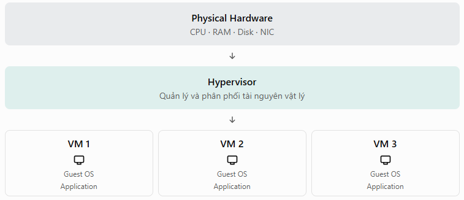

# 1. Virtualization

**Virtualization** (ảo hóa) là công nghệ sử dụng phần mềm để tạo ra các phiên bản logic hoặc ảo của tài nguyên máy tính vật lý

Thay vì mỗi ứng dụng phải chạy trên một máy chủ vật lý riêng biệt, công nghệ ảo hóa cho phép một máy chủ vật lý chạy nhiều máy ảo độc lập

Ví dụ:

Một máy chủ vật lý có cấu hình:

- CPU: 32 Core
- RAM: 128 GB
- Disk: 2 TB SSD
- Network: 10 Gbps

Có thể chia tài nguyên thành:

|Máy ảo	|vCPU	|RAM	|Disk	|Hệ điều hành|
| :--- | :--- | :--- | :--- | :--- |
|VM1	|4	|16 GB	|100 GB	|Ubuntu|
|VM2	|8	|32 GB	|200 GB	|Windows Server|
|VM3	|4	|8 GB	|100 GB	|Debian|
|VM4	|8	|32 GB	|300 GB	|Ubuntu|
|VM5	|4	|16 GB	|100 GB	|CentOS|

Các VM có thể chạy độc lập, cài đặt hệ điều hành và ứng dụng riêng

### 1.1. Mục tiêu của Virtualization

Có 6 mục tiêu quan trọng:

|Mục tiêu	|Ý nghĩa|
| :--- | :--- |
|Resource Consolidation	|Hợp nhất nhiều máy chủ thành một hệ thống sử dụng chung tài nguyên|
|Isolation	|Cô lập tài nguyên và môi trường giữa các VM|
|Flexibility	|Tạo, xóa, thay đổi cấu hình VM linh hoạt|
|Scalability	|Mở rộng tài nguyên khi cần|
|High Availability	|Hỗ trợ phục hồi và di chuyển workload|
|Cost Optimization	|Giảm chi phí phần cứng, điện, không gian và vận hành|

### 1.2. Virtualization hoạt động như thế nào?

Mô hình cơ bản:



Quá trình:

1. Phần cứng cung cấp tài nguyên vật lý
2. Hypervisor tạo ra các tài nguyên ảo
3. Mỗi VM được cấp vCPU, RAM, Disk và Network
4. Guest OS khởi động như trên một máy tính thật
5. Ứng dụng chạy trên Guest OS
6. Hypervisor quản lý việc sử dụng tài nguyên của các VM

# 2. Hypervisor

**Hypervisor** là lớp phần mềm chịu trách nhiệm tạo, chạy và quản lý máy ảo

**Hypervisor** đóng vai trò trung gian giữa phần cứng vật lý và các máy ảo

Nó quản lý:

- Virtual CPU (vCPU)
- Virtual Memory
- Virtual Disk
- Virtual Network Interface Card (vNIC)
- I/O và thiết bị ảo
- Phân bổ tài nguyên giữa các VM
- Cách ly các VM

Có hai loại Hypervisor chính

### 2.1. Type 1 Hypervisor – Bare-metal Hypervisor

Type 1 chạy trực tiếp trên phần cứng vật lý, không cần hệ điều hành thông thường làm lớp trung gian

Kiến trúc:

```
Physical Hardware
       |
       v
   Hypervisor
       |
  +----+----+
  |         |
 VM1       VM2
  |         |
Guest OS   Guest OS
  |         |
Apps       Apps
```

Đặc điểm:

- Hiệu năng tốt
- Quản lý tài nguyên trực tiếp
- Khả năng cách ly tốt
- Phù hợp Data Center và Cloud
- Thường hỗ trợ HA, Live Migration và quản lý tập trung thông qua nền tảng bổ trợ

### 2.2 Type 2 Hypervisor – Hosted Hypervisor

Type 2 chạy trên một hệ điều hành đã có sẵn

Kiến trúc:

```
Physical Hardware
       |
       v
 Host Operating System
       |
       v
 Hosted Hypervisor
       |
  +----+----+
  |         |
 VM1       VM2
  |         |
Ubuntu    Windows
```

Đặc điểm:

- Dễ cài đặt
- Dễ sử dụng
- Phù hợp học tập, thử nghiệm
- Có thêm lớp Host OS
- Hiệu năng và khả năng quản trị hạ tầng thường không tối ưu bằng Type 1

### 2.3. So sánh Type 1 và Type 2

|Tiêu chí	|Type 1	|Type 2|
| :--- | :--- | :--- |
|Vị trí	|Trực tiếp trên Hardware	|Trên Host OS|
|Hiệu năng	|Thường cao hơn	|Có thêm lớp trung gian
|Quản trị	|Phù hợp Data Center	|Phù hợp máy cá nhân|
|HA	|Có thể tích hợp	|Hạn chế hơn|
|Isolation	|Mạnh	|Phụ thuộc nền tảng|
|Ví dụ	|ESXi, KVM, Xen	|VirtualBox, Workstation|

# 3. Các loại Virtualization

Ảo hóa không chỉ có ảo hóa máy chủ. Có nhiều loại khác nhau

### 3.1. Server Virtualization

Đây là loại phổ biến nhất

Một máy chủ vật lý chạy nhiều máy ảo

Ứng dụng:

- Private Cloud
- Public Cloud
- Data Center
- Dev/Test Environment
- Disaster Recovery

### 3.2. Network Virtualization

Network Virtualization là công nghệ tạo ra mạng logic độc lập trên hạ tầng mạng vật lý

**Ví dụ:** Một hệ thống vật lý có thể triển khai nhiều mạng ảo:

- LAN
- WAN
- Management Network
- Storage Network
- Tenant Network
- Overlay Network

Các công nghệ:

|Công nghệ	|Chức năng|
| :--- | :--- |
|VLAN	|Phân chia mạng Layer 2|
|VXLAN	|Mở rộng Layer 2 trên nền Layer 3|
|GRE	|Tạo tunnel đóng gói gói tin|
|Geneve	|Giao thức encapsulation cho overlay|
|SDN	|Điều khiển mạng bằng phần mềm|
|NFV	|Triển khai chức năng mạng dưới dạng phần mềm|

Phân biệt VXLAN và VLAN:

- VLAN sử dụng VLAN ID 12 bit, có tối đa 4094 VLAN ID thông thường
- VXLAN sử dụng VNI 24 bit, có khoảng 16,7 triệu giá trị VNI

### 3.3. Storage Virtualization

Storage Virtualization là việc trừu tượng hóa nhiều thiết bị lưu trữ vật lý thành một tài nguyên lưu trữ logic

Ví dụ:

```
Physical Storage
   |       |       |
 Disk1   Disk2   Disk3
   \       |      /
     Storage Pool
           |
     Virtual Volume
           |
        VM Disk
```

Các công nghệ:

- LVM
- RAID
- Ceph
- SAN
- NAS
- VMware vSAN

Các mô hình lưu trữ:

|Mô hình	|Đặc điểm|
| :--- | :--- |
|DAS	|Lưu trữ trực tiếp trên máy chủ|
|NAS	|Lưu trữ qua mạng ở mức file|
|SAN	|Lưu trữ qua mạng ở mức block|
|Distributed Storage	|Phân tán dữ liệu trên nhiều node|

Trong OpenStack, các dịch vụ liên quan gồm:

- Cinder: Block Storage
- Swift: Object Storage
- Manila: Shared File System
- Glance: Quản lý VM Images

### 3.4. Desktop Virtualization

Cho phép người dùng truy cập Desktop được chạy trên hạ tầng máy chủ

Ví dụ:

- VDI
- Remote Desktop Infrastructure
- Cloud Desktop

### 3.5. Application Virtualization

Ứng dụng được đóng gói hoặc chạy trong môi trường độc lập với hệ điều hành nền

Ví dụ:

- Microsoft App-V
- Một số cơ chế application sandbox
- Application streaming

### 3.6. OS-level Virtualization

Đây chính là cơ sở kỹ thuật của Container

Thay vì tạo một Guest OS riêng cho mỗi ứng dụng, hệ thống sử dụng chung Kernel của Host OS và cô lập các tiến trình

Ví dụ:

- Docker
- LXC
- Podman
- containerd

Đây là điểm nối quan trọng giữa Virtualization truyền thống và Kubernetes

